# お札の肖像

1885年の最初の日本銀行券から2024年の新しいお札まで、肖像になった21人と、その券が発行されていた期間を額面ごとに並べた年表です。聖徳太子が1930年の百円券から1986年まで高額券の顔だったこと、一円・五十円・百円のお札が戦後もしばらく発行されていたこと（百円札は1974年まで）が見えます。

**動く版：[ihideck.github.io/chronology/banknotes](https://ihideck.github.io/chronology/banknotes/)**　データ：[banknotes.csv](banknotes.csv)（[書き方](../README.md#年表の足し方)）

<!-- ここから下は build.mjs が書き換えます -->
<a href="https://ihideck.github.io/chronology/banknotes/">
<picture>
  <source media="(prefers-color-scheme: dark)" srcset="timeline-dark.svg">
  
</picture>
</a>

## 一覧

一覧（4件）

| 肖像 | 発行開始 | 発行停止 | 発行 | 券種 | 備考 |
|---|---|---|---|---|---|
| 聖徳太子 | 1958年12月1日 | 1986年1月4日 | 約27年 | C号券 一万円券 | 初めての一万円券。現在も有効 |
| 福沢諭吉 | 1984年11月1日 | 2007年4月2日 | 約22年 | D号券 一万円券 | 記番号が褐色のものは1993年12月1日に発行開始。現在も有効 |
| 福沢諭吉 | 2004年11月1日 | 発行中 | 約22年 | E号券 一万円券 | D号券に続いて福沢諭吉の肖像を採用。日本銀行の「現在発行されている銀行券」に今も載っており、発行停止日は示されていないため end は null。共同通信（2025年12月10日）は、日本銀行が2025年9月末に金融機関への供給を止め、発行を実質的に終えたと報じた（緊急時に備え当面は発行できるようにする） |
| 渋沢栄一 | 2024年7月3日 | 発行中 | 約2年 | F号券 一万円券 | 現在発行中 |

一覧（4件）

| 肖像 | 発行開始 | 発行停止 | 発行 | 券種 | 備考 |
|---|---|---|---|---|---|
| 聖徳太子 | 1957年10月1日 | 1986年1月4日 | 約28年 | C号券 五千円券 | 現在も有効 |
| 新渡戸稲造 | 1984年11月1日 | 2007年4月2日 | 約22年 | D号券 五千円券 | 記番号が褐色のものは1993年12月1日に発行開始。現在も有効 |
| 樋口一葉 | 2004年11月1日 | 発行中 | 約22年 | E号券 五千円券 | 日本銀行の「現在発行されている銀行券」に今も載っており、発行停止日は示されていないため end は null。共同通信（2025年12月10日）は、日本銀行が2025年9月末に金融機関への供給を止め、発行を実質的に終えたと報じた（緊急時に備え当面は発行できるようにする） |
| 津田梅子 | 2024年7月3日 | 発行中 | 約2年 | F号券 五千円券 | 現在発行中 |

一覧（6件）

| 肖像 | 発行開始 | 発行停止 | 発行 | 券種 | 備考 |
|---|---|---|---|---|---|
| 日本武尊 | 1945年8月17日頃 | 1946年3月2日 | 197日 | 甲号券 千円券 | 日本銀行兌換券。告示上の発行開始は1942年4月20日だが、日本銀行に保管され、実際の発行は1945年8月17日。新円切替（日本銀行券預入令）により1946年3月2日限りで失効。発行停止日は公表資料で確認できないため、end はこの通用停止日 |
| 聖徳太子 | 1950年1月7日 | 1965年1月4日 | 約15年 | B号券 千円券 | 現在も有効 |
| 伊藤博文 | 1963年11月1日 | 1986年1月4日 | 約22年 | C号券 千円券 | 記番号が青色のものは1976年7月1日に発行開始。現在も有効 |
| 夏目漱石 | 1984年11月1日 | 2007年4月2日 | 約22年 | D号券 千円券 | 記番号の色を変えたものを1990年・1993年・2000年に発行開始。現在も有効 |
| 野口英世 | 2004年11月1日 | 発行中 | 約22年 | E号券 千円券 | 日本銀行の「現在発行されている銀行券」に今も載っており、発行停止日は示されていないため end は null。共同通信（2025年12月10日）は、日本銀行が2025年9月末に金融機関への供給を止め、発行を実質的に終えたと報じた（緊急時に備え当面は発行できるようにする） |
| 北里柴三郎 | 2024年7月3日 | 発行中 | 約2年 | F号券 千円券 | 現在発行中 |

一覧（2件）

| 肖像 | 発行開始 | 発行停止 | 発行 | 券種 | 備考 |
|---|---|---|---|---|---|
| 岩倉具視 | 1951年4月2日 | 1971年1月4日 | 約20年 | B号券 五百円券 | 現在も有効 |
| 岩倉具視 | 1969年11月1日 | 1994年4月1日 | 約24年 | C号券 五百円券 | 現在も有効 |

一覧（2件）

| 肖像 | 発行開始 | 発行停止 | 発行 | 券種 | 備考 |
|---|---|---|---|---|---|
| 藤原鎌足 | 1945年4月16日頃 | 1946年3月2日 | 320日 | 丁号券 二百円券 | 日本銀行兌換券として製造。大蔵省告示上の発行開始は1942年1月6日だが、日本銀行に保管され、実際の発行は1945年4月16日。新円切替（日本銀行券預入令）により1946年3月2日限りで失効。発行停止日は公表資料で確認できないため、end はこの通用停止日 |
| 武内宿禰 | 1945年8月16日頃 | 1946年3月2日 | 198日 | 丙号券 二百円券 | 日本銀行兌換券。通称「裏赤200円」。告示上の発行開始は1927年5月12日だが、日本銀行に保管され、実際の発行は1945年8月16日。新円切替（日本銀行券預入令）により1946年3月2日限りで失効。発行停止日は公表資料で確認できないため、end はこの通用停止日 |

一覧（8件）

| 肖像 | 発行開始 | 発行停止 | 発行 | 券種 | 備考 |
|---|---|---|---|---|---|
| 大黒天 | 1885年9月8日頃 | 1939年3月31日 | 約54年 | 旧券 百円券 | 日本銀行兌換銀券。1899年3月20日から回収の対象。兌換銀行券整理法により1939年3月31日限りで失効。日本銀行の発行停止日は公表資料で確認できないため、end はこの通用停止日（実際の発行はこれより前に終わっていたとみられる） |
| 藤原鎌足 | 1891年11月15日頃 | 1939年3月31日 | 約47年 | 改造券 百円券 | 日本銀行兌換銀券。通称「めがね100円」。日本のお札で最も大きい（国立印刷局）。兌換銀行券整理法により1939年3月31日限りで失効。日本銀行の発行停止日は公表資料で確認できないため、end はこの通用停止日（実際の発行はこれより前に終わっていたとみられる） |
| 藤原鎌足 | 1900年12月25日頃 | 1939年3月31日 | 約38年 | 甲号券 百円券 | 日本銀行兌換券。通称「裏紫100円」。兌換銀行券整理法により1939年3月31日限りで失効。日本銀行の発行停止日は公表資料で確認できないため、end はこの通用停止日（実際の発行はこれより前に終わっていたとみられる） |
| 聖徳太子 | 1930年1月11日頃 | 1946年3月2日 | 約16年 | 乙号券 百円券 | 日本銀行兌換券。聖徳太子が初めて肖像になった券（国立印刷局）。新円切替（日本銀行券預入令）により1946年3月2日限りで失効。発行停止日は公表資料で確認できないため、end はこの通用停止日 |
| 聖徳太子 | 1944年3月20日頃 | 1946年3月2日 | 712日 | い号券 百円券 | 日本銀行券（不換紙幣）。新円切替（日本銀行券預入令）により1946年3月2日限りで失効。発行停止日は公表資料で確認できないため、end はこの通用停止日 |
| 聖徳太子 | 1945年8月17日頃 | 1946年3月2日 | 197日 | ろ号券 百円券 | 日本銀行券（不換紙幣）。新円切替（日本銀行券預入令）により1946年3月2日限りで失効。発行停止日は公表資料で確認できないため、end はこの通用停止日 |
| 聖徳太子 | 1946年2月25日 | 1956年6月5日 | 約10年 | A号券 百円券 | 新円切替で発行。発行開始日は日本銀行の資料による（大蔵省告示の日付。Wikipedia は実際の発行開始を1946年3月1日とする）。現在も有効 |
| 板垣退助 | 1953年12月1日 | 1974年8月1日 | 約21年 | B号券 百円券 | 現在も有効 |

一覧（1件）

| 肖像 | 発行開始 | 発行停止 | 発行 | 券種 | 備考 |
|---|---|---|---|---|---|
| 高橋是清 | 1951年12月1日 | 1958年10月1日 | 約7年 | B号券 五十円券 | 現在も有効 |

一覧（2件）

| 肖像 | 発行開始 | 発行停止 | 発行 | 券種 | 備考 |
|---|---|---|---|---|---|
| 菅原道真 | 1917年11月20日頃 | 1939年3月31日 | 約21年 | 甲号券 二十円券 | 日本銀行兌換券。通称「横書き20円」。兌換銀行券整理法により1939年3月31日限りで失効。日本銀行の発行停止日は公表資料で確認できないため、end はこの通用停止日（実際の発行はこれより前に終わっていたとみられる） |
| 藤原鎌足 | 1931年7月21日頃 | 1946年3月2日 | 約15年 | 乙号券 二十円券 | 日本銀行兌換券。通称「縦書き20円」。新円切替（日本銀行券預入令）により1946年3月2日限りで失効。発行停止日は公表資料で確認できないため、end はこの通用停止日 |

一覧（7件）

| 肖像 | 発行開始 | 発行停止 | 発行 | 券種 | 備考 |
|---|---|---|---|---|---|
| 大黒天 | 1885年5月9日頃 | 1939年3月31日 | 約54年 | 旧券 十円券 | 最初の日本銀行券（日本銀行兌換銀券）。通称「大黒札」。1899年3月20日から回収の対象。兌換銀行券整理法により1939年3月31日限りで失効。日本銀行の発行停止日は公表資料で確認できないため、end はこの通用停止日（実際の発行はこれより前に終わっていたとみられる） |
| 和気清麻呂 | 1890年9月12日頃 | 1939年3月31日 | 約49年 | 改造券 十円券 | 日本銀行兌換銀券。通称「表猪10円」。兌換銀行券整理法により1939年3月31日限りで失効。日本銀行の発行停止日は公表資料で確認できないため、end はこの通用停止日（実際の発行はこれより前に終わっていたとみられる） |
| 和気清麻呂 | 1899年10月1日頃 | 1939年3月31日 | 約39年 | 甲号券 十円券 | 日本銀行兌換券。裏面のイノシシから「いのしし札」「裏猪10円」と呼ばれた。兌換銀行券整理法により1939年3月31日限りで失効。日本銀行の発行停止日は公表資料で確認できないため、end はこの通用停止日（実際の発行はこれより前に終わっていたとみられる） |
| 和気清麻呂 | 1915年5月1日頃 | 1939年3月31日 | 約24年 | 乙号券 十円券 | 日本銀行兌換券。肖像が左側にある唯一の日本銀行券で、通称「左和気10円」。兌換銀行券整理法により1939年3月31日限りで失効。日本銀行の発行停止日は公表資料で確認できないため、end はこの通用停止日（実際の発行はこれより前に終わっていたとみられる） |
| 和気清麻呂 | 1930年5月21日頃 | 1946年3月2日 | 約16年 | 丙号券 十円券 | 日本銀行兌換券。新円切替（日本銀行券預入令）により1946年3月2日限りで失効。発行停止日は公表資料で確認できないため、end はこの通用停止日 |
| 和気清麻呂 | 1943年12月15日頃 | 1946年3月2日 | 約2年 | い号券 十円券 | 日本銀行券（不換紙幣）。新円切替（日本銀行券預入令）により1946年3月2日限りで失効。発行停止日は公表資料で確認できないため、end はこの通用停止日 |
| 和気清麻呂 | 1945年8月17日頃 | 1946年3月2日 | 197日 | ろ号券 十円券 | 日本銀行券（不換紙幣）。新円切替（日本銀行券預入令）により1946年3月2日限りで失効。発行停止日は公表資料で確認できないため、end はこの通用停止日 |

一覧（7件）

| 肖像 | 発行開始 | 発行停止 | 発行 | 券種 | 備考 |
|---|---|---|---|---|---|
| 菅原道真 | 1888年12月3日頃 | 1939年3月31日 | 約50年 | 改造券 五円券 | 日本銀行兌換銀券。通称「分銅5円」。兌換銀行券整理法により1939年3月31日限りで失効。日本銀行の発行停止日は公表資料で確認できないため、end はこの通用停止日（実際の発行はこれより前に終わっていたとみられる） |
| 武内宿禰 | 1899年4月1日頃 | 1939年3月31日 | 約40年 | 甲号券 五円券 | 日本銀行兌換券（金兌換）。通称「中央武内5円」。兌換銀行券整理法により1939年3月31日限りで失効。日本銀行の発行停止日は公表資料で確認できないため、end はこの通用停止日（実際の発行はこれより前に終わっていたとみられる） |
| 菅原道真 | 1910年9月1日頃 | 1939年3月31日 | 約29年 | 乙号券 五円券 | 日本銀行兌換券。通称「透かし大黒5円」。兌換銀行券整理法により1939年3月31日限りで失効。日本銀行の発行停止日は公表資料で確認できないため、end はこの通用停止日（実際の発行はこれより前に終わっていたとみられる） |
| 武内宿禰 | 1916年12月15日頃 | 1939年3月31日 | 約22年 | 丙号券 五円券 | 日本銀行兌換券。通称「大正武内5円」。兌換銀行券整理法により1939年3月31日限りで失効。日本銀行の発行停止日は公表資料で確認できないため、end はこの通用停止日（実際の発行はこれより前に終わっていたとみられる） |
| 菅原道真 | 1930年3月1日頃 | 1946年3月2日 | 約16年 | 丁号券 五円券 | 日本銀行兌換券。新円切替（日本銀行券預入令）により1946年3月2日限りで失効。発行停止日は公表資料で確認できないため、end はこの通用停止日 |
| 菅原道真 | 1942年1月6日頃 | 1946年3月2日 | 約4年 | い号券 五円券 | 日本銀行兌換券として発行。新円切替（日本銀行券預入令）により1946年3月2日限りで失効。発行停止日は公表資料で確認できないため、end はこの通用停止日 |
| 菅原道真 | 1943年12月15日頃 | 1946年3月2日 | 約2年 | ろ号券 五円券 | 日本銀行券（不換紙幣）。新円切替（日本銀行券預入令）により1946年3月2日限りで失効。発行停止日は公表資料で確認できないため、end はこの通用停止日 |

一覧（4件）

| 肖像 | 発行開始 | 発行停止 | 発行 | 券種 | 備考 |
|---|---|---|---|---|---|
| 大黒天 | 1885年9月8日 | 1958年10月1日 | 約73年 | 旧券 一円券 | 日本銀行兌換銀券。日本銀行の資料では肖像を「大黒像」とする。発行停止日は日本銀行の資料による（1899年3月20日から回収の対象で、実際にはずっと前から発行されていなかったとみられる）。現在も有効 |
| 武内宿禰 | 1889年5月1日 | 1958年10月1日 | 約69年 | 改造券 一円券 | 日本銀行兌換銀券。記番号が漢数字のものは1889年5月1日、英数字のものは1916年8月15日に発行開始（日本銀行）。現在も有効 |
| 武内宿禰 | 1943年12月15日 | 1958年10月1日 | 約15年 | い号券 一円券 | 日本銀行券（不換紙幣）。現在も有効 |
| 二宮尊徳 | 1946年3月19日 | 1958年10月1日 | 約13年 | A号券 一円券 | 発行開始日は日本銀行の資料による（大蔵省告示の日付。Wikipedia は実際の発行開始を1946年3月20日とする）。現在も有効 |

一覧（1件）

| 肖像 | 発行開始 | 発行停止 | 発行 | 券種 | 備考 |
|---|---|---|---|---|---|
| 楠木正成 | 1944年11月1日頃 | 1953年12月31日 | 約9年 | い号券 五銭券 | 肖像画ではなく、皇居前広場の楠木正成像（騎馬の銅像）を表面に描いた券。小額通貨整理法により1953年12月31日限りで失効。発行停止日は公表資料で確認できないため、end はこの通用停止日 |

## 注記

- 1件は1種類の券。同じ人物でも券が違えば別の行にしている（例：福沢諭吉はD号券とE号券の2件）。
- 開始日は日本銀行が発行を開始した日、終了日は日本銀行が発行を停止した日（Wikipedia などで「支払停止日」と書かれている日と同じ）。いまも発行中の券は終わりを空欄（継続中）にした。
- 現在も有効な券（戦後の券と、明治〜戦中の一円券3種）の発行開始日・発行停止日は、日本銀行「現在有効な銀行券」によった。旧一円券・改造一円券のように、実際にはかなり前から発行されていなかったとみられる券も、日本銀行の発行停止日（1958年10月1日）をそのまま使っている。
- すでに失効した戦前・戦中の券は、日本銀行の発行停止日が公表資料で確認できなかった。そのため終了日には通用停止日（その日限りで失効した日。1939年3月31日、1946年3月2日、1953年12月31日）を入れて「推定・諸説あり」とした。実際の発行はこれより前に終わっていたものが多い。
- 失効券の発行開始日は Wikipedia（植村峻『紙幣肖像の歴史』や大蔵省告示を出典とする）によった。発行年は国立印刷局の収蔵品解説とも一致することを確かめた（旧券10円・甲10円・乙5円・乙100円など）。告示の日付と実際の発行開始日が違う券（甲千円券・丙二百円券・丁二百円券）は、実際の発行開始日を開始日にして、告示の日付を備考に書いた。
- A百円券・A一円券の発行開始日は日本銀行の資料（大蔵省告示の日付）によった。Wikipedia は実際の発行開始をそれぞれ1946年3月1日・3月20日としている。
- E号券（福沢諭吉・樋口一葉・野口英世）は、日本銀行の「現在発行されている銀行券」に今も載っているため終わりを空欄（継続中）にした。共同通信は、日本銀行が2025年9月末に供給を止めて発行を実質的に終えたと報じている（公式の発行停止日は示されていない）。
- 表面が人物でない券は入れていない：D二千円券（守礼門）、旧五円券（表面は彩紋で、大黒天は裏面）、乙二百円券（彩紋のみ）、A十円券（国会議事堂）、A五円券（彩紋）、い十銭券（八紘一宇塔）、A十銭券（鳩）、A五銭券（梅）。
- 二千円券の裏面には『源氏物語絵巻』の一部と『紫式部日記絵巻』の紫式部が描かれているが、表面は守礼門で、日本銀行も表面の図柄を「守礼門」としている。肖像の券とは数えず、紫式部は入れていない。
- 大黒天は実在の人物ではないが、最初の日本銀行券（旧券）の表面の図柄で、日本銀行も「肖像：大黒像」としているので入れた。い五銭券は肖像画ではなく皇居前広場の楠木正成像（銅像）を描いた券だが、人物を描いた券として入れた。
- 二十円券（甲号・乙号）と二百円券（丙号・丁号）、五銭券（い号）にも人物が描かれているため、額面のグループ "20" "200" "0.05" を加えた。
- 戦前の肖像（菅原道真・和気清麻呂・藤原鎌足・武内宿禰・日本武尊）は写真や確かな肖像画がないため、キヨッソーネらが別の人物をモデルに描いた想像上の肖像とされる。

## 出典

- [日本銀行「現在有効な銀行券」（2024年7月現在、PDF）](https://www.boj.or.jp/note_tfjgs/note/valid/validnotes.pdf)
- [日本銀行「現在発行されている銀行券・貨幣」](https://www.boj.or.jp/note_tfjgs/note/valid/issue.htm)
- [日本銀行「その他有効な銀行券・貨幣」](https://www.boj.or.jp/note_tfjgs/note/valid/past_issue/index.htm)
- [国立印刷局 お札と切手の博物館「お札の歴史を知る」](https://www.npb.go.jp/museum/collection/gallery/osatu/index.html)
- [Wikipedia「日本銀行券」](https://ja.wikipedia.org/wiki/日本銀行券)
- [Wikipedia「一円紙幣」「五円紙幣」「十円紙幣」「二十円紙幣」「百円紙幣」「二百円紙幣」「千円紙幣」「五銭紙幣」など額面別の記事](https://ja.wikipedia.org/wiki/十円紙幣)
- [秋田魁新報（共同通信）「諭吉先生、さようなら 日銀、旧紙幣の発行を実質終了」2025年12月10日](https://www.sakigake.jp/news/article/20251210CO0085/)
<!-- ここまで -->
