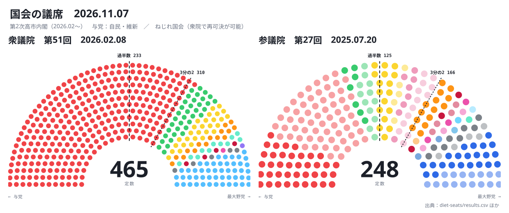

# 国会の議席

1946年からの衆議院と参議院の政党別の議席を、好きな日付の両院の構成として扇形に並べ、時系列のバーで日付を動かして見るページ。与党の議席、ねじれ、少数与党が一目で分かる。

**動く版：[ihideck.github.io/chronology/diet-seats](https://ihideck.github.io/chronology/diet-seats/)**　データ：[results.csv](results.csv)・[parties.csv](parties.csv)・[governments.csv](governments.csv)（[決まり](../README.md#しくみ)）

<!-- ここから下は build.mjs が書き換えます -->
<a href="https://ihideck.github.io/chronology/diet-seats/">
<picture>
  <source media="(prefers-color-scheme: dark)" srcset="seats-dark.svg">
  
</picture>
</a>

## 一覧

衆議院の党派別の議席（30回）

#### 第51回衆議院議員総選挙（2026-02-08・定数465）

| 党 | 当選 | 選挙前 |
|---|---:|---:|
| 自由民主党 | 315 | 198 |
| 中道改革連合 | 49 | 167 |
| 日本維新の会 | 36 | 34 |
| 国民民主党 | 28 | 27 |
| 参政党 | 15 | 2 |
| チームみらい | 11 | 0 |
| 日本共産党 | 4 | 8 |
| れいわ新選組 | 1 | 8 |
| 減税日本・ゆうこく連合 | 1 | 5 |
| 公明党 | 0 | 3 |
| 日本保守党 | 0 | 1 |
| 立憲民主党 | 0 | 2 |
| 無所属 | 5 | 10 |

出典：[1](https://www.soumu.go.jp/main_content/001061475.xlsx) [2](https://www.soumu.go.jp/main_content/001061492.pdf) [3](https://www.jiji.com/jc/2026syu) [4](https://ja.wikipedia.org/wiki/第51回衆議院議員総選挙) [5](https://mainichi.jp/senkyo/51shu/)

- 自由民主党：当選は総務省の公認の数。時事・毎日・Wikipedia は追加公認1を含め316
- 中道改革連合：選挙前は毎日・Wikipedia の167。時事は引退する立憲2・公明3を含め172
- 公明党：衆院選に候補を立てず、公示の日に党に残っていた引退議員3（毎日・Wikipedia の注記）
- 立憲民主党：衆院選に候補を立てず、公示の日に党に残っていた引退議員2（毎日・Wikipedia の注記）
- 無所属：当選は追加公認前の5（時事・毎日・Wikipedia は4）。選挙前は時事・毎日10（Wikipedia は引退する立憲2・公明3を含め15）

#### 第50回衆議院議員総選挙（2024-10-27・定数465）

| 党 | 当選 | 選挙前 |
|---|---:|---:|
| 自由民主党 | 191 | 256 |
| 立憲民主党 | 148 | 98 |
| 日本維新の会 | 38 | 43 |
| 国民民主党 | 28 | 7 |
| 公明党 | 24 | 32 |
| れいわ新選組 | 9 | 3 |
| 日本共産党 | 8 | 10 |
| 参政党 | 3 | 1 |
| 日本保守党 | 3 | 0 |
| 社会民主党 | 1 | 1 |
| 無所属 | 12 | 14 |

出典：[1](https://www.soumu.go.jp/main_content/000979122.xls) [2](https://www.shugiin.go.jp/internet/itdb_annai.nsf/html/statics/ugoki/r6ugoki32_04-3_kokuseisenkyokekka.pdf/$File/r6ugoki32_04-3_kokuseisenkyokekka.pdf) [3](https://www.jiji.com/jc/2024syu) [4](https://ja.wikipedia.org/wiki/第50回衆議院議員総選挙) [5](https://mainichi.jp/senkyo/50shu/)

- 自由民主党：選挙前は時事・毎日の256（非公認の前職を含み党員資格停止中の2人を除く）。Wikipedia は非公認11人を無所属とし247
- 日本維新の会：選挙前は時事・毎日43（党員資格停止中の1人を除く）。Wikipedia 44
- 日本保守党：当選3は比例2と愛知1区1（総務省の表は本人届出の政党等所属の欄）
- 無所属：選挙前は時事・毎日14（Wikipedia 22）

#### 第49回衆議院議員総選挙（2021-10-31・定数465）

| 党 | 当選 | 選挙前 |
|---|---:|---:|
| 自由民主党 | 259 | 276 |
| 立憲民主党 | 96 | 110 |
| 日本維新の会 | 41 | 11 |
| 公明党 | 32 | 29 |
| 国民民主党 | 11 | 8 |
| 日本共産党 | 10 | 12 |
| れいわ新選組 | 3 | 1 |
| 社会民主党 | 1 | 1 |
| NHKと裁判してる党弁護士法72条違反で | 0 | 1 |
| 無所属 | 12 | 11 |
| 諸派 | 0 | 1 |
| 欠員 |  | 4 |

出典：[1](https://www.soumu.go.jp/main_content/000776967.xls) [2](https://www.shugiin.go.jp/internet/itdb_annai.nsf/html/statics/ugoki/r3ugoki29_04-3_kokuseisenkyokekka.pdf/$File/r3ugoki29_04-3_kokuseisenkyokekka.pdf) [3](https://www.jiji.com/jc/2021syu) [4](https://ja.wikipedia.org/wiki/第49回衆議院議員総選挙) [5](https://mainichi.jp/senkyo/49shu/) [6](https://www.sakigake.jp/special/senkyo/2021shuin/result/)

- 自由民主党：当選は総務省の公認の数。時事・毎日・Wikipedia は追加公認2（東京15区・奈良3区）を含め261
- 立憲民主党：選挙前は時事・毎日・共同110（Wikipedia 109）
- 無所属：当選は追加公認前の12（時事・毎日・Wikipedia は10）。選挙前は時事・毎日・共同11（Wikipedia 13）
- 諸派：選挙前は時事・毎日・共同の諸派1（Wikipedia は無所属に含む）

#### 第48回衆議院議員総選挙（2017-10-22・定数465）

| 党 | 当選 | 選挙前 |
|---|---:|---:|
| 自由民主党 | 281 | 290 |
| 立憲民主党 | 54 | 15 |
| 希望の党 | 50 | 57 |
| 公明党 | 29 | 34 |
| 日本共産党 | 12 | 21 |
| 日本維新の会 | 11 | 14 |
| 社会民主党 | 2 | 2 |
| 無所属 | 26 | 39 |
| 欠員 |  | 3 |

出典：[1](https://www.soumu.go.jp/main_content/000516719.xls) [2](https://www.shugiin.go.jp/internet/itdb_annai.nsf/html/statics/ugoki/h29ugoki.pdf/$File/h29ugoki.pdf) [3](https://www.jiji.com/jc/2017syu) [4](https://ja.wikipedia.org/wiki/第48回衆議院議員総選挙) [5](https://www.sakigake.jp/special/2017/shuinsen/result/)

- 自由民主党：当選は総務省の公認の数。時事・Wikipedia は追加公認3を含め284。選挙前は時事・共同の290（Wikipedia 284）
- 立憲民主党：当選は総務省の公認の数。時事・Wikipedia は追加公認1を含め55。選挙前は時事・Wikipedia 15（共同16）
- 公明党：選挙前は時事34（共同・Wikipedia 35）
- 無所属：当選は追加公認前の26（時事・Wikipedia は22）。選挙前は時事39（共同37・Wikipedia 44）

#### 第47回衆議院議員総選挙（2014-12-14・定数475）

| 党 | 当選 | 選挙前 |
|---|---:|---:|
| 自由民主党 | 290 | 295 |
| 民主党 | 73 | 62 |
| 維新の党 | 41 | 42 |
| 公明党 | 35 | 31 |
| 日本共産党 | 21 | 8 |
| 次世代の党 | 2 | 20 |
| 社会民主党 | 2 | 2 |
| 生活の党 | 2 | 5 |
| 無所属 | 9 | 14 |
| 欠員 |  | 1 |

出典：[1](https://www.soumu.go.jp/main_content/000328943.xls) [2](https://www.shugiin.go.jp/internet/itdb_annai.nsf/html/statics/ugoki/h26ugoki.pdf/$File/h26ugoki.pdf) [3](https://www.jiji.com/jc/2014syu) [4](https://ja.wikipedia.org/wiki/第47回衆議院議員総選挙)

- 自由民主党：当選は総務省の公認の数。時事・Wikipedia は福岡1区の追加公認1を含め291
- 民主党：選挙前は時事62（Wikipedia 63）
- 次世代の党：選挙前は時事20（Wikipedia 19）
- 無所属：当選は追加公認前の9（時事・Wikipedia は8）。選挙前は時事14（Wikipedia 15）
- 欠員：時事の公示前は欠員1（Wikipedia は欠員0で無所属15）

#### 第46回衆議院議員総選挙（2012-12-16・定数480）

| 党 | 当選 | 選挙前 |
|---|---:|---:|
| 自由民主党 | 294 | 118 |
| 民主党 | 57 | 231 |
| 日本維新の会 | 54 | 11 |
| 公明党 | 31 | 21 |
| みんなの党 | 18 | 8 |
| 日本未来の党 | 9 | 61 |
| 日本共産党 | 8 | 9 |
| 社会民主党 | 2 | 5 |
| 国民新党 | 1 | 2 |
| 新党大地 | 1 | 3 |
| 新党日本 | 0 | 1 |
| 無所属 | 5 | 9 |
| 欠員 |  | 1 |

出典：[1](https://www.soumu.go.jp/main_content/000194183.xls) [2](https://www.shugiin.go.jp/internet/itdb_annai.nsf/html/statics/ugoki/h24ugoki.pdf/$File/h24ugoki.pdf) [3](https://www.jiji.com/jc/election?g=2012syuin&l=top) [4](https://ja.wikipedia.org/wiki/第46回衆議院議員総選挙)

- 民主党：選挙前は時事の公示前231。Wikipedia は230（無所属を1多く10）
- 新党日本：新党日本の候補は本人届出（総務省の表に党の欄が無い）で当選0

#### 第45回衆議院議員総選挙（2009-08-30・定数480）

| 党 | 当選 | 選挙前 |
|---|---:|---:|
| 民主党 | 308 | 115 |
| 自由民主党 | 119 | 300 |
| 公明党 | 21 | 31 |
| 日本共産党 | 9 | 9 |
| 社会民主党 | 7 | 7 |
| みんなの党 | 5 | 4 |
| 国民新党 | 3 | 4 |
| 新党大地 | 1 | 1 |
| 新党日本 | 1 | 0 |
| 改革クラブ | 0 | 1 |
| 無所属 | 6 | 6 |
| 欠員 |  | 2 |

出典：[1](https://www.e-stat.go.jp/stat-search/file-download?statInfId=000031474574&fileKind=2) [2](https://www.soumu.go.jp/main_content/000037622.xls) [3](https://www.shugiin.go.jp/internet/itdb_annai.nsf/html/statics/ugoki/h21ugoki.pdf/$File/h21ugoki.pdf) [4](https://ja.wikipedia.org/wiki/第45回衆議院議員総選挙) [5](https://web.archive.org/web/20190423100021/https://www.nhk.or.jp/senkyo/database/history/index.html) [6](https://www.shugiin.go.jp/internet/itdb_annai.nsf/html/statics/ugoki/h14ugoki/h14tokei/h14tou01.htm)

- 欠員：選挙前の欠員。解散時の定数480から各党の選挙前の数を引いた数（NHK と Wikipedia で一致）

#### 第44回衆議院議員総選挙（2005-09-11・定数480）

| 党 | 当選 | 選挙前 |
|---|---:|---:|
| 自由民主党 | 296 | 212 |
| 民主党 | 113 | 177 |
| 公明党 | 31 | 34 |
| 日本共産党 | 9 | 9 |
| 社会民主党 | 7 | 5 |
| 国民新党 | 4 | 4 |
| 新党大地 | 1 | 0 |
| 新党日本 | 1 | 3 |
| 自由連合 | 0 | 1 |
| 無所属 | 18 | 32 |
| 欠員 |  | 3 |

出典：[1](https://www.e-stat.go.jp/stat-search/file-download?statInfId=000031474574&fileKind=2) [2](https://warp.ndl.go.jp/20191221/20191201094458/www.stat.go.jp/data/chouki/zuhyou/27-08-b.xls) [3](https://www.shugiin.go.jp/internet/itdb_annai.nsf/html/statics/ugoki/h17ugoki13.pdf/$File/h17ugoki13.pdf) [4](https://ja.wikipedia.org/wiki/第44回衆議院議員総選挙) [5](https://web.archive.org/web/20190423100021/https://www.nhk.or.jp/senkyo/database/history/index.html) [6](https://www.shugiin.go.jp/internet/itdb_annai.nsf/html/statics/ugoki/h14ugoki/h14tokei/h14tou01.htm)

- 自由連合：候補者を立てなかった。選挙前1は Wikipedia の注（野党・無所属の公示前231に含める）
- 無所属：選挙前は Wikipedia。Wikipedia の無所属32と自由連合1の計33が、NHK の無所属（郵政民営化法案に反対した30）とその他3の計33と一致
- 欠員：選挙前の欠員。解散時の定数480から各党の選挙前の数を引いた数（NHK と Wikipedia で一致）

#### 第43回衆議院議員総選挙（2003-11-09・定数480）

| 党 | 当選 | 選挙前 |
|---|---:|---:|
| 自由民主党 | 237 | 247 |
| 民主党 | 177 | 137 |
| 公明党 | 34 | 31 |
| 日本共産党 | 9 | 20 |
| 社会民主党 | 6 | 18 |
| 保守新党 | 4 | 9 |
| 自由連合 | 1 | 1 |
| 無所属の会 | 1 | 5 |
| 無所属 | 11 | 5 |
| 諸派 | 0 | 2 |
| 欠員 |  | 5 |

出典：[1](https://www.e-stat.go.jp/stat-search/file-download?statInfId=000031474574&fileKind=2) [2](https://warp.ndl.go.jp/20191221/20191201094458/www.stat.go.jp/data/chouki/zuhyou/27-08-b.xls) [3](https://www.shugiin.go.jp/internet/itdb_annai.nsf/html/statics/ugoki/h15ugoki/syuse/43syuse.htm) [4](https://ja.wikipedia.org/wiki/第43回衆議院議員総選挙) [5](https://web.archive.org/web/20190423100021/https://www.nhk.or.jp/senkyo/database/history/index.html) [6](https://www.shugiin.go.jp/internet/itdb_annai.nsf/html/statics/ugoki/h14ugoki/h14tokei/h14tou01.htm)

- 自由連合：統計局27-8-bは政党自由連合と書く（第42回のあとに自由連合に戻した。Wikipedia）
- 無所属：選挙前は Wikipedia。NHK は諸派と合わせて7で一致
- 諸派：選挙前2は Wikipedia の数で、どの党かは書かれていない。NHK は無所属と合わせて7で一致
- 欠員：選挙前の欠員。解散時の定数480から各党の選挙前の数を引いた数（NHK と Wikipedia で一致）

#### 第42回衆議院議員総選挙（2000-06-25・定数480）

| 党 | 当選 | 選挙前 |
|---|---:|---:|
| 自由民主党 | 233 | 271 |
| 民主党 | 127 | 95 |
| 公明党 | 31 | 42 |
| 自由党 | 22 | 18 |
| 日本共産党 | 20 | 26 |
| 社会民主党 | 19 | 14 |
| 保守党 | 7 | 18 |
| 無所属の会 | 5 | 4 |
| 政党自由連合 | 1 | 1 |
| 無所属 | 15 | 5 |
| 諸派 | 0 | 5 |
| 欠員 |  | 1 |

出典：[1](https://www.e-stat.go.jp/stat-search/file-download?statInfId=000031474574&fileKind=2) [2](https://warp.ndl.go.jp/20191221/20191201094458/www.stat.go.jp/data/chouki/zuhyou/27-08-b.xls) [3](https://www.shugiin.go.jp/internet/itdb_annai.nsf/html/statics/ugoki/h12ugoki/42sousen/42sousen.htm) [4](https://ja.wikipedia.org/wiki/第42回衆議院議員総選挙) [5](https://web.archive.org/web/20190423100021/https://www.nhk.or.jp/senkyo/database/history/index.html) [6](https://www.shugiin.go.jp/internet/itdb_annai.nsf/html/statics/ugoki/h14ugoki/h14tokei/h14tou01.htm)

- 政党自由連合：選挙の時の名前（統計局27-8-b・Wikipedia）。衆議院の動きは自由連合と書く
- 無所属：選挙前は NHK の5。Wikipedia の表は4で、党の行と欠員を足すと総計500に1足りない
- 諸派：選挙前5は改革クラブ（1998年に結成した党。Wikipedia）。衆議院の動きも改革クラブは議席を失ったと書く
- 欠員：選挙前の欠員。解散時の定数500から各党の選挙前の数を引いた数（NHK と Wikipedia で一致）

#### 第41回衆議院議員総選挙（1996-10-20・定数500）

| 党 | 当選 | 選挙前 |
|---|---:|---:|
| 自由民主党 | 239 | 211 |
| 新進党 | 156 | 160 |
| 民主党 | 52 | 52 |
| 日本共産党 | 26 | 15 |
| 社会民主党 | 15 | 30 |
| 新党さきがけ | 2 | 9 |
| 民主改革連合 | 1 | 2 |
| 無所属 | 9 | 10 |
| 諸派 | 0 | 4 |
| 欠員 |  | 18 |

出典：[1](https://www.e-stat.go.jp/stat-search/file-download?statInfId=000031474574&fileKind=2) [2](https://warp.ndl.go.jp/20191221/20191201094458/www.stat.go.jp/data/chouki/zuhyou/27-08-b.xls) [3](https://ja.wikipedia.org/wiki/第41回衆議院議員総選挙) [4](https://web.archive.org/web/20190423100021/https://www.nhk.or.jp/senkyo/database/history/index.html) [5](https://www.shugiin.go.jp/internet/itdb_annai.nsf/html/statics/ugoki/h14ugoki/h14tokei/h14tou01.htm)

- 民主改革連合：統計局27-8-bはその他の党派1に含める
- 無所属：選挙前は Wikipedia。NHK は諸派と合わせて14で一致
- 諸派：選挙前4は新社会党2と自由連合2（Wikipedia）。どちらも候補者を立てて当選0
- 欠員：選挙前の欠員。解散時の定数511から各党の選挙前の数を引いた数（NHK と Wikipedia で一致）

#### 第40回衆議院議員総選挙（1993-07-18・定数511）

| 党 | 当選 | 選挙前 |
|---|---:|---:|
| 自由民主党 | 223 | 222 |
| 日本社会党 | 70 | 134 |
| 新生党 | 55 | 36 |
| 公明党 | 51 | 45 |
| 日本新党 | 35 | 0 |
| 日本共産党 | 15 | 16 |
| 民社党 | 15 | 13 |
| 新党さきがけ | 13 | 10 |
| 社会民主連合 | 4 | 4 |
| 進歩党 | 0 | 1 |
| 無所属 | 30 | 15 |
| 諸派 | 0 | 1 |
| 欠員 |  | 15 |

出典：[1](https://www.e-stat.go.jp/stat-search/file-download?statInfId=000031474574&fileKind=2) [2](https://warp.ndl.go.jp/20191221/20191201094458/www.stat.go.jp/data/chouki/zuhyou/27-08-a.xls) [3](https://ja.wikipedia.org/wiki/第40回衆議院議員総選挙) [4](https://web.archive.org/web/20190423100021/https://www.nhk.or.jp/senkyo/database/history/index.html) [5](https://www.shugiin.go.jp/internet/itdb_annai.nsf/html/statics/ugoki/h14ugoki/h14tokei/h14tou01.htm)

- 進歩党：候補者を立てなかった（Wikipedia）。選挙前1は Wikipedia の注で、NHK は無所属・その他を合わせて17
- 無所属：選挙前は Wikipedia。NHK は諸派・進歩党と合わせて17で一致
- 諸派：選挙前1は板橋民主党（解散後に社会党を除名された渋谷修が結成。Wikipedia）
- 欠員：選挙前の欠員。解散時の定数512から各党の選挙前の数を引いた数（NHK と Wikipedia で一致）

#### 第39回衆議院議員総選挙（1990-02-18・定数512）

| 党 | 当選 | 選挙前 |
|---|---:|---:|
| 自由民主党 | 275 | 294 |
| 日本社会党 | 136 | 82 |
| 公明党 | 45 | 54 |
| 日本共産党 | 16 | 26 |
| 民社党 | 14 | 25 |
| 社会民主連合 | 4 | 4 |
| 進歩党 | 1 | 1 |
| 無所属 | 21 | 9 |
| 欠員 |  | 17 |

出典：[1](https://www.e-stat.go.jp/stat-search/file-download?statInfId=000031474574&fileKind=2) [2](https://warp.ndl.go.jp/20191221/20191201094458/www.stat.go.jp/data/chouki/zuhyou/27-08-a.xls) [3](https://ja.wikipedia.org/wiki/第39回衆議院議員総選挙) [4](https://web.archive.org/web/20190423100021/https://www.nhk.or.jp/senkyo/database/history/index.html) [5](https://www.shugiin.go.jp/internet/itdb_annai.nsf/html/statics/ugoki/h14ugoki/h14tokei/h14tou01.htm)

- 自由民主党：選挙前は NHK。Wikipedia は295。差は議長の田村元（国会会議録の会派は無所属）を自由民主党に数えるかの違いとみられ、議長・副議長を無所属に数える NHK を採った
- 日本社会党：選挙前は NHK。Wikipedia は83。差は副議長の安井吉典（国会会議録の会派は無所属）を日本社会党に数えるかの違いとみられる
- 進歩党：統計局27-8-aはその他の党派1に含める
- 無所属：選挙前は NHK（議長・副議長を含む）。Wikipedia は7
- 欠員：選挙前の欠員。解散時の定数512から各党の選挙前の数を引いた数（NHK と Wikipedia で一致）

#### 第38回衆議院議員総選挙（1986-07-06・定数512）

| 党 | 当選 |
|---|---:|
| 自由民主党 | 300 |
| 日本社会党 | 85 |
| 公明党 | 56 |
| 日本共産党 | 26 |
| 民社党 | 26 |
| 新自由クラブ | 6 |
| 社会民主連合 | 4 |
| 無所属 | 9 |

出典：[1](https://www.e-stat.go.jp/stat-search/file-download?statInfId=000031474574&fileKind=2) [2](https://warp.ndl.go.jp/20191221/20191201094458/www.stat.go.jp/data/chouki/zuhyou/27-08-a.xls) [3](https://ja.wikipedia.org/wiki/第38回衆議院議員総選挙)

- 自由民主党：選挙前は Wikipedia のほかに照らし合わせる資料が見つからず空にした

#### 第37回衆議院議員総選挙（1983-12-18・定数511）

| 党 | 当選 |
|---|---:|
| 自由民主党 | 250 |
| 日本社会党 | 112 |
| 公明党 | 58 |
| 民社党 | 38 |
| 日本共産党 | 26 |
| 新自由クラブ | 8 |
| 社会民主連合 | 3 |
| 無所属 | 16 |

出典：[1](https://www.e-stat.go.jp/stat-search/file-download?statInfId=000031474574&fileKind=2) [2](https://warp.ndl.go.jp/20191221/20191201094458/www.stat.go.jp/data/chouki/zuhyou/27-08-a.xls) [3](https://ja.wikipedia.org/wiki/第37回衆議院議員総選挙)

- 自由民主党：選挙前は Wikipedia のほかに照らし合わせる資料が見つからず空にした

#### 第36回衆議院議員総選挙（1980-06-22・定数511）

| 党 | 当選 |
|---|---:|
| 自由民主党 | 284 |
| 日本社会党 | 107 |
| 公明党 | 33 |
| 民社党 | 32 |
| 日本共産党 | 29 |
| 新自由クラブ | 12 |
| 社会民主連合 | 3 |
| 無所属 | 11 |

出典：[1](https://www.e-stat.go.jp/stat-search/file-download?statInfId=000031474574&fileKind=2) [2](https://warp.ndl.go.jp/20191221/20191201094458/www.stat.go.jp/data/chouki/zuhyou/27-08-a.xls) [3](https://ja.wikipedia.org/wiki/第36回衆議院議員総選挙)

- 自由民主党：選挙前は Wikipedia のほかに照らし合わせる資料が見つからず空にした

#### 第35回衆議院議員総選挙（1979-10-07・定数511）

| 党 | 当選 |
|---|---:|
| 自由民主党 | 248 |
| 日本社会党 | 107 |
| 公明党 | 57 |
| 日本共産党 | 39 |
| 民社党 | 35 |
| 新自由クラブ | 4 |
| 社会民主連合 | 2 |
| 無所属 | 19 |

出典：[1](https://www.e-stat.go.jp/stat-search/file-download?statInfId=000031474574&fileKind=2) [2](https://warp.ndl.go.jp/20191221/20191201094458/www.stat.go.jp/data/chouki/zuhyou/27-08-a.xls) [3](https://ja.wikipedia.org/wiki/第35回衆議院議員総選挙)

- 自由民主党：選挙前は Wikipedia のほかに照らし合わせる資料が見つからず空にした

#### 第34回衆議院議員総選挙（1976-12-05・定数511）

| 党 | 当選 |
|---|---:|
| 自由民主党 | 249 |
| 日本社会党 | 123 |
| 公明党 | 55 |
| 民社党 | 29 |
| 新自由クラブ | 17 |
| 日本共産党 | 17 |
| 無所属 | 21 |

出典：[1](https://www.e-stat.go.jp/stat-search/file-download?statInfId=000031474574&fileKind=2) [2](https://warp.ndl.go.jp/20191221/20191201094458/www.stat.go.jp/data/chouki/zuhyou/27-08-a.xls) [3](https://ja.wikipedia.org/wiki/第34回衆議院議員総選挙)

- 自由民主党：選挙前は Wikipedia のほかに照らし合わせる資料が見つからず空にした

#### 第33回衆議院議員総選挙（1972-12-10・定数491）

| 党 | 当選 |
|---|---:|
| 自由民主党 | 271 |
| 日本社会党 | 118 |
| 日本共産党 | 38 |
| 公明党 | 29 |
| 民社党 | 19 |
| 無所属 | 14 |
| 諸派 | 2 |

出典：[1](https://www.e-stat.go.jp/stat-search/file-download?statInfId=000031474574&fileKind=2) [2](https://warp.ndl.go.jp/20191221/20191201094458/www.stat.go.jp/data/chouki/zuhyou/27-08-a.xls) [3](https://ja.wikipedia.org/wiki/第33回衆議院議員総選挙)

- 自由民主党：選挙前は Wikipedia のほかに照らし合わせる資料が見つからず空にした
- 諸派：沖縄社会大衆党1（安里積千代）と沖縄人民党1（瀬長亀次郎）。統計局はその他の党派2

#### 第32回衆議院議員総選挙（1969-12-27・定数486）

| 党 | 当選 |
|---|---:|
| 自由民主党 | 288 |
| 日本社会党 | 90 |
| 公明党 | 47 |
| 民社党 | 31 |
| 日本共産党 | 14 |
| 無所属 | 16 |

出典：[1](https://www.e-stat.go.jp/stat-search/file-download?statInfId=000031474574&fileKind=2) [2](https://warp.ndl.go.jp/20191221/20191201094458/www.stat.go.jp/data/chouki/zuhyou/27-08-a.xls) [3](https://ja.wikipedia.org/wiki/第32回衆議院議員総選挙)

- 自由民主党：選挙前は Wikipedia のほかに照らし合わせる資料が見つからず空にした
- 民社党：公的な表（統計局27-8-a）の名前。民社党への改称の時期は資料で分かれ、国会会議録の会派名と Wikipedia は1969年11月、日本大百科全書は1970年4月。統計局27-8-aは「民主社会党」と書くが、1969年11月の党大会で民社党に改称し、国会の会派名も11月から民社党なので、選挙の時点の名前の民社党にした

#### 第31回衆議院議員総選挙（1967-01-29・定数486）

| 党 | 当選 |
|---|---:|
| 自由民主党 | 277 |
| 日本社会党 | 140 |
| 民主社会党 | 30 |
| 公明党 | 25 |
| 日本共産党 | 5 |
| 無所属 | 9 |

出典：[1](https://www.e-stat.go.jp/stat-search/file-download?statInfId=000031474574&fileKind=2) [2](https://warp.ndl.go.jp/20191221/20191201094458/www.stat.go.jp/data/chouki/zuhyou/27-08-a.xls) [3](https://ja.wikipedia.org/wiki/第31回衆議院議員総選挙)

- 自由民主党：選挙前は Wikipedia のほかに照らし合わせる資料が見つからず空にした

#### 第30回衆議院議員総選挙（1963-11-21・定数467）

| 党 | 当選 | 選挙前 |
|---|---:|---:|
| 自由民主党 | 283 | 286 |
| 日本社会党 | 144 | 137 |
| 民主社会党 | 23 | 14 |
| 日本共産党 | 5 | 3 |
| 無所属 | 12 | 2 |
| 欠員 |  | 25 |

出典：[1](https://www.e-stat.go.jp/stat-search/file-download?statInfId=000031474574&fileKind=2) [2](https://dl.ndl.go.jp/view/download/digidepo_8689381_po_076103.pdf?contentNo=1&alternativeNo=) [3](https://warp.ndl.go.jp/20191221/20191201094458/www.stat.go.jp/data/chouki/zuhyou/27-08-a.xls) [4](https://dl.ndl.go.jp/pid/1351320/1/308) [5](https://ja.wikipedia.org/w/index.php?oldid=110220405)

- 自由民主党：選挙前は国立国会図書館の資料2の数（新聞報道による。公示前か解散時かの記載はない）

#### 第29回衆議院議員総選挙（1960-11-20・定数467）

| 党 | 当選 | 選挙前 |
|---|---:|---:|
| 自由民主党 | 296 | 283 |
| 日本社会党 | 145 | 122 |
| 民主社会党 | 17 | 40 |
| 日本共産党 | 3 | 1 |
| 無所属 | 5 | 2 |
| 諸派 | 1 | 0 |
| 欠員 |  | 19 |

出典：[1](https://www.e-stat.go.jp/stat-search/file-download?statInfId=000031474574&fileKind=2) [2](https://dl.ndl.go.jp/view/download/digidepo_8689381_po_076103.pdf?contentNo=1&alternativeNo=) [3](https://warp.ndl.go.jp/20191221/20191201094458/www.stat.go.jp/data/chouki/zuhyou/27-08-a.xls) [4](https://dl.ndl.go.jp/pid/1351320/1/308) [5](https://ja.wikipedia.org/w/index.php?oldid=110220400)

- 自由民主党：選挙前は国立国会図書館の資料2の数（新聞報道による。公示前か解散時かの記載はない）

#### 第28回衆議院議員総選挙（1958-05-22・定数467）

| 党 | 当選 | 選挙前 |
|---|---:|---:|
| 自由民主党 | 287 | 290 |
| 日本社会党 | 166 | 158 |
| 日本共産党 | 1 | 2 |
| 無所属 | 12 | 2 |
| 諸派 | 1 | 0 |
| 欠員 |  | 15 |

出典：[1](https://www.e-stat.go.jp/stat-search/file-download?statInfId=000031474574&fileKind=2) [2](https://dl.ndl.go.jp/view/download/digidepo_8689381_po_076103.pdf?contentNo=1&alternativeNo=) [3](https://warp.ndl.go.jp/20191221/20191201094458/www.stat.go.jp/data/chouki/zuhyou/27-08-a.xls) [4](https://dl.ndl.go.jp/pid/1351320/1/308) [5](https://ja.wikipedia.org/w/index.php?oldid=110287521)

- 自由民主党：選挙前は国立国会図書館の資料2の数（新聞報道による。公示前か解散時かの記載はない）

#### 第27回衆議院議員総選挙（1955-02-27・定数467）

| 党 | 当選 | 選挙前 |
|---|---:|---:|
| 日本民主党 | 185 | 124 |
| 自由党 | 112 | 180 |
| 日本社会党 | 89 | 74 |
| 日本社会党 | 67 | 61 |
| 労働者農民党 | 4 | 5 |
| 日本共産党 | 2 | 1 |
| 無所属 | 6 | 10 |
| 諸派 | 2 | 1 |
| 欠員 |  | 11 |

出典：[1](https://www.e-stat.go.jp/stat-search/file-download?statInfId=000031474574&fileKind=2) [2](https://dl.ndl.go.jp/view/download/digidepo_8689381_po_076103.pdf?contentNo=1&alternativeNo=) [3](https://dl.ndl.go.jp/pid/1350474/1/403) [4](https://ja.wikipedia.org/w/index.php?oldid=110220378)

- 日本民主党：選挙前は国立国会図書館の資料2の数（新聞報道による。公示前か解散時かの記載はない）
- 日本社会党：正式な名前は日本社会党。総務省の表は「左社」、衆議院事務局の表は「日本社会党(左)」
- 日本社会党：正式な名前は日本社会党。総務省の表は「右社」、衆議院事務局の表は「日本社会党(右)」

#### 第26回衆議院議員総選挙（1953-04-19・定数466）

| 党 | 当選 | 選挙前 |
|---|---:|---:|
| 自由党 | 199 | 205 |
| 改進党 | 76 | 88 |
| 日本社会党 | 72 | 56 |
| 日本社会党 | 66 | 60 |
| 自由党 | 35 | 41 |
| 労働者農民党 | 5 | 4 |
| 日本共産党 | 1 | 0 |
| 無所属 | 11 | 11 |
| 諸派 | 1 | 1 |

出典：[1](https://www.e-stat.go.jp/stat-search/file-download?statInfId=000031474574&fileKind=2) [2](https://dl.ndl.go.jp/view/download/digidepo_8689381_po_076103.pdf?contentNo=1&alternativeNo=) [3](https://dl.ndl.go.jp/pid/1350472/1/476) [4](https://ja.wikipedia.org/w/index.php?oldid=109708345)

- 自由党：選挙前は国立国会図書館の資料2の数（新聞報道による。公示前か解散時かの記載はない）。吉田茂の自由党。総務省の表は「吉自」
- 日本社会党：正式な名前は日本社会党。総務省の表は「左社」、衆議院事務局の表は「日本社会党(左)」
- 日本社会党：正式な名前は日本社会党。総務省の表は「右社」、衆議院事務局の表は「日本社会党(右)」
- 自由党：鳩山一郎らの党（正式な名前は自由党。通称は分党派自由党・鳩山自由党）。総務省の表は「鳩自」、衆議院事務局の表は「自由党(分)」と書く

#### 第25回衆議院議員総選挙（1952-10-01・定数466）

| 党 | 当選 | 選挙前 |
|---|---:|---:|
| 自由党 | 240 | 285 |
| 改進党 | 85 | 67 |
| 日本社会党 | 57 | 30 |
| 日本社会党 | 54 | 16 |
| 労働者農民党 | 4 | 4 |
| 日本共産党 | 0 | 22 |
| 無所属 | 19 | 4 |
| 諸派 | 7 | 9 |
| 欠員 |  | 29 |

出典：[1](https://www.e-stat.go.jp/stat-search/file-download?statInfId=000031474574&fileKind=2) [2](https://dl.ndl.go.jp/view/download/digidepo_8689381_po_076103.pdf?contentNo=1&alternativeNo=) [3](https://dl.ndl.go.jp/pid/1351320/1/308) [4](https://ja.wikipedia.org/w/index.php?oldid=110398233)

- 自由党：選挙前は国立国会図書館の資料2の数（新聞報道による。公示前か解散時かの記載はない）。当選は、衆議院事務局『一覧』第29回では238
- 日本社会党：正式な名前は日本社会党。総務省の表は「右社」、衆議院事務局の表は「日本社会党(右)」
- 日本社会党：正式な名前は日本社会党。総務省の表は「左社」、衆議院事務局の表は「日本社会党(左)」
- 無所属：当選は、衆議院事務局『一覧』第29回では22
- 諸派：当選は、衆議院事務局『一覧』第31・30回では協同党2・日本再建連盟1・諸派4に分ける（計7）、衆議院事務局『一覧』第29回では協同党2・日本再建連盟1・諸派3（計6）

#### 第24回衆議院議員総選挙（1949-01-23・定数466）

| 党 | 当選 | 選挙前 |
|---|---:|---:|
| 民主自由党 | 264 | 152 |
| 民主党 | 69 | 90 |
| 日本社会党 | 48 | 111 |
| 日本共産党 | 35 | 4 |
| 国民協同党 | 14 | 29 |
| 労働者農民党 | 7 | 12 |
| 無所属 | 12 | 3 |
| 諸派 | 17 | 46 |
| 欠員 |  | 19 |

出典：[1](https://www.e-stat.go.jp/stat-search/file-download?statInfId=000031474574&fileKind=2) [2](https://dl.ndl.go.jp/view/download/digidepo_8689381_po_076103.pdf?contentNo=1&alternativeNo=) [3](https://dl.ndl.go.jp/pid/1351320/1/308) [4](https://ja.wikipedia.org/w/index.php?oldid=110398123)

- 民主自由党：選挙前は国立国会図書館の資料2の数（新聞報道による。公示前か解散時かの記載はない）。当選は、衆議院事務局『一覧』第29回では265。選挙前は、Wikipediaの公示前では155
- 民主党：選挙前は、Wikipediaの公示前では92
- 国民協同党：選挙前は、Wikipediaの公示前では26
- 無所属：当選は、衆議院事務局『一覧』第29回では11。選挙前は、Wikipediaの公示前では7
- 諸派：当選は、衆議院事務局『一覧』第31・30・29回では社会革新党5・新自由党2・日本農民党1・諸派9に分ける（計17）、Wikipediaでは農民新党6・社会革新党5・諸派6に分ける（計17）。選挙前は、Wikipediaの公示前では農民新党5・社会革新党18・諸派17（計40）

#### 第23回衆議院議員総選挙（1947-04-25・定数466）

| 党 | 当選 | 選挙前 |
|---|---:|---:|
| 日本社会党 | 143 | 98 |
| 日本自由党 | 131 | 140 |
| 民主党 | 121 | 145 |
| 国民協同党 | 29 | 63 |
| 日本共産党 | 4 | 6 |
| 無所属 | 13 | 9 |
| 諸派 | 25 | 4 |
| 欠員 |  | 1 |

出典：[1](https://www.e-stat.go.jp/stat-search/file-download?statInfId=000031474574&fileKind=2) [2](https://dl.ndl.go.jp/view/download/digidepo_8689381_po_076103.pdf?contentNo=1&alternativeNo=) [3](https://dl.ndl.go.jp/pid/1079243/1/45) [4](https://dl.ndl.go.jp/pid/1079243/1/100) [5](https://dl.ndl.go.jp/pid/1351320/1/308) [6](https://ja.wikipedia.org/w/index.php?oldid=110797433)

- 日本社会党：選挙前は国立国会図書館の資料2の数（新聞報道による。公示前か解散時かの記載はない）。選挙前は、Wikipediaの公示前では99
- 日本自由党：選挙前は、Wikipediaの公示前では139
- 民主党：当選は総務省と内務省（届出の党派による集計）の数を採った。衆議院事務局『一覧』第31・30・29回では126、Wikipediaでは124
- 国民協同党：当選は総務省と内務省（届出の党派による集計）の数を採った。衆議院事務局『一覧』第31・30・29回・Wikipediaでは31
- 無所属：当選は、衆議院事務局『一覧』第29回では11、Wikipediaでは12。選挙前は、Wikipediaの公示前では6
- 諸派：当選は総務省と内務省66ページの本表の数を採った（日本農民党を含む。内務省176ページの29は同じ表の計466と合わない）。内務省『結果調』176ページでは29、衆議院事務局『一覧』第31・30回では日本農民党4・諸派14（計18）、衆議院事務局『一覧』第29回では日本農民党4・諸派16（計20）、Wikipediaでは日本農民党5・諸派16（計21）。選挙前は、Wikipediaの公示前では日本農民党4・諸派3（計7）
- 欠員：選挙前は、Wikipediaの公示前では3

#### 第22回衆議院議員総選挙（1946-04-10・定数464）

| 党 | 当選 |
|---|---:|
| 日本自由党 | 140 |
| 日本進歩党 | 94 |
| 日本社会党 | 92 |
| 日本協同党 | 14 |
| 日本共産党 | 5 |
| 無所属 | 81 |
| 諸派 | 38 |

出典：[1](https://www.e-stat.go.jp/stat-search/file-download?statInfId=000031474574&fileKind=2) [2](https://dl.ndl.go.jp/view/download/digidepo_8689381_po_076103.pdf?contentNo=1&alternativeNo=) [3](https://dl.ndl.go.jp/pid/1079243/1/100) [4](https://ja.wikipedia.org/w/index.php?oldid=111711090)

- 日本自由党：選挙前は空（国立国会図書館の資料2に第22回の選挙前が無く、Wikipediaの解散前は記事の表と情報欄で数が違う）
- 日本進歩党：内務省『結果調』176ページの表は刊行時の名前の「民主党」の行（得票10350530がWikipediaの日本進歩党と同じ）
- 日本協同党：内務省『結果調』176ページの表は刊行時の名前の「国民協同党」の行（得票1799764がWikipediaの日本協同党と同じ）

参議院の党派別の議席（27回）

#### 第27回参議院議員通常選挙（2025-07-20・定数248）

| 党 | 当選 | 非改選 | 計 |
|---|---:|---:|---:|
| 自由民主党 | 39 | 62 | 101 |
| 立憲民主党 | 22 | 16 | 38 |
| 国民民主党 | 17 | 5 | 22 |
| 公明党 | 8 | 13 | 21 |
| 日本維新の会 | 7 | 12 | 19 |
| 参政党 | 14 | 1 | 15 |
| 日本共産党 | 3 | 4 | 7 |
| れいわ新選組 | 3 | 3 | 6 |
| 社会民主党 | 1 | 1 | 2 |
| 日本保守党 | 2 | 0 | 2 |
| NHK党 | 0 | 1 | 1 |
| チームみらい | 1 | 0 | 1 |
| 無所属 | 8 | 5 | 13 |

出典：[1](https://www.soumu.go.jp/main_content/001027813.xlsx) [2](https://www.sangiin.go.jp/jpn/shiryo/s_gaiyo/218/2181000.pdf) [3](https://www.jiji.com/jc/2025san) [4](https://ja.wikipedia.org/wiki/第27回参議院議員通常選挙) [5](https://mainichi.jp/senkyo/27san/) [6](https://www.sakigake.jp/special/senkyo/2025sanin/result/)

- 立憲民主党：当選22は通常選挙21と、合併して行った東京都選挙区の補欠選挙1（総務省の表の外書）
- NHK党：非改選1（時事・毎日・共同は諸派）。2022年の NHK党（今のみんなでつくる党）とは別の政治団体
- チームみらい：時事・毎日・共同は諸派

#### 第26回参議院議員通常選挙（2022-07-10・定数248）

| 党 | 当選 | 非改選 | 計 |
|---|---:|---:|---:|
| 自由民主党 | 63 | 56 | 119 |
| 立憲民主党 | 17 | 22 | 39 |
| 公明党 | 13 | 14 | 27 |
| 日本維新の会 | 12 | 9 | 21 |
| 日本共産党 | 4 | 7 | 11 |
| 国民民主党 | 5 | 5 | 10 |
| れいわ新選組 | 3 | 2 | 5 |
| NHK党 | 1 | 1 | 2 |
| 参政党 | 1 | 0 | 1 |
| 社会民主党 | 1 | 0 | 1 |
| 無所属 | 5 | 7 | 12 |

出典：[1](https://www.soumu.go.jp/main_content/000825825.xls) [2](https://www.sangiin.go.jp/jpn/shiryo/s_gaiyo/209/2091000.pdf) [3](https://www.jiji.com/jc/2022san) [4](https://ja.wikipedia.org/wiki/第26回参議院議員通常選挙) [5](https://mainichi.jp/senkyo/26san/)

- 立憲民主党：当選17は通常選挙16と、合併して行った神奈川選挙区の補欠選挙1（総務省の表の外書）
- 参政党：時事は諸派

#### 第25回参議院議員通常選挙（2019-07-21・定数245）

| 党 | 当選 | 非改選 | 計 |
|---|---:|---:|---:|
| 自由民主党 | 57 | 56 | 113 |
| 立憲民主党 | 17 | 15 | 32 |
| 公明党 | 14 | 14 | 28 |
| 国民民主党 | 6 | 15 | 21 |
| 日本維新の会 | 10 | 6 | 16 |
| 日本共産党 | 7 | 6 | 13 |
| れいわ新選組 | 2 | 0 | 2 |
| 社会民主党 | 1 | 1 | 2 |
| NHKから国民を守る党 | 1 | 0 | 1 |
| 無所属 | 9 | 8 | 17 |

出典：[1](https://www.soumu.go.jp/main_content/000636671.xls) [2](https://www.sangiin.go.jp/jpn/shiryo/s_gaiyo/199/1991100.pdf) [3](https://www.jiji.com/jc/2019san) [4](https://ja.wikipedia.org/wiki/第25回参議院議員通常選挙) [5](https://www.sakigake.jp/special/2019/saninsen/result/)

- れいわ新選組：時事・共同は諸派
- NHKから国民を守る党：時事・共同は諸派

#### 第24回参議院議員通常選挙（2016-07-10・定数242）

| 党 | 当選 | 非改選 | 計 |
|---|---:|---:|---:|
| 自由民主党 | 55 | 65 | 120 |
| 民進党 | 32 | 17 | 49 |
| 公明党 | 14 | 11 | 25 |
| 日本共産党 | 6 | 8 | 14 |
| おおさか維新の会 | 7 | 5 | 12 |
| 日本のこころを大切にする党 | 0 | 3 | 3 |
| 社会民主党 | 1 | 1 | 2 |
| 生活の党と山本太郎となかまたち | 1 | 1 | 2 |
| 日本を元気にする会 | 0 | 2 | 2 |
| 無所属 | 5 | 7 | 12 |
| 諸派 | 0 | 1 | 1 |

出典：[1](https://www.soumu.go.jp/main_content/000430606.xls) [2](https://www.sangiin.go.jp/jpn/shiryo/s_gaiyo/191/1911100.pdf) [3](https://www.jiji.com/jc/2016san) [4](https://ja.wikipedia.org/wiki/第24回参議院議員通常選挙) [5](https://www.sakigake.jp/special/2016/saninsen/result/)

- 自由民主党：当選は総務省の公認の数。時事・Wikipedia は追加公認1（神奈川の中西健治）を含め56
- 日本を元気にする会：非改選2（時事・共同は諸派）
- 無所属：当選は追加公認前の5（時事・Wikipedia は4）
- 諸派：非改選1は沖縄社会大衆党

#### 第23回参議院議員通常選挙（2013-07-21・定数242）

| 党 | 当選 | 非改選 | 計 |
|---|---:|---:|---:|
| 自由民主党 | 65 | 50 | 115 |
| 民主党 | 17 | 42 | 59 |
| 公明党 | 11 | 9 | 20 |
| みんなの党 | 8 | 10 | 18 |
| 日本共産党 | 8 | 3 | 11 |
| 日本維新の会 | 8 | 1 | 9 |
| 社会民主党 | 1 | 2 | 3 |
| 生活の党 | 0 | 2 | 2 |
| 新党改革 | 0 | 1 | 1 |
| 無所属 | 2 | 1 | 3 |
| 諸派 | 1 | 0 | 1 |

出典：[1](https://www.soumu.go.jp/main_content/000244365.xls) [2](https://www.sangiin.go.jp/jpn/shiryo/s_gaiyo/184/1841100.pdf) [3](https://www.jiji.com/jc/2013san) [4](https://ja.wikipedia.org/wiki/第23回参議院議員通常選挙)

- 新党改革：非改選1（時事は諸派）
- 諸派：当選1は沖縄社会大衆党（総務省の表の諸派）

#### 第22回参議院議員通常選挙（2010-07-11・定数242）

| 党 | 当選 | 非改選 | 計 |
|---|---:|---:|---:|
| 民主党 | 44 | 62 | 106 |
| 自由民主党 | 51 | 33 | 84 |
| 公明党 | 9 | 10 | 19 |
| みんなの党 | 10 | 1 | 11 |
| 日本共産党 | 3 | 3 | 6 |
| 社会民主党 | 2 | 2 | 4 |
| たちあがれ日本 | 1 | 2 | 3 |
| 国民新党 | 0 | 3 | 3 |
| 新党改革 | 1 | 1 | 2 |
| 幸福実現党 | 0 | 1 | 1 |
| 新党日本 | 0 | 1 | 1 |
| 無所属 | 0 | 1 | 1 |
| 諸派 | 0 | 1 | 1 |

出典：[1](https://www.soumu.go.jp/main_content/000074805.xls) [2](https://www.sangiin.go.jp/jpn/shiryo/s_gaiyo/175/1751100.pdf) [3](https://www.sangiin.go.jp/jpn/shiryo/s_gaiyo/175/1751400.pdf) [4](https://www.jiji.com/jc/election?g=2010sanin&l=top) [5](https://ja.wikipedia.org/wiki/第22回参議院議員通常選挙)

- 幸福実現党：非改選1は大江康弘（時事は諸派）
- 新党日本：非改選1（時事は無所属に含む）
- 無所属：非改選は時事の無所属3から新党日本1・沖縄社会大衆党1を除いた1（Wikipedia は無所属3と別に2党を数え合計123）
- 諸派：非改選1は沖縄社会大衆党（時事は無所属に含む）

#### 第21回参議院議員通常選挙（2007-07-29・定数242）

| 党 | 当選 | 非改選 | 計 |
|---|---:|---:|---:|
| 民主党 | 60 | 49 | 109 |
| 自由民主党 | 37 | 46 | 83 |
| 公明党 | 9 | 11 | 20 |
| 日本共産党 | 3 | 4 | 7 |
| 社会民主党 | 2 | 3 | 5 |
| 国民新党 | 2 | 2 | 4 |
| 新党日本 | 1 | 0 | 1 |
| 無所属 | 7 | 6 | 13 |

出典：[1](https://www.soumu.go.jp/senkyo/senkyo_s/data/sangiin21/xls/sangiin21_3_1.xls) [2](https://www.sangiin.go.jp/jpn/shiryo/s_gaiyo/167/1671100.pdf) [3](https://www.sangiin.go.jp/jpn/shiryo/s_gaiyo/167/1671300.pdf) [4](https://ja.wikipedia.org/wiki/第21回参議院議員通常選挙) [5](https://web.archive.org/web/20070815173855/http://www.yomiuri.co.jp/election/sangiin2007/index.htm)

- 社会民主党：非改選は Wikipedia の表と読売新聞。Wikipedia の情報欄は2

#### 第20回参議院議員通常選挙（2004-07-11・定数242）

| 党 | 当選 | 非改選 | 計 |
|---|---:|---:|---:|
| 自由民主党 | 49 | 66 | 115 |
| 民主党 | 50 | 32 | 82 |
| 公明党 | 11 | 13 | 24 |
| 日本共産党 | 4 | 5 | 9 |
| 社会民主党 | 2 | 3 | 5 |
| 無所属 | 5 | 2 | 7 |

出典：[1](https://web.archive.org/web/20121113230000/http://www.stat.go.jp/data/chouki/zuhyou/27-13.xls) [2](https://www.sangiin.go.jp/jpn/shiryo/s_gaiyo/160/1601100.pdf) [3](https://www.sangiin.go.jp/jpn/shiryo/s_gaiyo/160/1601400.pdf) [4](https://ja.wikipedia.org/wiki/第20回参議院議員通常選挙) [5](https://web.archive.org/web/20040714051532/http://www.yomiuri.co.jp/election/sangiin2004/)

- 自由民主党：第160回国会の会派表の2001年選出は自由民主党65・各派に属しない議員3（召集日に議長・副議長が会派を離れた後の数）。読売新聞の表は「党籍離脱中の正副議長は元の所属政党に含めた」数

#### 第19回参議院議員通常選挙（2001-07-29・定数247）

| 党 | 当選 | 非改選 | 計 |
|---|---:|---:|---:|
| 自由民主党 | 64 | 46 | 110 |
| 民主党 | 26 | 33 | 59 |
| 公明党 | 13 | 10 | 23 |
| 日本共産党 | 5 | 15 | 20 |
| 自由党 | 6 | 2 | 8 |
| 社会民主党 | 3 | 5 | 8 |
| 保守党 | 1 | 4 | 5 |
| 無所属の会 | 0 | 4 | 4 |
| さきがけ | 0 | 1 | 1 |
| 第二院クラブ | 0 | 1 | 1 |
| 無所属 | 3 | 5 | 8 |

出典：[1](https://web.archive.org/web/20121113230000/http://www.stat.go.jp/data/chouki/zuhyou/27-13.xls) [2](https://www.soumu.go.jp/senkyo/senkyo_s/data/sangiin19/sangiin19_3_1.html) [3](https://www.sangiin.go.jp/jpn/shiryo/s_gaiyo/152/1521100.pdf) [4](https://www.sangiin.go.jp/jpn/shiryo/s_gaiyo/152/1522200.pdf) [5](https://www.sangiin.go.jp/jpn/shiryo/s_gaiyo/152/1527300.pdf) [6](https://ja.wikipedia.org/wiki/第19回参議院議員通常選挙)

- さきがけ：非改選は国会概観。Wikipedia の表には無い（Wikipedia の非改選の合計は124）
- 第二院クラブ：非改選は国会概観。Wikipedia の表には無い

#### 第18回参議院議員通常選挙（1998-07-12・定数252）

| 党 | 当選 | 非改選 | 計 |
|---|---:|---:|---:|
| 自由民主党 | 44 | 58 | 102 |
| 民主党 | 27 | 20 | 47 |
| 日本共産党 | 15 | 8 | 23 |
| 公明 | 9 | 13 | 22 |
| 社会民主党 | 5 | 8 | 13 |
| 自由党 | 6 | 6 | 12 |
| 改革クラブ | 0 | 3 | 3 |
| 新党さきがけ | 0 | 3 | 3 |
| 第二院クラブ | 0 | 1 | 1 |
| 無所属 | 20 | 6 | 26 |

出典：[1](https://web.archive.org/web/20121113230000/http://www.stat.go.jp/data/chouki/zuhyou/27-13.xls) [2](https://www.sangiin.go.jp/jpn/shiryo/s_gaiyo/143/1431100.pdf) [3](https://www.sangiin.go.jp/jpn/shiryo/s_gaiyo/143/1432200.pdf) [4](https://www.sangiin.go.jp/jpn/shiryo/s_gaiyo/143/1439301.pdf) [5](https://ja.wikipedia.org/wiki/第18回参議院議員通常選挙)

- 公明：統計局の表は「公明党」と書くが、選挙の時点の党名は公明（1998年11月に新党平和と合流して公明党）

#### 第17回参議院議員通常選挙（1995-07-23・定数252）

| 党 | 当選 | 非改選 | 計 |
|---|---:|---:|---:|
| 自由民主党 | 46 | 61 | 107 |
| 新進党 | 40 | 16 | 56 |
| 日本社会党 | 16 | 22 | 38 |
| 日本共産党 | 8 | 6 | 14 |
| 公明 | 0 | 11 | 11 |
| 新党さきがけ | 3 | 0 | 3 |
| 第二院クラブ | 1 | 1 | 2 |
| 平和・市民 | 1 | 1 | 2 |
| 民主改革連合 | 2 | 0 | 2 |
| スポーツ平和党 | 0 | 1 | 1 |
| 無所属 | 9 | 6 | 15 |
| 諸派 | 0 | 1 | 1 |

出典：[1](https://web.archive.org/web/20121113230000/http://www.stat.go.jp/data/chouki/zuhyou/27-13.xls) [2](https://www.sangiin.go.jp/jpn/shiryo/s_gaiyo/133/1331101.pdf) [3](https://www.sangiin.go.jp/jpn/shiryo/s_gaiyo/133/1332201.pdf) [4](https://www.sangiin.go.jp/jpn/shiryo/s_gaiyo/133/1332401.pdf) [5](https://www.sangiin.go.jp/jpn/shiryo/s_gaiyo/133/1337303.pdf) [6](https://ja.wikipedia.org/wiki/第17回参議院議員通常選挙) [7](http://archive.ipu.org/parline-e/reports/arc/2162_95.htm)

- 自由民主党：非改選は参議院「第133回国会概観」の「非改選と合わせると107議席」から当選46を引いた数。Wikipedia は65
- 新進党：非改選は国会概観（合わせて56）。Wikipedia は17
- 日本社会党：非改選は国会概観（合わせて38）。Wikipedia は21
- 公明：国会概観に無いので Wikipedia と IPU（Komeito 11）
- 平和・市民：非改選は国会概観（合わせて2）。Wikipedia は0
- スポーツ平和党：国会概観に無いので Wikipedia
- 無所属：非改選は国会概観（合わせて15）と IPU（Independents 12−6）。Wikipedia は4
- 諸派：国会概観の党派の数に公明11とスポーツ平和党1を足すと125で、投票日の欠員は0（会期終了日の表の欠員1は8月8日に死去した田辺哲夫の分）。残り1人を国会概観の文に出ない党派として諸派にした（要確認）。IPU の Others の非改選4は、採った第二院クラブ1・平和・市民1・スポーツ平和党1・諸派1の合計と合う

#### 第16回参議院議員通常選挙（1992-07-26・定数252）

| 党 | 当選 | 非改選 | 計 |
|---|---:|---:|---:|
| 自由民主党 | 68 | 39 | 107 |
| 日本社会党 | 22 | 49 | 71 |
| 公明党 | 14 | 10 | 24 |
| 連合の会 | 0 | 12 | 12 |
| 日本共産党 | 6 | 5 | 11 |
| 民社党 | 4 | 3 | 7 |
| 日本新党 | 4 | 0 | 4 |
| スポーツ平和党 | 1 | 1 | 2 |
| 第二院クラブ | 1 | 1 | 2 |
| 無所属 | 5 | 3 | 8 |
| 諸派 | 2 | 2 | 4 |

出典：[1](https://web.archive.org/web/20121113230000/http://www.stat.go.jp/data/chouki/zuhyou/27-13.xls) [2](https://www.sangiin.go.jp/jpn/shiryo/s_gaiyo/123/1236200.pdf) [3](https://www.sangiin.go.jp/jpn/shiryo/s_gaiyo/124/1243200.pdf) [4](https://www.sangiin.go.jp/jpn/shiryo/s_gaiyo/133/1337303.pdf) [5](https://ja.wikipedia.org/wiki/第16回参議院議員通常選挙)

- 自由民主党：当選は統計局の表の67に、埼玉選挙区の合併選挙（欠員補充1・任期3年）で当選した佐藤泰三（自民）を足した数。当選の合計127は改選定数126と合併補欠1
- 無所属：非改選は Wikipedia の党派別獲得議席の表。同じ記事の情報欄は自民38・連合の会11・民社5で、表と食い違う。第123回国会の会派表（6月21日）の1989年選出は自由民主党39・連合参議院12・民社党・スポーツ・国民連合5で、表のほうと合う
- 諸派：当選は統計局の表の「その他の党派」（選挙区2）

#### 第15回参議院議員通常選挙（1989-07-23・定数252）

| 党 | 当選 | 非改選 | 計 |
|---|---:|---:|---:|
| 自由民主党 | 36 | 73 | 109 |
| 日本社会党 | 46 | 20 | 66 |
| 公明党 | 10 | 10 | 20 |
| 日本共産党 | 5 | 9 | 14 |
| 連合の会 | 11 | 1 | 12 |
| 民社党 | 3 | 5 | 8 |
| 税金党 | 2 | 1 | 3 |
| 第二院クラブ | 1 | 1 | 2 |
| サラリーマン新党 | 0 | 1 | 1 |
| スポーツ平和党 | 1 | 0 | 1 |
| 無所属 | 10 | 5 | 15 |
| 諸派 | 1 | 0 | 1 |

出典：[1](https://web.archive.org/web/20121113230000/http://www.stat.go.jp/data/chouki/zuhyou/27-13.xls) [2](https://www.sangiin.go.jp/jpn/shiryo/s_gaiyo/114/1145200.pdf) [3](https://www.sangiin.go.jp/jpn/shiryo/s_gaiyo/115/1154200.pdf) [4](https://dl.ndl.go.jp/view/download/digidepo_999859_po_065905.pdf?contentNo=1) [5](https://ja.wikipedia.org/wiki/第15回参議院議員通常選挙) [6](http://archive.ipu.org/parline-e/reports/arc/2162_89.htm)

- 日本社会党：非改選は6月25日の新潟選挙区補欠選挙で当選した大渕絹子（社会）を含む
- 諸派：統計局の表の「その他の党派」（選挙区1）。Wikipedia は沖縄革新共闘会議1とする

#### 第14回参議院議員通常選挙（1986-07-06・定数252）

| 党 | 当選 | 非改選 | 計 |
|---|---:|---:|---:|
| 自由民主党 | 72 | 70 | 142 |
| 日本社会党 | 20 | 21 | 41 |
| 公明党 | 10 | 14 | 24 |
| 日本共産党 | 9 | 7 | 16 |
| 民社党 | 5 | 7 | 12 |
| サラリーマン新党 | 1 | 2 | 3 |
| 税金党 | 1 | 1 | 2 |
| 第二院クラブ | 1 | 1 | 2 |
| 社会民主連合 | 0 | 1 | 1 |
| 新自由クラブ | 0 | 1 | 1 |
| 新自由クラブ民主連合 | 1 | 0 | 1 |
| 無所属 | 6 | 0 | 6 |
| 欠員 |  | 1 | 1 |

出典：[1](https://web.archive.org/web/20121113230000/http://www.stat.go.jp/data/chouki/zuhyou/27-13.xls) [2](https://www.sangiin.go.jp/jpn/shiryo/s_gaiyo/105/1053200.pdf) [3](https://www.sangiin.go.jp/jpn/shiryo/s_gaiyo/106/1063200.pdf) [4](https://dl.ndl.go.jp/view/download/digidepo_999859_po_065905.pdf?contentNo=1) [5](https://ja.wikipedia.org/wiki/第14回参議院議員通常選挙) [6](https://ja.wikipedia.org/wiki/第13回参議院議員通常選挙)

- 自由民主党：非改選は Wikipedia の71から、衆院選に立候補して辞職した大坪健一郎（自民・佐賀。補欠選挙は8月10日）を除いた数。第105回国会召集日（6月2日）の会派表の1983年選出は自由民主党・自由国民会議70・各派に属しない議員1・欠員0
- 新自由クラブ民主連合：統計局の表の名前。Wikipedia は新自由クラブとする（新自由クラブと社会民主連合の統一名簿）
- 欠員：佐賀選挙区（大坪健一郎の衆院選立候補による辞職。国立国会図書館「戦後の補欠選挙」）。第106回国会の会派表で1983年選出の選挙区に欠員1

#### 第13回参議院議員通常選挙（1983-06-26・定数252）

| 党 | 当選 | 非改選 | 計 |
|---|---:|---:|---:|
| 自由民主党 | 68 | 69 | 137 |
| 日本社会党 | 22 | 22 | 44 |
| 公明党 | 14 | 13 | 27 |
| 日本共産党 | 7 | 7 | 14 |
| 民社党 | 6 | 6 | 12 |
| 新自由クラブ民主連合 | 2 | 1 | 3 |
| サラリーマン新党 | 2 | 0 | 2 |
| 第二院クラブ | 1 | 1 | 2 |
| 福祉党 | 1 | 0 | 1 |
| 無所属 | 1 | 4 | 5 |
| 諸派 | 2 | 0 | 2 |
| 欠員 |  | 3 | 3 |

出典：[1](https://web.archive.org/web/20121113230000/http://www.stat.go.jp/data/chouki/zuhyou/27-13.xls) [2](https://www.sangiin.go.jp/jpn/shiryo/s_gaiyo/098/985200.pdf) [3](https://www.sangiin.go.jp/jpn/shiryo/s_gaiyo/099/993200.pdf) [4](https://www.sangiin.go.jp/jpn/shiryo/s_gaiyo/096/965200.pdf) [5](https://www.sangiin.go.jp/jpn/shiryo/s_gaiyo/097/975200.pdf) [6](https://dl.ndl.go.jp/view/download/digidepo_999859_po_065905.pdf?contentNo=1) [7](https://ja.wikipedia.org/wiki/第13回参議院議員通常選挙) [8](https://ja.wikipedia.org/wiki/第12回参議院議員通常選挙) [9](https://ja.wikipedia.org/wiki/市川房枝)

- 日本社会党：非改選は副議長に選ばれ会派を離れた阿具根登（社会）を含む。第99回国会の会派表は日本社会党21・各派に属しない議員1
- 無所属：非改選は Wikipedia の7から欠員3を除いた数。Wikipedia は欠員を0として無所属に数えている
- 諸派：統計局の表の「その他の党派」（選挙区2）。Wikipedia は税金党1と沖縄革新共闘会議1に分ける
- 欠員：1980年選出の全国区の欠員3（市川房枝が1981年2月11日、江藤智が1982年6月26日、丸茂重貞が1982年7月23日に死去）。参議院の会派別所属議員数表で第97回国会（1982年11月）から第99回国会召集日（1983年7月18日）まで全国区の欠員3。全国区の補欠選挙は行われたことがない（国立国会図書館「戦後の補欠選挙」）ので投票日も欠員

#### 第12回参議院議員通常選挙（1980-06-22・定数252）

| 党 | 当選 | 非改選 | 計 |
|---|---:|---:|---:|
| 自由民主党 | 69 | 66 | 135 |
| 日本社会党 | 22 | 25 | 47 |
| 公明党 | 12 | 14 | 26 |
| 日本共産党 | 7 | 5 | 12 |
| 民社党 | 5 | 6 | 11 |
| 新自由クラブ | 0 | 3 | 3 |
| 社会民主連合 | 1 | 1 | 2 |
| 無所属 | 8 | 4 | 12 |
| 諸派 | 2 | 0 | 2 |
| 欠員 |  | 2 | 2 |

出典：[1](https://web.archive.org/web/20121113230000/http://www.stat.go.jp/data/chouki/zuhyou/27-13.xls) [2](https://www.sangiin.go.jp/jpn/shiryo/s_gaiyo/095/955200.pdf) [3](https://web.archive.org/web/20260214153404/https://www.sangiin.go.jp/japanese/san60/s60_shiryou/giinsuu_kaiha.htm) [4](https://ja.wikipedia.org/wiki/第12回参議院議員通常選挙)

- 民社党：全国区の向井長年（民社）が投票の翌日に死去し秦豊（社民連）が繰上当選。統計局の表は繰上後の数（民社5・社民連1）
- 諸派：統計局の表の「その他の党派」（全国区1・地方区1）。Wikipedia の議席数の表は無所属に含めて無所属10とする
- 欠員：非改選の数は Wikipedia（合計124・欠員2）。参議院「会派別所属議員数の変遷」では第92回国会召集日（7月17日）の欠員は1で、選挙の日から召集日までに非改選の欠員を埋める仕組みは無いため、欠員は1でどこかの党が1少ない可能性がある。党を特定できず要確認

#### 第11回参議院議員通常選挙（1977-07-10・定数252）

| 党 | 当選 | 非改選 | 計 |
|---|---:|---:|---:|
| 自由民主党 | 63 | 61 | 124 |
| 日本社会党 | 27 | 29 | 56 |
| 公明党 | 14 | 14 | 28 |
| 日本共産党 | 5 | 11 | 16 |
| 民社党 | 6 | 5 | 11 |
| 新自由クラブ | 3 | 1 | 4 |
| 革新自由連合 | 1 | 0 | 1 |
| 社会市民連合 | 1 | 0 | 1 |
| 無所属 | 5 | 4 | 9 |
| 諸派 | 1 | 0 | 1 |
| 欠員 |  | 1 | 1 |

出典：[1](https://web.archive.org/web/20171124130540/http://www.stat.go.jp/data/chouki/zuhyou/27-13.xls) [2](https://dl.ndl.go.jp/view/download/digidepo_8689381_po_076103.pdf?contentNo=1&alternativeNo=) [3](https://ja.wikipedia.org/w/index.php?title=第11回参議院議員通常選挙&oldid=111564477) [4](https://web.archive.org/web/20260214153404/https://www.sangiin.go.jp/japanese/san60/s60_shiryou/giinsuu_kaiha.htm) [5](https://ja.wikipedia.org/w/index.php?title=有田一壽&oldid=109100408) [6](https://web.archive.org/web/20260116090120/https://www.sangiin.go.jp/japanese/san60/giin/20250911rekidai_giin.pdf)

- 公明党：非改選は資料2の14（1974年の当選14と同じ）。Wikipediaの表は11。選挙後最初の国会の召集日の会派「公明党」は28（当選14＋非改選14）
- 新自由クラブ：非改選は資料2の1（選挙前1−改選対象0）。Wikipediaの表は0。1974年に自由民主党で当選した有田一壽（福岡県）が1976年に新自由クラブの結成に加わった分
- 無所属：非改選は資料2の4。Wikipediaの表は6（非改選の合計が123で、定数252−改選126＝126に合わない）
- 諸派：Wikipediaの表は革新自由連合と諸派を無所属に含める
- 欠員：全国区の神田博（自由民主党。1974年当選。1977年6月30日死去）の議席。この選挙では補充していない

#### 第10回参議院議員通常選挙（1974-07-07・定数252）

| 党 | 当選 | 非改選 | 計 |
|---|---:|---:|---:|
| 自由民主党 | 62 | 64 | 126 |
| 日本社会党 | 28 | 34 | 62 |
| 公明党 | 14 | 10 | 24 |
| 日本共産党 | 13 | 7 | 20 |
| 民社党 | 5 | 5 | 10 |
| 無所属 | 7 | 2 | 9 |
| 諸派 | 1 | 0 | 1 |

出典：[1](https://web.archive.org/web/20171124130540/http://www.stat.go.jp/data/chouki/zuhyou/27-13.xls) [2](https://dl.ndl.go.jp/view/download/digidepo_8689381_po_076103.pdf?contentNo=1&alternativeNo=) [3](https://ja.wikipedia.org/w/index.php?title=第10回参議院議員通常選挙&oldid=111564470)

- 諸派：Wikipediaの表は諸派を無所属に含める

#### 第9回参議院議員通常選挙（1971-06-27・定数252）

| 党 | 当選 | 非改選 | 計 |
|---|---:|---:|---:|
| 自由民主党 | 63 | 72 | 135 |
| 日本社会党 | 39 | 27 | 66 |
| 公明党 | 10 | 13 | 23 |
| 民社党 | 6 | 7 | 13 |
| 日本共産党 | 6 | 4 | 10 |
| 無所属 | 2 | 3 | 5 |

出典：[1](https://web.archive.org/web/20171124130540/http://www.stat.go.jp/data/chouki/zuhyou/27-13.xls) [2](https://dl.ndl.go.jp/view/download/digidepo_8689381_po_076103.pdf?contentNo=1&alternativeNo=) [3](https://web.archive.org/web/20260116090120/https://www.sangiin.go.jp/japanese/san60/giin/20250911rekidai_giin.pdf) [4](https://web.archive.org/web/20260214153404/https://www.sangiin.go.jp/japanese/san60/s60_shiryou/giinsuu_kaiha.htm) [5](https://ja.wikipedia.org/w/index.php?title=第9回参議院議員通常選挙&oldid=111564463)

- 自由民主党：当選は統計局の表27-13の62に、沖縄県選挙区の稲嶺一郎（参議院の歴代議員一覧で第9回の当選）を足した63。統計局の表と資料2は沖縄県を含めない。非改選は資料2の72（選挙前136−改選対象64）。Wikipediaの表は非改選68で、非改選の合計が123（定数252−改選126＝126に足りない）
- 公明党：非改選は資料2の13。Wikipediaの表は12。選挙後最初の国会の召集日の会派「公明党」は23（当選10＋非改選13）
- 民社党：統計局の表27-13は「民主社会党」と書くが、1969年11月に民社党へ改称している
- 無所属：非改選は資料2の3（沖縄県選挙区の喜屋武眞榮を含む）。Wikipediaの表は5

#### 第8回参議院議員通常選挙（1968-07-07・定数250）

| 党 | 当選 | 非改選 | 計 |
|---|---:|---:|---:|
| 自由民主党 | 69 | 68 | 137 |
| 日本社会党 | 28 | 37 | 65 |
| 公明党 | 13 | 11 | 24 |
| 民主社会党 | 7 | 3 | 10 |
| 日本共産党 | 4 | 3 | 7 |
| 無所属 | 5 | 2 | 7 |

出典：[1](https://web.archive.org/web/20171124130540/http://www.stat.go.jp/data/chouki/zuhyou/27-13.xls) [2](https://dl.ndl.go.jp/view/download/digidepo_8689381_po_076103.pdf?contentNo=1&alternativeNo=) [3](https://ja.wikipedia.org/w/index.php?title=第8回参議院議員通常選挙&oldid=111564460)

- 民主社会党：Wikipediaの表は「民社党」と書くが、民社党への改称は1969年11月

#### 第7回参議院議員通常選挙（1965-07-04・定数250）

| 党 | 当選 | 非改選 | 計 |
|---|---:|---:|---:|
| 自由民主党 | 71 | 69 | 140 |
| 日本社会党 | 36 | 37 | 73 |
| 公明党 | 11 | 9 | 20 |
| 民主社会党 | 3 | 4 | 7 |
| 日本共産党 | 3 | 1 | 4 |
| 無所属 | 3 | 2 | 5 |
| 欠員 |  | 1 | 1 |

出典：[1](https://web.archive.org/web/20171124130540/http://www.stat.go.jp/data/chouki/zuhyou/27-13.xls) [2](https://dl.ndl.go.jp/view/download/digidepo_8689381_po_076103.pdf?contentNo=1&alternativeNo=) [3](https://ja.wikipedia.org/w/index.php?title=第7回参議院議員通常選挙&oldid=111564457) [4](https://web.archive.org/web/20260214153404/https://www.sangiin.go.jp/japanese/san60/s60_shiryou/giinsuu_kaiha.htm) [5](https://web.archive.org/web/20260116090120/https://www.sangiin.go.jp/japanese/san60/giin/20250911rekidai_giin.pdf)

- 無所属：Wikipediaの表は非改選4だが、非改選の合計が124で定数250−改選127＝123を超える。資料2（選挙前5−改選対象3＝2）を採った。選挙後最初の国会の召集日の会派も第二院クラブ4＋各派に属しない1＝5（当選3＋非改選2）
- 欠員：熊本県選挙区の北口龍徳（自由民主党。1965年5月31日死去）の議席。この選挙では補充せず、1965年7月18日の補欠選挙で園田清充が当選

#### 第6回参議院議員通常選挙（1962-07-01・定数250）

| 党 | 当選 | 非改選 | 計 |
|---|---:|---:|---:|
| 自由民主党 | 69 | 73 | 142 |
| 日本社会党 | 37 | 29 | 66 |
| 公明政治連盟 | 9 | 6 | 15 |
| 民主社会党 | 4 | 7 | 11 |
| 参議院同志会 | 2 | 5 | 7 |
| 日本共産党 | 3 | 1 | 4 |
| 無所属 | 3 | 2 | 5 |

出典：[1](https://web.archive.org/web/20171124130540/http://www.stat.go.jp/data/chouki/zuhyou/27-13.xls) [2](https://dl.ndl.go.jp/view/download/digidepo_8689381_po_076103.pdf?contentNo=1&alternativeNo=) [3](https://ja.wikipedia.org/w/index.php?title=第6回参議院議員通常選挙&oldid=111564448)

- 参議院同志会：参議院の会派（1960年1月に緑風会から改称）。統計局の表27-13が党と並べて載せる

#### 第5回参議院議員通常選挙（1959-06-02・定数250）

| 党 | 当選 | 非改選 | 計 |
|---|---:|---:|---:|
| 自由民主党 | 71 | 61 | 132 |
| 日本社会党 | 38 | 47 | 85 |
| 緑風会 | 6 | 5 | 11 |
| 日本共産党 | 1 | 2 | 3 |
| 日本中小企業政治連盟 | 1 | 0 | 1 |
| 無所属 | 10 | 8 | 18 |

出典：[1](https://web.archive.org/web/20171124130540/http://www.stat.go.jp/data/chouki/zuhyou/27-13.xls) [2](https://dl.ndl.go.jp/view/download/digidepo_8689381_po_076103.pdf?contentNo=1&alternativeNo=) [3](https://ja.wikipedia.org/w/index.php?title=第5回参議院議員通常選挙&oldid=111564441)

- 日本中小企業政治連盟：統計局の表27-13は略称の「中政連」で党と並べて載せる。資料2は諸派に含める（諸派の当選1・非改選0）
- 無所属：Wikipediaは創価学会系の無所属（当選6・非改選3）を分けて載せる

#### 第4回参議院議員通常選挙（1956-07-08・定数250）

| 党 | 当選 | 非改選 | 計 |
|---|---:|---:|---:|
| 自由民主党 | 61 | 61 | 122 |
| 日本社会党 | 49 | 31 | 80 |
| 緑風会 | 5 | 26 | 31 |
| 日本共産党 | 2 | 0 | 2 |
| 無所属 | 9 | 5 | 14 |
| 諸派 | 1 | 0 | 1 |

出典：[1](https://web.archive.org/web/20171124130540/http://www.stat.go.jp/data/chouki/zuhyou/27-13.xls) [2](https://dl.ndl.go.jp/view/download/digidepo_8689381_po_076103.pdf?contentNo=1&alternativeNo=) [3](https://ja.wikipedia.org/w/index.php?title=第4回参議院議員通常選挙&oldid=111564432)

- 無所属：Wikipediaは創価学会系の無所属（当選3）を分けて載せる

#### 第3回参議院議員通常選挙（1953-04-24・定数250）

| 党 | 当選 | 非改選 | 計 |
|---|---:|---:|---:|
| 自由党 | 46 | 47 | 93 |
| 日本社会党 | 18 | 22 | 40 |
| 緑風会 | 16 | 18 | 34 |
| 日本社会党 | 10 | 16 | 26 |
| 改進党 | 8 | 7 | 15 |
| 自由党 | 0 | 2 | 2 |
| 労働者農民党 | 0 | 2 | 2 |
| 日本共産党 | 0 | 1 | 1 |
| 無所属 | 29 | 7 | 36 |
| 諸派 | 1 | 0 | 1 |

出典：[1](https://web.archive.org/web/20171124130540/http://www.stat.go.jp/data/chouki/zuhyou/27-13.xls) [2](https://dl.ndl.go.jp/view/download/digidepo_8689381_po_076103.pdf?contentNo=1&alternativeNo=) [3](https://ja.wikipedia.org/w/index.php?title=第3回参議院議員通常選挙&oldid=111649944)

- 自由党：統計局の表27-13は「自由党（吉田派）」、資料2は「吉田自由党」と書く。1950年結党の自由党で、1953年3月に鳩山派が離党したあとの党
- 自由党：1953年3月に自由党を離党した鳩山派の党（統計局の表27-13と参議院の会派の表の書き方。資料2は「鳩山自由党」）
- 労働者農民党：資料2は労働者農民党を諸派に含める（諸派の非改選2）。非改選の内訳はWikipediaによる（1950年の当選2と同じ数）

#### 第2回参議院議員通常選挙（1950-06-04・定数250）

| 党 | 当選 | 非改選 | 計 |
|---|---:|---:|---:|
| 自由党 | 52 | 24 | 76 |
| 日本社会党 | 36 | 25 | 61 |
| 緑風会 | 9 | 41 | 50 |
| 国民民主党 | 9 | 20 | 29 |
| 労働者農民党 | 2 | 3 | 5 |
| 日本共産党 | 2 | 2 | 4 |
| 無所属 | 19 | 3 | 22 |
| 諸派 | 3 | 0 | 3 |

出典：[1](https://web.archive.org/web/20171124130540/http://www.stat.go.jp/data/chouki/zuhyou/27-13.xls) [2](https://dl.ndl.go.jp/view/download/digidepo_8689381_po_076103.pdf?contentNo=1&alternativeNo=) [3](https://ja.wikipedia.org/w/index.php?title=第2回参議院議員通常選挙&oldid=111564411) [4](https://web.archive.org/web/20260214153404/https://www.sangiin.go.jp/japanese/san60/s60_shiryou/giinsuu_kaiha.htm)

- 緑風会：参議院の会派。統計局の表27-13が党と並べて載せる
- 労働者農民党：資料2は労働者農民党を諸派に含める（諸派の非改選3）。非改選の内訳はWikipediaと参議院の会派「労働者農民党」（選挙後最初の国会の召集日に5＝当選2＋非改選3）で確かめた

#### 第1回参議院議員通常選挙（1947-04-20・定数250）

| 党 | 当選 | 非改選 | 計 |
|---|---:|---:|---:|
| 日本社会党 | 47 | 0 | 47 |
| 日本自由党 | 38 | 0 | 38 |
| 民主党 | 28 | 0 | 28 |
| 国民協同党 | 9 | 0 | 9 |
| 日本共産党 | 4 | 0 | 4 |
| 無所属 | 111 | 0 | 111 |
| 諸派 | 13 | 0 | 13 |

出典：[1](https://web.archive.org/web/20171124130540/http://www.stat.go.jp/data/chouki/zuhyou/27-13.xls) [2](https://dl.ndl.go.jp/view/download/digidepo_8689381_po_076103.pdf?contentNo=1&alternativeNo=) [3](https://ja.wikipedia.org/w/index.php?title=第1回参議院議員通常選挙&oldid=111564398)

- 日本自由党：統計局の表27-13は「自由党」と書く。選挙の時点の党名は日本自由党
- 民主党：Wikipediaの表は「日本民主党」と書く（1947年3月結党の民主党）
- 国民協同党：資料2（国立国会図書館）は国民協同党を諸派に含める（諸派22＝国民協同党9＋その他13）

## 注記

- 議席は、選挙の結果（党派別の公認の当選者数）です。衆議院は選挙から解散まで、参議院は当選者と非改選の議員を合わせた数を、次の選挙まで同じとして並べています。選挙のあとの追加公認・会派入り・離党・補欠選挙は反映していません。
- このため、実際には与党が過半数を持っていた時期も「少数与党」「ねじれ国会」と出ることがあります。無所属や閣外協力の党を足すと過半数に届く日は、そう添えています。
- 与党は、その日の内閣に閣僚を出している党です。閣外協力の党（正式に閣外協力をした党と、閣僚を出していない連立相手）は与党に数えません。選挙のあとに名前を変えたり合流したりした党は、後継の党として与党かどうかを判断します。
- 参議院の与党の議席は、選挙の日の党の数です。国政選挙の年表は、選挙のあとの最初の国会の会派の数（議長・副議長を除く）なので、1〜5議席違う回があります。
- 過半数は定数の半分を超える数、3分の2は定数の3分の2以上の数です。衆議院の与党が3分の2以上なら、参議院が否決した法案を再可決できます。
- 「ねじれ国会」は衆議院で与党が過半数、参議院で過半数割れの日、「少数与党」は衆議院で与党が過半数割れの日です。衆議院が解散している間は判定しません。
- 衆議院の選挙前の議席は、1947〜1963年は国立国会図書館の資料の「選挙前」、1990〜2009年は NHK、2012年からは時事通信の公示前の集計です。1946年と1967〜1986年は、照らし合わせられる資料が無いので出していません。
- 回ごと・党ごと・政権ごとの出典と、資料による数の違いは、CSV の「出典」「メモ」の列にあります。

## 出典

- [総務省『衆議院議員総選挙・最高裁判所裁判官国民審査結果調』（党派別当選人数の推移）](https://www.e-stat.go.jp/stat-search/file-download?statInfId=000031474574&fileKind=2)
- [総務省「選挙関連資料」（各回の党派別の当選人数）](https://www.soumu.go.jp/senkyo/senkyo_s/data/index.html)
- [総務省統計局「日本の長期統計系列」第27章（国立国会図書館インターネット資料収集保存事業の保存版）](https://warp.ndl.go.jp/)
- [国立国会図書館 調査及び立法考査局「戦後主要政党の変遷と国会内勢力の推移」（『レファレンス』2014年6月号）](https://dl.ndl.go.jp/view/download/digidepo_8689381_po_076103.pdf?contentNo=1&alternativeNo=)
- 衆議院「衆議院の動き」、衆議院事務局『衆議院議員総選挙一覧』
- [参議院「国会概観」「会派別所属議員数の変遷」](https://www.sangiin.go.jp/)
- [首相官邸「歴代内閣」（内閣と閣僚）](https://www.kantei.go.jp/jp/rekidainaikaku/)
- 時事通信・毎日新聞・共同通信・読売新聞・NHK の選挙の集計（公示前と非改選の照らし合わせ）
- 各党の公式サイト・ロゴ（党の色）
- [日本語版 Wikipedia（各回の選挙・各党・各内閣の記事。照らし合わせ）](https://ja.wikipedia.org/)

- 総理大臣の顔写真：「歴代内閣」（首相官邸ホームページ）（https://www.kantei.go.jp/jp/rekidainaikaku/index.html）を加工して作成（円形に切り抜き・縮小）（[公共データ利用規約（第1.0版）](https://www.digital.go.jp/resources/open_data/public_data_license_v1.0)）
<!-- ここまで -->
