# イタリアの首相

カヴールから現在の首相まで、イタリア王国とイタリア共和国の首相（閣僚評議会議長）の在任期間。

**動く版：[ihideck.github.io/chronology/italy-prime-ministers](https://ihideck.github.io/chronology/italy-prime-ministers/)**　データ：[italy-prime-ministers.csv](italy-prime-ministers.csv)（[書き方](../README.md#年表の足し方)）

<!-- ここから下は build.mjs が書き換えます -->
<a href="https://ihideck.github.io/chronology/italy-prime-ministers/">
<picture>
  <source media="(prefers-color-scheme: dark)" srcset="timeline-dark.svg">
  
</picture>
</a>

## 一覧

一覧（88件）

| 名前 | 就任 | 退任 | 在任 | 政党 | 内閣 | 終わり |
|---|---|---|---|---|---|---|
| カミッロ・カヴール | 1861年3月23日 | 1861年6月6日 | 75日 | 歴史的右派 | 第4次カヴール内閣 | 死去 |
| ベッティーノ・リカーソリ | 1861年6月12日 | 1862年3月3日 | 264日 | 歴史的右派 | 第1次リカーソリ内閣 | 辞任 |
| ウルバーノ・ラッタッツィ | 1862年3月3日 | 1862年12月8日 | 280日 | 歴史的左派 | 第1次ラッタッツィ内閣 | 辞任 |
| ルイジ・カルロ・ファリーニ | 1862年12月8日 | 1863年3月24日 | 106日 | 歴史的右派 | ファリーニ内閣 | 病気のため辞任 |
| マルコ・ミンゲッティ | 1863年3月24日 | 1864年9月28日 | 554日 | 歴史的右派 | 第1次ミンゲッティ内閣 | トリノの暴動のあと、国王の求めで辞任 |
| アルフォンソ・フェレロ・ラ・マルモラ | 1864年9月28日 | 1866年6月20日 | 630日 | 歴史的右派 | 第2・3次ラ・マルモラ内閣 | 普墺戦争で軍を指揮するため辞任 |
| ベッティーノ・リカーソリ | 1866年6月20日 | 1867年4月10日 | 294日 | 歴史的右派 | 第2次リカーソリ内閣 | 辞任 |
| ウルバーノ・ラッタッツィ | 1867年4月10日 | 1867年10月27日 | 200日 | 歴史的左派 | 第2次ラッタッツィ内閣 | ガリバルディのローマ進攻をめぐって辞任 |
| ルイジ・フェデリコ・メナブレア | 1867年10月27日 | 1869年12月14日 | 779日 | 歴史的右派 | 第1〜3次メナブレア内閣 | 辞任 |
| ジョヴァンニ・ランツァ | 1869年12月14日 | 1873年7月10日 | 1,304日 | 歴史的右派 | ランツァ内閣 | 辞任 |
| マルコ・ミンゲッティ | 1873年7月10日 | 1876年3月25日 | 989日 | 歴史的右派 | 第2次ミンゲッティ内閣 | 議会の採決に敗れ辞任（歴史的右派の政権の終わり） |
| アゴスティーノ・デプレーティス | 1876年3月25日 | 1878年3月24日 | 729日 | 歴史的左派 | 第1・2次デプレーティス内閣 | 辞任 |
| ベネデット・カイローリ | 1878年3月24日 | 1878年12月19日 | 270日 | 歴史的左派 | 第1次カイローリ内閣 | 議会の不信任で辞任 |
| アゴスティーノ・デプレーティス | 1878年12月19日 | 1879年7月14日 | 207日 | 歴史的左派 | 第3次デプレーティス内閣 | 辞任 |
| ベネデット・カイローリ | 1879年7月14日 | 1881年5月29日 | 685日 | 歴史的左派 | 第2・3次カイローリ内閣 | フランスのチュニジア占領を受けて辞任 |
| アゴスティーノ・デプレーティス | 1881年5月29日 | 1887年7月29日 | 2,252日 | 歴史的左派 | 第4〜8次デプレーティス内閣 | 死去 |
| フランチェスコ・クリスピ | 1887年7月29日 | 1891年2月6日 | 1,288日 | 歴史的左派 | 第1・2次クリスピ内閣 | 議会の採決に敗れ辞任 |
| アントニオ・スタラッバ・ディ・ルディニ | 1891年2月6日 | 1892年5月15日 | 464日 | 歴史的右派 | 第1次ルディニ内閣 | 辞任 |
| ジョヴァンニ・ジョリッティ | 1892年5月15日 | 1893年12月15日 | 579日 | 歴史的左派 | 第1次ジョリッティ内閣 | ローマ銀行事件で辞任 |
| フランチェスコ・クリスピ | 1893年12月15日 | 1896年3月10日 | 816日 | 歴史的左派 | 第3・4次クリスピ内閣 | アドワの戦いの敗北で辞任 |
| アントニオ・スタラッバ・ディ・ルディニ | 1896年3月10日 | 1898年6月29日 | 841日 | 歴史的右派 | 第2〜5次ルディニ内閣 | ミラノの暴動のあと辞任 |
| ルイジ・ペッルー | 1898年6月29日 | 1900年6月24日 | 725日 | 無所属（軍人） | 第1・2次ペッルー内閣 | 総選挙のあと交代 |
| ジュゼッペ・サラッコ | 1900年6月24日 | 1901年2月15日 | 236日 | 歴史的左派 | サラッコ内閣 | 辞任 |
| ジュゼッペ・ザナルデッリ | 1901年2月15日 | 1903年11月3日 | 991日 | 歴史的左派 | ザナルデッリ内閣 | 病気のため辞任 |
| ジョヴァンニ・ジョリッティ | 1903年11月3日 | 1905年3月12日 | 495日 | 歴史的左派 | 第2次ジョリッティ内閣 | 辞任 |
| トンマーゾ・ティットーニ | 1905年3月12日 | 1905年3月28日 | 16日 | 歴史的右派 | ティットーニ内閣 | 辞任 |
| アレッサンドロ・フォルティス | 1905年3月28日 | 1906年2月8日 | 317日 | 歴史的左派 | 第1・2次フォルティス内閣 | 辞任 |
| シドニー・ソンニーノ | 1906年2月8日 | 1906年5月29日 | 110日 | 歴史的右派 | 第1次ソンニーノ内閣 | 辞任 |
| ジョヴァンニ・ジョリッティ | 1906年5月29日 | 1909年12月11日 | 1,292日 | 歴史的左派 | 第3次ジョリッティ内閣 | 辞任 |
| シドニー・ソンニーノ | 1909年12月11日 | 1910年3月31日 | 110日 | 歴史的右派 | 第2次ソンニーノ内閣 | 辞任 |
| ルイージ・ルッツァッティ | 1910年3月31日 | 1911年3月30日 | 364日 | 歴史的右派 | ルッツァッティ内閣 | 辞任 |
| ジョヴァンニ・ジョリッティ | 1911年3月30日 | 1914年3月21日 | 1,087日 | 自由主義派 | 第4次ジョリッティ内閣 | 辞任 |
| アントニオ・サランドラ | 1914年3月21日 | 1916年6月18日 | 820日 | 自由主義派 | 第1・2次サランドラ内閣 | 議会の信任を失い辞任 |
| パオロ・ボセッリ | 1916年6月18日 | 1917年10月29日 | 498日 | 自由主義派 | ボセッリ内閣 | カポレットの戦いの敗北で辞任 |
| ヴィットーリオ・エマヌエーレ・オルランド | 1917年10月29日 | 1919年6月23日 | 602日 | 自由主義派 | オルランド内閣 | 議会の信任を失い辞任 |
| フランチェスコ・サヴェリオ・ニッティ | 1919年6月23日 | 1920年6月15日 | 358日 | イタリア急進党 | 第1・2次ニッティ内閣 | 辞任 |
| ジョヴァンニ・ジョリッティ | 1920年6月15日 | 1921年7月4日 | 384日 | 自由主義派 | 第5次ジョリッティ内閣 | 総選挙のあと交代 |
| イヴァノエ・ボノーミ | 1921年7月4日 | 1922年2月26日 | 237日 | イタリア社会改良党 | 第1次ボノーミ内閣 | 辞任 |
| ルイージ・ファクタ | 1922年2月26日 | 1922年10月31日 | 247日 | イタリア自由党 | 第1・2次ファクタ内閣 | ローマ進軍で辞任 |
| ベニート・ムッソリーニ | 1922年10月31日 | 1943年7月25日 | 7,572日 | 国家ファシスト党 | ムッソリーニ内閣 | ファシズム大評議会の不信任のあと、国王が解任 |
| ピエトロ・バドリオ | 1943年7月25日 | 1944年6月18日 | 329日 | 無所属（軍人） | 第1・2次バドリオ内閣 | ローマ解放のあと辞任 |
| イヴァノエ・ボノーミ | 1944年6月18日 | 1945年6月21日 | 368日 | 労働民主党 | 第2・3次ボノーミ内閣 | 北イタリアの解放のあと辞任 |
| フェルッチョ・パッリ | 1945年6月21日 | 1945年12月10日 | 172日 | 行動党 | パッリ内閣 | 自由党などの離脱で辞任 |
| アルチーデ・デ・ガスペリ | 1945年12月10日 | 1953年8月17日 | 2,807日 | キリスト教民主党 | 第1〜8次デ・ガスペリ内閣 | 信任を得られず辞任 |
| ジュゼッペ・ペッラ | 1953年8月17日 | 1954年1月18日 | 154日 | キリスト教民主党 | ペッラ内閣 | 辞任 |
| アミントレ・ファンファーニ | 1954年1月18日 | 1954年2月10日 | 23日 | キリスト教民主党 | 第1次ファンファーニ内閣 | 信任を得られず辞任 |
| マリオ・シェルバ | 1954年2月10日 | 1955年7月6日 | 511日 | キリスト教民主党 | シェルバ内閣 | 辞任 |
| アントニオ・セーニ | 1955年7月6日 | 1957年5月19日 | 683日 | キリスト教民主党 | 第1次セーニ内閣 | 辞任 |
| アドネ・ツォーリ | 1957年5月19日 | 1958年7月1日 | 408日 | キリスト教民主党 | ツォーリ内閣 | 総選挙のあと交代 |
| アミントレ・ファンファーニ | 1958年7月1日 | 1959年2月15日 | 229日 | キリスト教民主党 | 第2次ファンファーニ内閣 | 辞任 |
| アントニオ・セーニ | 1959年2月15日 | 1960年3月25日 | 404日 | キリスト教民主党 | 第2次セーニ内閣 | 辞任 |
| フェルナンド・タンブロニ | 1960年3月25日 | 1960年7月26日 | 123日 | キリスト教民主党 | タンブロニ内閣 | 各地の暴動のあと辞任 |
| アミントレ・ファンファーニ | 1960年7月26日 | 1963年6月21日 | 1,060日 | キリスト教民主党 | 第3・4次ファンファーニ内閣 | 総選挙のあと交代 |
| ジョヴァンニ・レオーネ | 1963年6月21日 | 1963年12月4日 | 166日 | キリスト教民主党 | 第1次レオーネ内閣 | 中道左派の内閣ができるまでのつなぎで、辞任 |
| アルド・モーロ | 1963年12月4日 | 1968年6月24日 | 1,664日 | キリスト教民主党 | 第1〜3次モーロ内閣 | 総選挙のあと交代 |
| ジョヴァンニ・レオーネ | 1968年6月24日 | 1968年12月12日 | 171日 | キリスト教民主党 | 第2次レオーネ内閣 | つなぎの内閣で、辞任 |
| マリアーノ・ルモール | 1968年12月12日 | 1970年8月6日 | 602日 | キリスト教民主党 | 第1〜3次ルモール内閣 | 辞任 |
| エミリオ・コロンボ | 1970年8月6日 | 1972年2月17日 | 560日 | キリスト教民主党 | コロンボ内閣 | 辞任 |
| ジュリオ・アンドレオッティ | 1972年2月17日 | 1973年7月7日 | 506日 | キリスト教民主党 | 第1・2次アンドレオッティ内閣 | 辞任 |
| マリアーノ・ルモール | 1973年7月7日 | 1974年11月23日 | 504日 | キリスト教民主党 | 第4・5次ルモール内閣 | 辞任 |
| アルド・モーロ | 1974年11月23日 | 1976年7月29日 | 614日 | キリスト教民主党 | 第4・5次モーロ内閣 | 総選挙のあと交代 |
| ジュリオ・アンドレオッティ | 1976年7月29日 | 1979年8月4日 | 1,101日 | キリスト教民主党 | 第3〜5次アンドレオッティ内閣 | 総選挙のあと交代 |
| フランチェスコ・コッシーガ | 1979年8月4日 | 1980年10月18日 | 441日 | キリスト教民主党 | 第1・2次コッシーガ内閣 | 議会の採決に敗れ辞任 |
| アルナルド・フォルラーニ | 1980年10月18日 | 1981年6月28日 | 253日 | キリスト教民主党 | フォルラーニ内閣 | ロッジP2の事件で辞任 |
| ジョヴァンニ・スパドリーニ | 1981年6月28日 | 1982年12月1日 | 521日 | イタリア共和党 | 第1・2次スパドリーニ内閣 | 辞任 |
| アミントレ・ファンファーニ | 1982年12月1日 | 1983年8月4日 | 246日 | キリスト教民主党 | 第5次ファンファーニ内閣 | 総選挙のあと交代 |
| ベッティーノ・クラクシ | 1983年8月4日 | 1987年4月17日 | 1,352日 | イタリア社会党 | 第1・2次クラクシ内閣 | 辞任 |
| アミントレ・ファンファーニ | 1987年4月17日 | 1987年7月28日 | 102日 | キリスト教民主党 | 第6次ファンファーニ内閣 | 信任を得られず、総選挙のあと交代 |
| ジョヴァンニ・ゴリーア | 1987年7月28日 | 1988年4月13日 | 260日 | キリスト教民主党 | ゴリーア内閣 | 辞任 |
| チリアーコ・デ・ミータ | 1988年4月13日 | 1989年7月22日 | 465日 | キリスト教民主党 | デ・ミータ内閣 | 辞任 |
| ジュリオ・アンドレオッティ | 1989年7月22日 | 1992年6月28日 | 1,072日 | キリスト教民主党 | 第6・7次アンドレオッティ内閣 | 総選挙のあと交代 |
| ジュリアーノ・アマート | 1992年6月28日 | 1993年4月28日 | 304日 | イタリア社会党 | 第1次アマート内閣 | 辞任 |
| カルロ・アツェリオ・チャンピ | 1993年4月28日 | 1994年5月10日 | 377日 | 無所属 | チャンピ内閣 | 総選挙のあと交代 |
| シルヴィオ・ベルルスコーニ | 1994年5月10日 | 1995年1月17日 | 252日 | フォルツァ・イタリア | 第1次ベルルスコーニ内閣 | 北部同盟の離脱で辞任 |
| ランベルト・ディーニ | 1995年1月17日 | 1996年5月17日 | 486日 | 無所属 | ディーニ内閣 | 総選挙のあと交代 |
| ロマーノ・プローディ | 1996年5月17日 | 1998年10月21日 | 887日 | 無所属（オリーブの木） | 第1次プローディ内閣 | 信任投票に1票差で敗れ辞任 |
| マッシモ・ダレマ | 1998年10月21日 | 2000年4月25日 | 552日 | 左翼民主主義者 | 第1・2次ダレマ内閣 | 州議会選挙の敗北で辞任 |
| ジュリアーノ・アマート | 2000年4月25日 | 2001年6月11日 | 412日 | 無所属（オリーブの木） | 第2次アマート内閣 | 総選挙のあと交代 |
| シルヴィオ・ベルルスコーニ | 2001年6月11日 | 2006年5月17日 | 1,801日 | フォルツァ・イタリア | 第2・3次ベルルスコーニ内閣 | 総選挙で敗れ交代 |
| ロマーノ・プローディ | 2006年5月17日 | 2008年5月8日 | 722日 | 無所属（2007年から民主党） | 第2次プローディ内閣 | 上院の信任投票に敗れ、総選挙のあと交代 |
| シルヴィオ・ベルルスコーニ | 2008年5月8日 | 2011年11月16日 | 1,287日 | 自由の人民 | 第4次ベルルスコーニ内閣 | 債務危機の中で辞任 |
| マリオ・モンティ | 2011年11月16日 | 2013年4月28日 | 529日 | 無所属 | モンティ内閣 | 総選挙のあと交代 |
| エンリコ・レッタ | 2013年4月28日 | 2014年2月22日 | 300日 | 民主党 | レッタ内閣 | 民主党の決定で辞任 |
| マッテオ・レンツィ | 2014年2月22日 | 2016年12月12日 | 1,024日 | 民主党 | レンツィ内閣 | 憲法改正の国民投票に敗れ辞任 |
| パオロ・ジェンティローニ | 2016年12月12日 | 2018年6月1日 | 536日 | 民主党 | ジェンティローニ内閣 | 総選挙のあと交代 |
| ジュゼッペ・コンテ | 2018年6月1日 | 2021年2月13日 | 988日 | 無所属 | 第1・2次コンテ内閣 | 連立与党の離脱で辞任 |
| マリオ・ドラギ | 2021年2月13日 | 2022年10月22日 | 616日 | 無所属 | ドラギ内閣 | 連立が崩れて辞任し、総選挙のあと交代 |
| ジョルジャ・メローニ | 2022年10月22日 | 在任中 | 1,476日（2026年11月6日時点） | イタリアの同胞 | メローニ内閣 |  |

## 注記

- イタリア王国（1861〜1946年）とイタリア共和国の首相（政府の長）の在任期間を並べた。イタリア王国の最初の内閣（1861年3月23日の第4次カヴール内閣）から始めた。
- 就任日は内閣が発足した日、退任日は後任の内閣が発足した日にした。1943年からはイタリア政府（governo.it）の内閣一覧に、それより前は下院の一覧に合わせた。governo.it は発足の日を大統領の前で宣誓した日としているが、2000年までの日付は下院の一覧の任命の日と同じになっている。イタリア語版 Wikipedia は宣誓の日を就任日にしていて、1954〜2000年の21回の交代で、この年表より1日あとになっている（英語版は20回。例：プローディの就任は1996年5月18日）。
- 同じ人が続けて率いた内閣は1本にし（例：デ・ガスペリの第1〜8次内閣）、ほかの人をはさんで返り咲いたときは分けた（ジョリッティとファンファーニは5本）。内閣の番号は下院の一覧とイタリア語版 Wikipedia に合わせた。カヴール（第4次）とラ・マルモラ（第2・3次）はサルデーニャ王国の内閣から数え、ボノーミの1944〜1945年の内閣は第2・3次とした（governo.it は第1・2次としている）。
- カヴールは1860年からサルデーニャ王国の首相で、1861年3月17日のイタリア王国の成立のあと、3月23日に王国の最初の内閣をつくった（Wikidata は就任を3月17日としている）。カヴールは6月6日に在任のまま死去し、6月12日にリカーソリが就任するまでは空白にした。デプレーティスは1887年7月29日に在任のまま死去し、同じ日にクリスピが首相に任命された。
- 王国期の日付は下院の一覧（任命の日）に合わせた。英語版・イタリア語版 Wikipedia は、ボセッリからオルランドへの交代を1917年10月30日としている（下院の一覧は29日）。イタリア語版は、ティットーニの就任を1905年3月16日（下院の一覧は12日）、ジョリッティの4回目の就任を1911年3月29日（同じく30日）、パッリの就任を1945年6月19日（下院と governo.it は21日）としている。
- 首相の正式な職名は閣僚評議会議長（Presidente del Consiglio dei ministri）。1925年12月24日の法律（1926年1月13日施行）で、ムッソリーニの職名は「政府首長・首相・国務大臣」（Capo del Governo, Primo Ministro Segretario di Stato）に変わり、1944年5月16日の国王の暫定措置令（6月3日施行）で閣僚評議会議長に戻った。
- 1943年7月25日、ファシズム大評議会でムッソリーニへの不信任が可決されたあと、国王ヴィットーリオ・エマヌエーレ3世がムッソリーニを解任し、バドリオを首相に任命した。9月8日に連合国との休戦が発表されると、国王と政府は南部のブリンディジに移った。1944年6月4日のローマ解放のあと、反ファシズムの政党がつくる国民解放委員会のボノーミが首相になり、パッリ、デ・ガスペリと続いた。この間も国の形は王国のままだったので、バドリオ・ボノーミ・パッリの区分はイタリア王国にした。
- ムッソリーニは1943年9月から1945年4月まで、ドイツの占領下の北イタリアにできたイタリア社会共和国（サロ共和国）の首班だったが、これはイタリアの首相ではないので年表に入れていない。
- 1946年6月2日の国民投票で共和政が選ばれ、6月12日から13日にかけての夜、閣議の決定で首相のデ・ガスペリが暫定の国家元首の職務も担った。13日に国王ウンベルト2世が国外に去り、7月1日にデ・ニコラが暫定の国家元首に就いた。デ・ガスペリは王国の最後の首相と共和国の最初の首相を続けて務めたので1本にし、在任の大半が共和国の時期なので区分はイタリア共和国にした（Wikidata は、王国の首相としての在任を6月13日までとしている）。
- 名前は日本語版 Wikipedia の記事名に合わせた。記事のない17人は、日本語版 Wikipedia「イタリアの首相」の表の書き方に合わせ、リンクはイタリア語版 Wikipedia にした。ソンニーノは、日本語版のほかの記事に多い「シドニー・ソンニーノ」にした。ルディニ侯アントニオ・スタラッバは、イタリア語の名前に合わせて「アントニオ・スタラッバ・ディ・ルディニ」とし、略称をルディニにした。
- 政党は、イタリア語版 Wikipedia の一覧の分け方に合わせ、名前は日本語版 Wikipedia に合わせた。歴史的右派・歴史的左派と、1911〜1921年の自由主義派（Liberali）は、議会の会派で、政党ではない。
- 2026年11月6日の時点で、メローニが在任中。

## 出典

- [イタリア政府（governo.it）「I Governi nelle Legislature」（1943年からの内閣の一覧と、各内閣のページ）](https://www.governo.it/it/i-governi-dal-1943-ad-oggi/i-governi-nelle-legislature/192)
- [イタリア政府（governo.it）「Governo Meloni」](https://www.governo.it/it/i-governi-dal-1943-ad-oggi/governo-meloni/20727)
- [イタリア下院「I Presidenti del Consiglio dall'Unità d'Italia al 1943」](https://legislature.camera.it/organiparlamentarism/241/4405/5342/documentotesto.asp)
- [イタリア下院「I Presidenti del Consiglio della Transizione Costituzionale」](https://legislature.camera.it/organiparlamentariSM/241/4405/5342/documentotesto.ASP?cost=2)
- [イタリア下院「I Presidenti del Consiglio della Repubblica」](https://legislature.camera.it/organiparlamentariSM/241/4405/5342/documentotesto.ASP?cost=3)
- [イタリア下院の公開データ（dati.camera.it）の内閣の一覧（1848年から）](https://dati.camera.it/sparql)
- [Normattiva「Legge 24 dicembre 1925, n. 2263」（政府首長・首相・国務大臣の職務と権限）](https://www.normattiva.it/uri-res/N2Ls?urn:nir:stato:legge:1925-12-24;2263)
- [Normattiva「Regio decreto-legge 16 maggio 1944, n. 136」（職名を閣僚評議会議長に戻した）](https://www.normattiva.it/uri-res/N2Ls?urn:nir:stato:decreto.regio:1944-05-16;136@originale)
- [Wikidata「Prime Minister of Italy」（Q796897）と「Prime Minister of the Kingdom of Italy」（Q25160174）の在任の記録](https://www.wikidata.org/wiki/Q796897)
- [イタリア語版 Wikipedia「Capi di governo del Regno d'Italia」](https://it.wikipedia.org/wiki/Capi_di_governo_del_Regno_d'Italia)
- [イタリア語版 Wikipedia「Presidenti del Consiglio dei ministri della Repubblica Italiana」](https://it.wikipedia.org/wiki/Presidenti_del_Consiglio_dei_ministri_della_Repubblica_Italiana)
- [イタリア語版 Wikipedia「Capo del Governo, Primo Ministro Segretario di Stato del Regno d'Italia」](https://it.wikipedia.org/wiki/Capo_del_Governo,_Primo_Ministro_Segretario_di_Stato_del_Regno_d'Italia)
- [イタリア語版 Wikipedia「Capo provvisorio dello Stato」](https://it.wikipedia.org/wiki/Capo_provvisorio_dello_Stato)
- [英語版 Wikipedia「List of prime ministers of Italy」](https://en.wikipedia.org/wiki/List_of_prime_ministers_of_Italy)
- [日本語版 Wikipedia「イタリアの首相」](https://ja.wikipedia.org/wiki/イタリアの首相)

- 肖像：Wikimedia Commons の画像を円形に切り抜き・縮小して使用。ライセンスは画像ごとに異なり、切り抜いた画像も元の画像と同じライセンスで公開しています。作者・ライセンス・画像のページは、吹き出しと README の「写真の出典」に載せています

### 写真の出典

- カミッロ・カヴール：Léopold-Ernest Mayer, Pierre-Louis Pierson・パブリックドメイン（[画像のページ](https://commons.wikimedia.org/wiki/File:11_Meyer-Pierson.jpg)）
- ベッティーノ・リカーソリ：Duroni & Murer・パブリックドメイン（[画像のページ](https://commons.wikimedia.org/wiki/File:Bettino_Ricasoli,_c._1860-1870_%28crop%29.jpg)）
- ウルバーノ・ラッタッツィ：作者不明・パブリックドメイン（[画像のページ](https://commons.wikimedia.org/wiki/File:Urbano_Rattazzi-lookingleft.jpg)）
- ルイジ・カルロ・ファリーニ：作者不明・パブリックドメイン（[画像のページ](https://commons.wikimedia.org/wiki/File:Luigi_Carlo_Farini_%28crop%29.jpg)）
- マルコ・ミンゲッティ：作者不明・パブリックドメイン（[画像のページ](https://commons.wikimedia.org/wiki/File:Marco_Minghetti_%28LVS%29_%28crop%29.jpg)）
- アルフォンソ・フェレロ・ラ・マルモラ：作者不明・パブリックドメイン（[画像のページ](https://commons.wikimedia.org/wiki/File:Alfonso_La_Marmora_foto_cropped.jpg)）
- ルイジ・フェデリコ・メナブレア：作者不明・パブリックドメイン（[画像のページ](https://commons.wikimedia.org/wiki/File:Luigi_Federico_Menabrea_%28crop%29.jpg)）
- ジョヴァンニ・ランツァ：作者不明・パブリックドメイン（[画像のページ](https://commons.wikimedia.org/wiki/File:Giovanni_Lanza_iii_without_oval_frame.jpg)）
- アゴスティーノ・デプレーティス：作者不明・パブリックドメイン（[画像のページ](https://commons.wikimedia.org/wiki/File:Agostino_Depretis.jpg)）
- ベネデット・カイローリ：作者不明・パブリックドメイン（[画像のページ](https://commons.wikimedia.org/wiki/File:Benedetto_Cairoli_iii.jpg)）
- フランチェスコ・クリスピ：作者不明・パブリックドメイン（[画像のページ](https://commons.wikimedia.org/wiki/File:Francesco_Crispi_%281%29.jpg)）
- アントニオ・スタラッバ・ディ・ルディニ：作者不明・パブリックドメイン（[画像のページ](https://commons.wikimedia.org/wiki/File:Antonio_Starabba_di_Rudin%C3%AC_1908.jpg)）
- ジョヴァンニ・ジョリッティ：作者不明・パブリックドメイン（[画像のページ](https://commons.wikimedia.org/wiki/File:Giolitti2.jpg)）
- ルイジ・ペッルー：作者不明・パブリックドメイン（[画像のページ](https://commons.wikimedia.org/wiki/File:Luigi_Pelloux.jpg)）
- ジュゼッペ・サラッコ：作者不明・パブリックドメイン（[画像のページ](https://commons.wikimedia.org/wiki/File:Giuseppe_Saracco.gif)）
- ジュゼッペ・ザナルデッリ：作者不明・パブリックドメイン（[画像のページ](https://commons.wikimedia.org/wiki/File:Giuseppe_Zanardelli_iii.jpg)）
- トンマーゾ・ティットーニ：作者不明・パブリックドメイン（[画像のページ](https://commons.wikimedia.org/wiki/File:Tommaso_Tittoni_01.jpg)）
- アレッサンドロ・フォルティス：Mario Nunes Vais・パブリックドメイン（[画像のページ](https://commons.wikimedia.org/wiki/File:Alessandro_Fortis_by_Mario_Nunes_Vais_%28crop%29.jpg)）
- シドニー・ソンニーノ：作者不明・パブリックドメイン（[画像のページ](https://commons.wikimedia.org/wiki/File:Sidney_sonnino.jpg)）
- ルイージ・ルッツァッティ：Bain News Service・パブリックドメイン（[画像のページ](https://commons.wikimedia.org/wiki/File:Luigi_Luzzatti_2.jpg)）
- アントニオ・サランドラ：Mario Nunes Vais・パブリックドメイン（[画像のページ](https://commons.wikimedia.org/wiki/File:Antonio_Salandra_01.jpg)）
- パオロ・ボセッリ：Ernesto Rossi・パブリックドメイン（[画像のページ](https://commons.wikimedia.org/wiki/File:Paolo_Boselli,_dal_1858_al_1932_-_Accademia_delle_Scienze_di_Torino_0043_C.jpg)）
- ヴィットーリオ・エマヌエーレ・オルランド：Camera dei Deputati・パブリックドメイン（[画像のページ](https://commons.wikimedia.org/wiki/File:Vittorio_Emanuele_Orlando.jpeg)）
- フランチェスコ・サヴェリオ・ニッティ：作者不明・パブリックドメイン（[画像のページ](https://commons.wikimedia.org/wiki/File:Francesco_Saverio_Nitti_1920.png)）
- イヴァノエ・ボノーミ：George Grantham Bain・パブリックドメイン（[画像のページ](https://commons.wikimedia.org/wiki/File:Ivanoe_Bonomi.jpg)）
- ルイージ・ファクタ：作者不明・パブリックドメイン（[画像のページ](https://commons.wikimedia.org/wiki/File:Luigi_Facta_photo.jpg)）
- ベニート・ムッソリーニ：作者不明・パブリックドメイン（[画像のページ](https://commons.wikimedia.org/wiki/File:Mussolini_mezzobusto.jpg)）
- ピエトロ・バドリオ：作者不明・パブリックドメイン（[画像のページ](https://commons.wikimedia.org/wiki/File:Pietro_Badoglio_3.jpg)）
- フェルッチョ・パッリ：senato.it・CC BY 3.0 IT（[画像のページ](https://commons.wikimedia.org/wiki/File:Ferruccio_Parri_Senato.jpg)・[ライセンス](https://creativecommons.org/licenses/by/3.0/it/deed.ja)）
- アルチーデ・デ・ガスペリ：Presidenza Del Consiglio Dei Ministri・パブリックドメイン（[画像のページ](https://commons.wikimedia.org/wiki/File:Alcide_De_Gasperi_2.jpg)）
- ジュゼッペ・ペッラ：van Duinen / Anefo・CC0（[画像のページ](https://commons.wikimedia.org/wiki/File:Giuseppe_Pella_%28cropped%29.jpg)・[ライセンス](https://creativecommons.org/publicdomain/zero/1.0/deed.ja)）
- アミントレ・ファンファーニ：Rob Croes for Anefo・CC BY-SA 3.0 NL（[画像のページ](https://commons.wikimedia.org/wiki/File:Amintore_Fanfani_1983-04-14.jpg)・[ライセンス](https://creativecommons.org/licenses/by-sa/3.0/nl/deed.ja)）
- マリオ・シェルバ：作者不明・パブリックドメイン（[画像のページ](https://commons.wikimedia.org/wiki/File:Mario_Scelba_ufficio.jpg)）
- アントニオ・セーニ：Quirinale.it・Attribution（[画像のページ](https://commons.wikimedia.org/wiki/File:Antonio_Segni_Official_1962.jpg)・[ライセンス](https://commons.wikimedia.org/wiki/Template:Attribution)）
- アドネ・ツォーリ：senato.it・CC BY 3.0 IT（[画像のページ](https://commons.wikimedia.org/wiki/File:Adone_Zoli.jpg)・[ライセンス](https://creativecommons.org/licenses/by/3.0/it/deed.ja)）
- フェルナンド・タンブロニ：Camera dei deputati・パブリックドメイン（[画像のページ](https://commons.wikimedia.org/wiki/File:Fernando_Tambroni_2.jpg)）
- ジョヴァンニ・レオーネ：Quirinale.it・Attribution（[画像のページ](https://commons.wikimedia.org/wiki/File:Presidente_Leone.jpg)・[ライセンス](https://commons.wikimedia.org/wiki/Template:Attribution)）
- アルド・モーロ：dati.camera.it・CC BY-SA 4.0（[画像のページ](https://commons.wikimedia.org/wiki/File:Aldo_Moro_1968.jpg)・[ライセンス](https://creativecommons.org/licenses/by-sa/4.0/deed.ja)）
- マリアーノ・ルモール：dati.camera.it・CC BY-SA 4.0（[画像のページ](https://commons.wikimedia.org/wiki/File:Mariano_Rumor_daticamera.jpg)・[ライセンス](https://creativecommons.org/licenses/by-sa/4.0/deed.ja)）
- エミリオ・コロンボ：Joop van Bilsen for Anefo・CC BY-SA 3.0 NL（[画像のページ](https://commons.wikimedia.org/wiki/File:Emilio_Colombo_1966.jpg)・[ライセンス](https://creativecommons.org/licenses/by-sa/3.0/nl/deed.ja)）
- ジュリオ・アンドレオッティ：Senato della Repubblica・パブリックドメイン（[画像のページ](https://commons.wikimedia.org/wiki/File:Giulio_Andreotti.jpg)）
- フランチェスコ・コッシーガ：Quirinale.it・Attribution（[画像のページ](https://commons.wikimedia.org/wiki/File:Cossiga_Francesco.jpg)・[ライセンス](https://commons.wikimedia.org/wiki/Template:Attribution)）
- アルナルド・フォルラーニ：dati.camera.it・CC BY-SA 4.0（[画像のページ](https://commons.wikimedia.org/wiki/File:Arnaldo_Forlani_1972.jpg)・[ライセンス](https://creativecommons.org/licenses/by-sa/4.0/deed.ja)）
- ジョヴァンニ・スパドリーニ：Comet Photo AG (Zürich)・CC BY-SA 4.0（[画像のページ](https://commons.wikimedia.org/wiki/File:Giovanni_Spadolini_1986_cropped.jpg)・[ライセンス](https://creativecommons.org/licenses/by-sa/4.0/deed.ja)）
- ベッティーノ・クラクシ：作者不明・パブリックドメイン（[画像のページ](https://commons.wikimedia.org/wiki/File:Bettino_Craxi-1.jpg)）
- ジョヴァンニ・ゴリーア：Associated Press・パブリックドメイン（[画像のページ](https://commons.wikimedia.org/wiki/File:Giovanni_Goria.jpg)）
- チリアーコ・デ・ミータ：作者不明・パブリックドメイン（[画像のページ](https://commons.wikimedia.org/wiki/File:Ciriaco_De_Mita_anni_80.jpg)）
- ジュリアーノ・アマート：Niccolò Caranti・CC BY-SA 3.0（[画像のページ](https://commons.wikimedia.org/wiki/File:Giuliano_Amato_-_Festival_Economia_2013.JPG)・[ライセンス](https://creativecommons.org/licenses/by-sa/3.0/deed.ja)）
- カルロ・アツェリオ・チャンピ：Quirinale.it・Attribution（[画像のページ](https://commons.wikimedia.org/wiki/File:Ciampi_ritratto.jpg)・[ライセンス](https://commons.wikimedia.org/wiki/Template:Attribution)）
- シルヴィオ・ベルルスコーニ：European People’s Party・CC BY 2.0（[画像のページ](https://commons.wikimedia.org/wiki/File:Silvio_Berlusconi_2018.jpg)・[ライセンス](https://creativecommons.org/licenses/by/2.0/deed.ja)）
- ランベルト・ディーニ：Cezary p・CC BY-SA 4.0（[画像のページ](https://commons.wikimedia.org/wiki/File:Lamberto_dini_pl.jpg)・[ライセンス](https://creativecommons.org/licenses/by-sa/4.0/deed.ja)）
- ロマーノ・プローディ：Niccolò Caranti・CC BY-SA 4.0（[画像のページ](https://commons.wikimedia.org/wiki/File:Romano_Prodi_-_Giornata_Autonomia_2014.JPG)・[ライセンス](https://creativecommons.org/licenses/by-sa/4.0/deed.ja)）
- マッシモ・ダレマ：European University Institute from Italy・CC BY-SA 2.0（[画像のページ](https://commons.wikimedia.org/wiki/File:Massimo_D%E2%80%99Alema_%288812707342%29_cropped.jpg)・[ライセンス](https://creativecommons.org/licenses/by-sa/2.0/deed.ja)）
- マリオ・モンティ：senato.it・CC BY 3.0 IT（[画像のページ](https://commons.wikimedia.org/wiki/File:Mario_Monti_portrait_november_2011.jpg)・[ライセンス](https://creativecommons.org/licenses/by/3.0/it/deed.ja)）
- エンリコ・レッタ：FinnishGovernment・CC BY 2.0（[画像のページ](https://commons.wikimedia.org/wiki/File:Former_Prime_Minister_of_Italy_Enrico_Letta_in_2024_%28cropped%29.jpg)・[ライセンス](https://creativecommons.org/licenses/by/2.0/deed.ja)）
- マッテオ・レンツィ：PSD Romania・CC BY 2.0（[画像のページ](https://commons.wikimedia.org/wiki/File:Matteo_Renzi_2.jpg)・[ライセンス](https://creativecommons.org/licenses/by/2.0/deed.ja)）
- パオロ・ジェンティローニ：© European Union, 2026・CC BY 4.0（[画像のページ](https://commons.wikimedia.org/wiki/File:Paolo_Gentiloni_EC_2019_%28cropped%29.jpg)・[ライセンス](https://creativecommons.org/licenses/by/4.0/deed.ja)）
- ジュゼッペ・コンテ：© European Union, 1998 – 2026・Attribution（[画像のページ](https://commons.wikimedia.org/wiki/File:Giuseppe_Conte,_2018.06.29_%2806%29_%28cropped%29.jpg)・[ライセンス](https://commons.wikimedia.org/wiki/Template:Attribution)）
- マリオ・ドラギ：European Parliament・CC BY 2.0（[画像のページ](https://commons.wikimedia.org/wiki/File:Mario_Draghi_2024_%28cropped%29.jpg)・[ライセンス](https://creativecommons.org/licenses/by/2.0/deed.ja)）
- ジョルジャ・メローニ：governo.it・CC BY 3.0 IT（[画像のページ](https://commons.wikimedia.org/wiki/File:Giorgia_Meloni_Official_2024_%28cropped%29.jpg)・[ライセンス](https://creativecommons.org/licenses/by/3.0/it/deed.ja)）
<!-- ここまで -->
