# 偉人の生没年

日本と世界の偉人の、生まれてから亡くなるまでを同じ時間軸に並べた年表です。徳川家康とシェイクスピアは同じ1616年に亡くなり、最後の将軍・徳川慶喜は明治天皇より長生きしました。

**動く版：[ihideck.github.io/chronology/lifespans](https://ihideck.github.io/chronology/lifespans/)**　データ：[lifespans.csv](lifespans.csv)（[書き方](../README.md#年表の足し方)）

<!-- ここから下は build.mjs が書き換えます -->
<a href="https://ihideck.github.io/chronology/lifespans/">
<picture>
  <source media="(prefers-color-scheme: dark)" srcset="timeline-dark.svg">
  
</picture>
</a>

## 一覧

一覧（32件）

| 人物 | 生まれ | 没 | 期間 | 分野 | ひとこと | 日付 |
|---|---|---|---|---|---|---|
| 聖徳太子 | 574年2月7日頃 | 622年4月8日 | 48歳ごろ没 | 政治 | 亡くなった622年は、ムハンマドがメッカからメディナへ移った年（ヒジュラ）にあたる。 | 生年月日は伝承による。没年は推古天皇30年（622年）とした（『日本書紀』は推古天皇29年＝621年とする）。 |
| 聖武天皇 | 701年9月18日 | 756年6月4日 | 満54歳で没 | 政治（第45代天皇） | 唐の詩人・李白と同じ701年生まれ。 | 没日はユリウス暦で書いた。日本語版 Wikipedia の冒頭にある「756年6月8日」はグレゴリオ暦に直した日付。 |
| 空海 | 774年 | 835年4月22日 | 61歳ごろ没 | 宗教（真言宗の開祖） | 遣唐使とともに唐へ渡った804年、ヨーロッパではカール大帝がローマ皇帝の位にあった。 | 誕生日は6月15日と伝わるが、裏付ける史料はない。 |
| 紫式部 | 973年頃 | 1014年 | 41歳ごろ没 | 文学（『源氏物語』の作者） |  | 生没年とも不詳。生年は973年説、没年は1014年説（いずれも岡一男）を採った。生年は970〜978年、没年は1014〜1031年の諸説がある。 |
| 源頼朝 | 1147年5月9日 | 1199年2月9日 | 満51歳で没 | 政治（鎌倉幕府の初代将軍） | 弟の源義経には、生き延びてチンギス・カンになったという伝説（義経＝ジンギスカン説）がある。 |  |
| 北条時宗 | 1251年6月5日 | 1284年4月20日 | 満32歳で没 | 政治（鎌倉幕府の執権） | クビライが送った元軍の襲来を2度（1274年・1281年）退けた。 |  |
| 足利義満 | 1358年9月25日 | 1408年5月31日 | 満49歳で没 | 政治（室町幕府の3代将軍） | 明の永楽帝の時代に、勘合貿易（日明貿易）を始めた（1404年）。 |  |
| 雪舟 | 1420年頃 | 1506年 | 86歳ごろ没 | 美術（水墨画） | レオナルド・ダ・ヴィンチと同じ時代の画家で、雪舟のほうが32歳年上。 | 没年は永正3年（1506年）とされるが、諸説ある。 |
| 千利休 | 1522年 | 1591年4月21日 | 69歳ごろ没 | 茶道 | 織田信長・豊臣秀吉に仕えた茶人で、信長より12歳年上。 |  |
| 織田信長 | 1534年6月23日頃 | 1582年6月21日 | 47歳ごろ没 | 政治（戦国大名） | エリザベス1世の翌年に生まれた。 | 誕生日は天文3年5月12日説を採った（5月28日説もある）。 |
| 豊臣秀吉 | 1537年3月17日頃 | 1598年9月18日 | 61歳ごろ没 | 政治（天下統一） | エリザベス1世の4年後に生まれ、エリザベスより5年早い1598年に亡くなった。 | 生年月日は天文6年2月6日説を採った（生年を天文5年＝1536年とする説もある）。 |
| 徳川家康 | 1543年1月31日 | 1616年6月1日 | 満73歳で没 | 政治（江戸幕府の初代将軍） | シェイクスピアと同じ1616年に亡くなった（シェイクスピアの約1か月後）。 |  |
| 宮本武蔵 | 1584年頃 | 1645年6月13日 | 61歳ごろ没 | 剣術・美術 | ガリレオ・ガリレイと同じ時代を生き、ガリレオの3年後に亡くなった。 | 生年は『五輪書』の記述から逆算した天正12年（1584年）説を採った（天正10年＝1582年説もある）。 |
| 関孝和 | 1642年頃 | 1708年12月5日 | 66歳ごろ没 | 数学（和算） | ニュートンと同世代の和算家で、行列式にあたるものを考え出した。 | 生年は寛永19年（1642年）説を採った（寛永14年＝1637年説もある）。 |
| 松尾芭蕉 | 1644年 | 1694年11月28日 | 50歳ごろ没 | 文学（俳諧） | ニュートンとは1歳違いで、その一生はルイ14世の在位中にすっぽり収まる。 |  |
| 徳川吉宗 | 1684年11月27日 | 1751年7月12日 | 満66歳で没 | 政治（江戸幕府の8代将軍） | バッハとは、生まれた年も亡くなった年も1年違い。 |  |
| 伊能忠敬 | 1745年2月11日 | 1818年5月17日 | 満73歳で没 | 測量・地理 | 全国の測量を始めた1800年、フランスではナポレオンが第一統領として実権を握っていた。 |  |
| 葛飾北斎 | 1760年10月31日頃 | 1849年5月10日 | 88歳ごろ没 | 美術（浮世絵） | ベートーヴェンより10歳年上で、ベートーヴェンが亡くなった22年後まで生きた。 | 生年月日は、北斎が85歳のときの作品の落款にある記述による。 |
| 吉田松陰 | 1830年9月20日 | 1859年11月21日 | 満29歳で没 | 思想・教育 | 刑死した1859年11月、イギリスでダーウィンの『種の起源』が出版された。 |  |
| 福沢諭吉 | 1835年1月10日 | 1901年2月3日 | 満66歳で没 | 思想・教育 | 咸臨丸の一行としてアメリカへ渡った1860年は、リンカーンが大統領に選ばれた年。 |  |
| 坂本龍馬 | 1836年1月3日 | 1867年12月10日 | 満31歳で没 | 政治（幕末の志士） | リンカーンが暗殺された2年後、京都の近江屋で暗殺された。 |  |
| 徳川慶喜 | 1837年10月28日 | 1913年11月22日 | 満76歳で没 | 政治（江戸幕府の15代将軍） | 明治天皇より15歳年上だが、天皇が亡くなった翌年まで生きた。 |  |
| 明治天皇 | 1852年11月3日 | 1912年7月30日 | 満59歳で没 | 政治（第122代天皇） | 最後の将軍・徳川慶喜より15歳年下だが、慶喜より先に亡くなった。 |  |
| 北里柴三郎 | 1853年1月29日 | 1931年6月13日 | 満78歳で没 | 医学（細菌学） | ゴッホと同じ1853年生まれで、エジソンと同じ1931年に亡くなった。 |  |
| 津田梅子 | 1864年12月31日 | 1929年8月16日 | 満64歳で没 | 教育 | イギリスを訪れたとき、ナイチンゲールと面会した。 |  |
| 夏目漱石 | 1867年2月9日 | 1916年12月9日 | 満49歳で没 | 文学（小説） | 正岡子規と同じ慶応3年（1867年）生まれの親友で、マリ・キュリーも同じ年の生まれ。 |  |
| 正岡子規 | 1867年10月14日 | 1902年9月19日 | 満34歳で没 | 文学（俳句・短歌） | 夏目漱石と同い年の大学予備門の同窓で、松山では漱石の下宿（愚陀仏庵）に52日間同居した。 |  |
| 樋口一葉 | 1872年5月2日 | 1896年11月23日 | 満24歳で没 | 文学（小説） | 夏目漱石・正岡子規の5年後に生まれたが、2人より早く24歳で亡くなった。 |  |
| 野口英世 | 1876年11月9日 | 1928年5月21日 | 満51歳で没 | 医学（細菌学） | アインシュタインより2歳年上で、黄熱病の研究中にアフリカ（現在のガーナ）で亡くなった。 |  |
| 与謝野晶子 | 1878年12月7日 | 1942年5月29日 | 満63歳で没 | 文学（短歌） | 紫式部の『源氏物語』を現代語に訳した（『新訳源氏物語』など）。 |  |
| 湯川秀樹 | 1907年1月23日 | 1981年9月8日 | 満74歳で没 | 科学（物理学） | アインシュタインと親交があり、ラッセル＝アインシュタイン宣言にも名を連ねた。 |  |
| 手塚治虫 | 1928年11月3日 | 1989年2月9日 | 満60歳で没 | 漫画・アニメ | 幼いころからディズニー映画を愛し、『バンビ』の漫画版も描いた。 |  |

一覧（31件）

| 人物 | 生まれ | 没 | 期間 | 分野 | ひとこと | 日付 |
|---|---|---|---|---|---|---|
| ムハンマド | 570年頃 | 632年6月8日 | 62歳ごろ没 | 宗教（イスラームの預言者） | 聖徳太子（574年生まれ）とほぼ同じ時代の人。 | 生年は570年ごろとされる。 |
| 李白 | 701年 | 762年 | 61歳ごろ没 | 文学（唐の詩人） | 聖武天皇と同じ701年生まれで、唐に渡った阿倍仲麻呂と親交があった。 | 生没の月日は確かでない（762年の冬に亡くなったとされる）。 |
| カール大帝 | 748年頃 | 814年1月28日 | 66歳ごろ没 | 政治（フランク王国の王） | 800年にローマ皇帝の冠を受け、その4年後に空海が唐へ渡った。 | 生年は742年・747年・748年の説がある（ここでは748年）。誕生日は4月2日とされる。 |
| チンギス・カン | 1162年頃 | 1227年8月25日 | 65歳ごろ没 | 政治（モンゴル帝国の建国者） | 源頼朝より15歳ほど年下で、頼朝の弟・義経がチンギス・カンになったという伝説がある。 | 生年は1162年説を採った（1155年説などもある）。 |
| クビライ（フビライ） | 1215年9月23日 | 1294年2月18日 | 満78歳で没 | 政治（元の初代皇帝） | 日本に2度軍を送った（元寇）が、北条時宗の鎌倉幕府に退けられた。 |  |
| マルコ・ポーロ | 1254年頃 | 1324年1月8日 | 70歳ごろ没 | 旅行・探検 | 『東方見聞録』で、日本を「ジパング」としてヨーロッパに初めて紹介した。 | 生年は1254年ごろとされる。 |
| 永楽帝 | 1360年5月2日 | 1424年8月12日 | 満64歳で没 | 政治（明の皇帝） | 足利義満との間で、勘合貿易（日明貿易）が始まった（1404年）。 |  |
| クリストファー・コロンブス | 1451年頃 | 1506年5月20日 | 55歳ごろ没 | 探検（大航海時代） | 雪舟と同じ1506年に亡くなった（雪舟の没年には諸説ある）。 | 生年月日は1451年8月25日〜10月末のあいだとする説が主流だが、裏付ける史料はない。 |
| レオナルド・ダ・ヴィンチ | 1452年4月15日 | 1519年5月2日 | 満67歳で没 | 美術・科学 | 同じころ日本では、雪舟（32歳年上）が水墨画を描いていた。 |  |
| ニコラウス・コペルニクス | 1473年2月19日 | 1543年5月24日 | 満70歳で没 | 科学（天文学・地動説） | 亡くなった1543年は、種子島に鉄砲が伝わったとされる年でもある。 |  |
| ミケランジェロ | 1475年3月6日 | 1564年2月18日 | 満88歳で没 | 美術 | 亡くなる3日前に、ガリレオ・ガリレイが生まれた。 |  |
| マルティン・ルター | 1483年11月10日 | 1546年2月18日 | 満62歳で没 | 宗教（宗教改革） | 宗教改革を始めた1517年の17年後、ザビエルらがカトリックのイエズス会をつくった（1534年）。 |  |
| フランシスコ・ザビエル | 1506年4月7日 | 1552年12月3日 | 満46歳で没 | 宗教（イエズス会の宣教師） | 1549年に鹿児島へ来て、日本に初めてキリスト教を伝えた。 |  |
| エリザベス1世 | 1533年9月7日 | 1603年4月3日 | 満69歳で没 | 政治（イングランド女王） | 織田信長の前年に生まれ、信長が亡くなった21年後に亡くなった。 | 没日はグレゴリオ暦で書いた（当時のイングランドのユリウス暦では1603年3月24日）。 |
| ウィリアム・シェイクスピア | 1564年 | 1616年5月3日 | 52歳ごろ没 | 文学（劇作家） | 徳川家康と同じ1616年に亡くなった。 | 誕生日は不明（1564年4月26日に洗礼。4月23日生まれとされることが多い）。没日はグレゴリオ暦で書いた（ユリウス暦では1616年4月23日）。 |
| ガリレオ・ガリレイ | 1564年2月15日 | 1642年1月8日 | 満77歳で没 | 科学（天文学・物理学） | ミケランジェロが亡くなる3日前に生まれ、宮本武蔵の3年前に亡くなった。 |  |
| ルイ14世 | 1638年9月5日 | 1715年9月1日 | 満76歳で没 | 政治（フランス王） | 在位（1643〜1715年）は72年におよび、松尾芭蕉の一生がその間にすっぽり収まる。 |  |
| アイザック・ニュートン | 1643年1月4日 | 1727年3月31日 | 満84歳で没 | 科学（物理学・数学） | 関孝和・松尾芭蕉と同世代の人。 | グレゴリオ暦で書いた（当時のイングランドのユリウス暦では1642年12月25日生まれ、1727年3月20日没）。 |
| ヨハン・ゼバスティアン・バッハ | 1685年3月31日 | 1750年7月28日 | 満65歳で没 | 音楽 | 徳川吉宗とは、生まれた年も亡くなった年も1年違い。 | 誕生日はグレゴリオ暦で書いた（当時の地元のユリウス暦では3月21日）。 |
| ジョージ・ワシントン | 1732年2月22日 | 1799年12月14日 | 満67歳で没 | 政治（アメリカ合衆国の初代大統領） | 亡くなった1799年、フランスではナポレオンが第一統領になった。 | 誕生日はグレゴリオ暦で書いた（当時のイギリス領のユリウス暦では2月11日）。 |
| ナポレオン・ボナパルト | 1769年8月15日 | 1821年5月5日 | 満51歳で没 | 政治・軍事（フランス皇帝） | 伊能忠敬が全国の測量を始めた1800年には、第一統領としてフランスの実権を握っていた。 |  |
| ルートヴィヒ・ヴァン・ベートーヴェン | 1770年 | 1827年3月26日 | 57歳ごろ没 | 音楽 | 葛飾北斎より10歳年下で、北斎より22年早く亡くなった。 | 誕生日は不明（1770年12月17日に洗礼。16日生まれとされることが多い）。 |
| エイブラハム・リンカーン | 1809年2月12日 | 1865年4月15日 | 満56歳で没 | 政治（アメリカ合衆国大統領） | ダーウィンとまったく同じ日（1809年2月12日）に生まれた。 |  |
| チャールズ・ダーウィン | 1809年2月12日 | 1882年4月19日 | 満73歳で没 | 科学（生物学・進化論） | リンカーンと同じ日に生まれ、吉田松陰が刑死した1859年に『種の起源』を出版した。 |  |
| フローレンス・ナイチンゲール | 1820年5月12日 | 1910年8月13日 | 満90歳で没 | 医療（看護） | 晩年、イギリスを訪れた津田梅子と面会した。 |  |
| トーマス・エジソン | 1847年2月11日 | 1931年10月18日 | 満84歳で没 | 発明 | 電球のフィラメントに、京都・八幡の竹を約10年間使い続けた。 |  |
| フィンセント・ファン・ゴッホ | 1853年3月30日 | 1890年7月29日 | 満37歳で没 | 美術 | 浮世絵に強くひかれ、歌川広重の『名所江戸百景』を油絵で模写した。 |  |
| マリ・キュリー | 1867年11月7日 | 1934年7月4日 | 満66歳で没 | 科学（物理学・化学） | 夏目漱石・正岡子規と同じ1867年生まれ。 |  |
| マハトマ・ガンディー | 1869年10月2日 | 1948年1月30日 | 満78歳で没 | 政治（インド独立運動） |  |  |
| アルベルト・アインシュタイン | 1879年3月14日 | 1955年4月18日 | 満76歳で没 | 科学（物理学） | 1922年に来日して43日間滞在した（ノーベル賞受賞の知らせは来日の船上で受けた）。 |  |
| ウォルト・ディズニー | 1901年12月5日 | 1966年12月15日 | 満65歳で没 | 映画・アニメ | 手塚治虫は、幼いころからディズニー映画を愛していた。 |  |

## 注記

- 人物は、指定の11組（聖徳太子とムハンマド、源頼朝とチンギス・カン、雪舟とレオナルド・ダ・ヴィンチ、織田信長とエリザベス1世、徳川家康とシェイクスピア、宮本武蔵とガリレオ・ガリレイ、葛飾北斎とベートーヴェン、坂本龍馬とリンカーン、徳川慶喜と明治天皇、夏目漱石と正岡子規、野口英世とアインシュタイン）を必ず入れ、ほかは時代（1500〜1950年ごろを厚めに）と分野（政治・文化・科学・宗教など）が偏らないように選んだ。日本32人、世界31人。
- 日付は日本語版 Wikipedia の各記事（冒頭と基礎情報）に合わせ、Wikidata の生年月日・没年月日と照らし合わせた。
- 西暦の日付は、1582年10月15日より前はユリウス暦、それ以後はグレゴリオ暦で書いた。そのころまだユリウス暦を使っていた国の人物（エリザベス1世の没日、シェイクスピアの没日、ニュートン、バッハやワシントンの誕生日）も、グレゴリオ暦に直した日付にしている。
- 日本・中国の旧暦の日付は、日本語版 Wikipedia の換算どおりに西暦に直した。換算した日付はすべて、天文計算で求めた新月の日と照らして、その月の1日が新月の日か翌日にあたること（旧暦の決まりと合うこと）を確かめた。聖武天皇の没日は、記事の冒頭にある「756年6月8日」がグレゴリオ暦に直した日付だったため、記事中に書かれているユリウス暦の6月4日を採った。
- 生年月日が分からない人は年だけを書いた（シェイクスピアとベートーヴェンは洗礼日しか分からないので、生年だけにしている）。生年・没年が推定のものや、日付に諸説あるものは「推定・諸説あり」とし、採った説を「日付」に書いた。
- 「ひとこと」は、並べると面白い点（同い年、同じ年に死去、直接の関わりなど）があるものだけに書き、内容は日本語版 Wikipedia の記事で確かめた。

## 出典

- [日本語版 Wikipedia（各人物の記事の冒頭と基礎情報）](https://ja.wikipedia.org/)
- [Wikidata（生年月日 P569・没年月日 P570。照合に使用）](https://www.wikidata.org/)
<!-- ここまで -->
