# ノーベル賞の日本人受賞者

湯川秀樹（1949年）から硤合憲三（2026年）まで、日本出身のノーベル賞受賞者の生まれてから亡くなるまでを、賞の種類で色分けして並べた年表です。棒の上の白い丸が、受賞が発表された日です。

**動く版：[ihideck.github.io/chronology/nobel-laureates](https://ihideck.github.io/chronology/nobel-laureates/)**　データ：[nobel-laureates.csv](nobel-laureates.csv)（[書き方](../README.md#年表の足し方)）

<!-- ここから下は build.mjs が書き換えます -->
<a href="https://ihideck.github.io/chronology/nobel-laureates/">
<picture>
  <source media="(prefers-color-scheme: dark)" srcset="timeline-dark.svg">
  
</picture>
</a>

## 一覧

一覧（33件）

| 受賞者 | 生まれ | 没 | 期間 | 区分 | 受賞年 | 発表日 | 受賞理由 | 受賞時の国籍 | 生まれた所 | 共同受賞者 | 受賞時の所属 |
|---|---|---|---|---|---|---|---|---|---|---|---|
| 川端康成 | 1899年6月14日 | 1972年4月16日 | 満72歳で没 | 文学賞 | 1968 | 1968-10-17 | すぐれた感受性で日本人の心の本質を表現する、物語の巧みさ | 日本 | 大阪府 |  |  |
| 佐藤栄作 | 1901年3月27日 | 1975年6月3日 | 満74歳で没 | 平和賞 | 1974 | 1974-10-09 | 太平洋地域の情勢の安定への貢献と、核兵器不拡散条約への署名 | 日本 | 山口県 | ショーン・マクブライド |  |
| 朝永振一郎 | 1906年3月31日 | 1979年7月8日 | 満73歳で没 | 物理学賞 | 1965 | 1965-10-21 | 素粒子物理学に深い影響を与えた、量子電磁力学の基礎的研究 | 日本 | 東京都 | ジュリアン・シュウィンガー、リチャード・P・ファインマン | 東京教育大学 |
| 湯川秀樹 | 1907年1月23日 | 1981年9月8日 | 満74歳で没 | 物理学賞 | 1949 | 1949-11-03 | 核力の理論的研究にもとづく中間子の存在の予言 | 日本 | 東京都 |  | コロンビア大学・京都大学 |
| 福井謙一 | 1918年10月4日 | 1998年1月9日 | 満79歳で没 | 化学賞 | 1981 | 1981-10-19 | それぞれ独自に発展させた、化学反応の過程に関する理論 | 日本 | 奈良県 | ロアルド・ホフマン | 京都大学 |
| 南部陽一郎 | 1921年1月18日 | 2015年7月5日 | 満94歳で没 | 物理学賞 | 2008 | 2008-10-07 | 素粒子物理学と核物理学における自発的対称性の破れの発見 | アメリカ | 東京都 | 小林誠、益川敏英 | シカゴ大学 |
| 江崎玲於奈 | 1925年3月12日 | 存命 | 存命（101歳） | 物理学賞 | 1973 | 1973-10-23 | 半導体と超伝導体におけるトンネル現象に関する、それぞれの実験的発見 | 日本 | 大阪府 | アイヴァー・ジェーバー、ブライアン・ジョゼフソン | IBM ワトソン研究所 |
| 小柴昌俊 | 1926年9月19日 | 2020年11月12日 | 満94歳で没 | 物理学賞 | 2002 | 2002-10-08 | 天体物理学とくに宇宙ニュートリノの検出にパイオニア的貢献 | 日本 | 愛知県 | レイモンド・デイビス、リカルド・ジャコーニ | 東京大学 |
| 下村脩 | 1928年8月27日 | 2018年10月19日 | 満90歳で没 | 化学賞 | 2008 | 2008-10-08 | 緑色蛍光タンパク質GFPの発見と開発 | 日本 | 京都府 | マーティン・チャルフィー、ロジャー・Y・チエン | ウッズホール海洋生物学研究所・ボストン大学 |
| 赤﨑勇 | 1929年1月30日 | 2021年4月1日 | 満92歳で没 | 物理学賞 | 2014 | 2014-10-07 | 高輝度、省エネルギーの白色光源を可能とした高効率青色発光ダイオードの発明 | 日本 | 鹿児島県 | 天野浩、中村修二 | 名城大学・名古屋大学 |
| 鈴木章 | 1930年9月12日 | 存命 | 存命（96歳） | 化学賞 | 2010 | 2010-10-06 | 有機合成におけるパラジウム触媒クロスカップリング | 日本 | 北海道 | リチャード・ヘック、根岸英一 | 北海道大学 |
| 眞鍋淑郎 | 1931年9月21日 | 存命 | 存命（95歳） | 物理学賞 | 2021 | 2021-10-05 | 地球の気候の物理モデルをつくり、変動を定量化し、地球温暖化を確かに予測したこと | アメリカ | 愛媛県 | クラウス・ハッセルマン、ジョルジョ・パリージ | プリンストン大学 |
| 大江健三郎 | 1935年1月31日 | 2023年3月3日 | 満88歳で没 | 文学賞 | 1994 | 1994-10-13 | 詩的な力で想像の世界を創り出し、そこで生と神話が凝縮して、今日の人間の窮状を心かき乱す姿で描き出した | 日本 | 愛媛県 |  |  |
| 大村智 | 1935年7月12日 | 存命 | 存命（91歳） | 生理学・医学賞 | 2015 | 2015-10-05 | 線虫寄生による感染症に対する革新的な治療法の発見 | 日本 | 山梨県 | ウィリアム・セシル・キャンベル、屠呦呦 | 北里大学 |
| 根岸英一 | 1935年7月14日 | 2021年6月6日 | 満85歳で没 | 化学賞 | 2010 | 2010-10-06 | 有機合成におけるパラジウム触媒クロスカップリング | 日本 | 満洲国 新京（今の中国 長春） | リチャード・ヘック、鈴木章 | パデュー大学 |
| 白川英樹 | 1936年8月20日 | 2026年8月24日 | 満90歳で没 | 化学賞 | 2000 | 2000-10-10 | 伝導性ポリマーの発見と開発 | 日本 | 東京都 | アラン・ヒーガー、アラン・マクダイアミッド | 筑波大学 |
| 野依良治 | 1938年9月3日 | 存命 | 存命（88歳） | 化学賞 | 2001 | 2001-10-10 | キラル触媒による不斉水素化反応の研究 | 日本 | 兵庫県 | ウィリアム・ノールズ、バリー・シャープレス | 名古屋大学 |
| 利根川進 | 1939年9月5日 | 2026年7月11日 | 満86歳で没 | 生理学・医学賞 | 1987 | 1987-10-12 | 抗体の多様性を生み出す遺伝的原理の発見 | 日本 | 愛知県 |  | マサチューセッツ工科大学 |
| 益川敏英 | 1940年2月7日 | 2021年7月23日 | 満81歳で没 | 物理学賞 | 2008 | 2008-10-07 | クォークが自然界に少なくとも三世代以上ある事を予言する、対称性の破れの起源の発見 | 日本 | 愛知県 | 南部陽一郎、小林誠 | 京都産業大学・京都大学 |
| 本庶佑 | 1942年1月27日 | 存命 | 存命（84歳） | 生理学・医学賞 | 2018 | 2018-10-01 | 負の免疫制御機構の阻害による新たながん治療法の発見 | 日本 | 京都府 | ジェームズ・P・アリソン | 京都大学 |
| 小林誠 | 1944年4月7日 | 存命 | 存命（82歳） | 物理学賞 | 2008 | 2008-10-07 | クォークが自然界に少なくとも三世代以上ある事を予言する、対称性の破れの起源の発見 | 日本 | 愛知県 | 南部陽一郎、益川敏英 | 高エネルギー加速器研究機構 |
| 大隅良典 | 1945年2月9日 | 存命 | 存命（81歳） | 生理学・医学賞 | 2016 | 2016-10-03 | オートファジーの仕組みの解明 | 日本 | 福岡県 |  | 東京工業大学 |
| 吉野彰 | 1948年1月30日 | 存命 | 存命（78歳） | 化学賞 | 2019 | 2019-10-09 | リチウムイオン電池の開発 | 日本 | 大阪府 | ジョン・グッドイナフ、スタンリー・ウィッティンガム | 旭化成・名城大学 |
| 硤合憲三 | 1950年 | 存命 | 存命（76歳） | 化学賞 | 2026 | 2026-10-07 | 不斉有機合成における非線形効果および自己触媒作用の発見 | 日本 | 広島県 | アンリ・カガン | 東京理科大学 |
| 坂口志文 | 1951年1月19日 | 存命 | 存命（75歳） | 生理学・医学賞 | 2025 | 2025-10-06 | 末梢性免疫寛容に関する発見 | 日本 | 滋賀県 | メアリー・E・ブランコウ、フレッド・ラムズデル | 大阪大学 |
| 北川進 | 1951年7月4日 | 存命 | 存命（75歳） | 化学賞 | 2025 | 2025-10-08 | 金属有機構造体の開発 | 日本 | 京都府 | リチャード・ロブソン、オマー・ヤギー | 京都大学 |
| 中村修二 | 1954年5月22日 | 存命 | 存命（72歳） | 物理学賞 | 2014 | 2014-10-07 | 高輝度、省エネルギーの白色光源を可能とした高効率青色発光ダイオードの発明 | アメリカ | 愛媛県 | 赤﨑勇、天野浩 | カリフォルニア大学サンタバーバラ校 |
| カズオ・イシグロ | 1954年11月8日 | 存命 | 存命（71歳） | 文学賞 | 2017 | 2017-10-05 | 強い感情の力をもつ小説で、世界とつながっているという私たちの幻想の下にある深淵を明らかにした | イギリス | 長崎県 |  |  |
| 日本原水爆被害者団体協議会 | 1956年8月10日 | 現在 | 約70年 | 平和賞 | 2024 | 2024-10-11 | 核兵器のない世界の実現を目指して尽力し、核兵器が二度と使われてはならないことを目撃証言を通じて身をもって示してきたこと | 日本 | 長崎県 |  |  |
| 梶田隆章 | 1959年3月9日 | 存命 | 存命（67歳） | 物理学賞 | 2015 | 2015-10-06 | ニュートリノが質量をもつことを示した、ニュートリノ振動の発見 | 日本 | 埼玉県 | アーサー・B・マクドナルド | 東京大学 |
| 田中耕一 | 1959年8月3日 | 存命 | 存命（67歳） | 化学賞 | 2002 | 2002-10-09 | 生体高分子の質量分析法のための穏和な脱着イオン化法の開発 | 日本 | 富山県 | ジョン・フェン、クルト・ヴュートリッヒ | 島津製作所 |
| 天野浩 | 1960年9月11日 | 存命 | 存命（66歳） | 物理学賞 | 2014 | 2014-10-07 | 高輝度、省エネルギーの白色光源を可能とした高効率青色発光ダイオードの発明 | 日本 | 静岡県 | 赤﨑勇、中村修二 | 名古屋大学 |
| 山中伸弥 | 1962年9月4日 | 存命 | 存命（64歳） | 生理学・医学賞 | 2012 | 2012-10-08 | 成熟細胞が初期化され、多能性を獲得しうる現象の発見 | 日本 | 大阪府 | ジョン・ガードン | 京都大学・グラッドストーン研究所 |

## 注記

- 日本で生まれ、生まれたときに日本国籍だった受賞者を並べた。受賞のときにアメリカ国籍だった南部陽一郎・中村修二・眞鍋淑郎と、イギリス国籍だったカズオ・イシグロも入れた。満洲国の新京（今の中国の長春）で生まれ、日本国籍で受賞した根岸英一と、2024年に平和賞を受けた日本原水爆被害者団体協議会（日本被団協）も入れた。日本の統治下で生まれた李遠哲（1936年に台湾の新竹で生まれ、1986年に化学賞）と金大中（1924年に朝鮮の木浦で生まれ、2000年に平和賞）は入れていない。
- ノーベル財団のデータで生まれた国が日本の受賞者は、2026年10月の発表までで31人。この31人に根岸英一と日本被団協を足した33件。
- 開始日は生年月日、終了日は没年月日（存命なら空欄）。日本被団協は、長崎で結成した1956年8月10日を開始日にした。
- 生年月日・没年月日はノーベル財団のデータにより、Wikidata・日本語版 Wikipedia・国立国会図書館の典拠データと照らし合わせた。没年月日は、全員が政府・所属機関などの発表（訃報など）と合う。川端康成の生年月日は、ノーベル財団は1899年6月11日とするが、国立国会図書館「近代日本人の肖像」と文京区の資料に合わせて6月14日にした。硤合憲三は、ノーベル財団・東京理科大学・日本学士院が生まれた年しか示していないので、年だけにした。
- 発表日は、各選考機関が受賞を発表した日（ノーベル財団のデータ）。プレスリリースのある年は、その日付と合う。1974年の平和賞（佐藤栄作）の発表日は、ノーベル財団のデータでは10月9日だが、日本の年表などでは10月8日とされる。
- 受賞理由は、ノーベル財団の英語の受賞理由の日本語訳。スウェーデン王立科学アカデミーとノルウェー・ノーベル委員会の日本語のプレスリリース（2000年・2001年・2002年・2008年・2010年の化学賞、2002年・2008年の物理学賞、2024年の平和賞）、科学技術振興機構・日本医療研究開発機構・新エネルギー・産業技術総合開発機構の談話や発表、受賞者の所属大学の発表に訳があるものはそれを使った。訳が見つからなかった13件（湯川秀樹・朝永振一郎・川端康成・江崎玲於奈・佐藤栄作・福井謙一・利根川進・大江健三郎・梶田隆章・カズオ・イシグロ・吉野彰・眞鍋淑郎・北川進）は、この年表で訳した。
- 受賞時の国籍は、ノーベル財団のプレスリリース（2000〜2015年の多くの年は国籍を書いている）、京都大学「ノーベル賞受賞者一覧」（南部陽一郎・中村修二・眞鍋淑郎を「受賞時：米国籍」とする）、日本学士院の客員一覧で確かめた。カズオ・イシグロは、スウェーデン・アカデミーのプレスリリースの「English author」によった。
- 受賞時の所属は、ノーベル財団のデータの受賞時の所属（Affiliation at the time of the award）を日本語にした。文学賞・平和賞の受賞者には所属がない。
- 生まれた所は、ノーベル財団のデータの出生地を今の都道府県で書いた。朝永振一郎は、ノーベル財団のデータでは京都だが、同じ財団の経歴（Biographical）と国立国会図書館「近代日本人の肖像」に合わせて東京都にした。
- 名前は日本語版 Wikipedia の記事名に合わせた（赤﨑勇・眞鍋淑郎の字体も記事名どおり）。共同受賞者の名前も同じ。読みは国立国会図書館の典拠データ（硤合憲三は文部科学省の文化勲章受章者の発表）により、Wikidata・日本語版 Wikipedia と照らし合わせた。

## 出典

- [Nobel Prize API（受賞者と賞のデータ。生年月日・没年月日・出生地・受賞年・発表日・英語の受賞理由・受賞時の所属・共同受賞者）](https://api.nobelprize.org/2.1/laureates)
- [nobelprize.org 各賞のプレスリリース（発表日と国籍の照合）](https://www.nobelprize.org/prizes/)
- [nobelprize.org「Sin-Itiro Tomonaga – Biographical」（朝永振一郎の出生地）](https://www.nobelprize.org/prizes/physics/1965/tomonaga/biographical/)
- [nobelprize.org「The Nobel Prize in Literature 2017 – Press release」（カズオ・イシグロの国籍）](https://www.nobelprize.org/prizes/literature/2017/press-release/)
- [スウェーデン王立科学アカデミー「2000年ノーベル化学賞」プレスリリース日本語版（白川英樹の受賞理由）](https://www.nobelprize.org/uploads/2018/06/chemja.pdf)
- [スウェーデン王立科学アカデミー「2001年度 ノーベル化学賞」プレスリリース日本語版（野依良治の受賞理由）](https://www.nobelprize.org/uploads/2018/06/chemja-1.pdf)
- [スウェーデン王立科学アカデミー「2002年 ノーベル物理学賞」プレスリリース日本語版（小柴昌俊の受賞理由）](https://www.nobelprize.org/uploads/2018/06/press-ja.pdf)
- [スウェーデン王立科学アカデミー「2002年 ノーベル化学賞」プレスリリース日本語版（田中耕一の受賞理由）](https://www.nobelprize.org/uploads/2018/06/press-ja-1.pdf)
- [スウェーデン王立科学アカデミー「2008年ノーベル物理学賞」プレスリリース日本語版（南部陽一郎・小林誠・益川敏英の受賞理由と国籍）](https://www.nobelprize.org/uploads/2018/06/press_jap.pdf)
- [スウェーデン王立科学アカデミー「2008年 ノーベル化学賞」プレスリリース日本語版（下村脩の受賞理由）](https://www.nobelprize.org/uploads/2018/06/press-jap.pdf)
- [スウェーデン王立科学アカデミー「2010年 ノーベル化学賞」プレスリリース日本語版（根岸英一・鈴木章の受賞理由）](https://www.nobelprize.org/uploads/2018/06/press_jap-1.pdf)
- [ノルウェー・ノーベル委員会 2024年ノーベル平和賞のお知らせ（日本語版。日本被団協の受賞理由）](https://www.nobelprize.org/uploads/2024/10/press-peaceprize2024-japanese.pdf)
- [日本被団協 2024年ノーベル平和賞受賞講演（日本語。結成日）](https://nobelprize.org/uploads/2024/12/nihon-hidankyo-lecture-japanese.pdf)
- [国立国会図書館 典拠データ（名前の読み、生没年の照合）](https://id.ndl.go.jp/auth/ndla)
- [国立国会図書館「近代日本人の肖像」湯川秀樹](https://www.ndl.go.jp/portrait/datas/6080)
- [国立国会図書館「近代日本人の肖像」朝永振一郎](https://www.ndl.go.jp/portrait/datas/6465)
- [国立国会図書館「近代日本人の肖像」川端康成](https://www.ndl.go.jp/portrait/datas/6086)
- [文京区「文京ゆかりの文人 川端康成」](https://www.city.bunkyo.lg.jp/b014/p003901.html)
- [首相官邸「歴代内閣 佐藤榮作」](https://www.kantei.go.jp/jp/rekidainaikaku/061.html)
- [衆議院本会議 1975年6月13日（佐藤榮作の逝去の報告と追悼演説。国会会議録検索システム）](https://kokkai.ndl.go.jp/txt/107505254X02719750613/5)
- [日本学士院「物故会員一覧」](https://www.japan-acad.go.jp/japanese/members/bukko_members_index.html)
- [日本学士院「物故名誉会員・物故客員一覧」（南部陽一郎）](https://www.japan-acad.go.jp/japanese/members/bukko/bukko_kyakuin.html)
- [日本学士院「客員一覧」（眞鍋淑郎）](https://www.japan-acad.go.jp/japanese/members/kyakuin.html)
- [日本学士院「日本学士院賞授賞の決定について」（2025年。硤合憲三の生年）](https://www.japan-acad.go.jp/japanese/news/2025/031201.html)
- [東京理科大学「硤合憲三栄誉教授ノーベル化学賞記念ページ」](https://www.tus.ac.jp/about/nobelprize2026/)
- [文部科学省「令和8年度 文化勲章受章者」（硤合憲三の読み）](https://www.mext.go.jp/b_menu/houdou/2026/1422026_00001.htm)
- [新エネルギー・産業技術総合開発機構「硤合憲三博士のノーベル化学賞受賞のお祝い」（硤合憲三の受賞理由）](https://www.nedo.go.jp/news/other/ZZKH_100132.html)
- [京都大学「ノーベル賞受賞者一覧」（受賞時の国籍の照合）](https://www.kyoto-u.ac.jp/ja/about/history/honor/award-b/nobel)
- [科学技術振興機構 理事長談話（2012年 山中伸弥）](https://www.jst.go.jp/topics/nobel/2012/danwa20121008.html)
- [科学技術振興機構 理事長談話（2014年 赤﨑勇・天野浩・中村修二）](https://www.jst.go.jp/topics/nobel/2014/danwa20141007.html)
- [科学技術振興機構「本庶佑博士 ノーベル生理学・医学賞受賞をお祝いして」](https://www.jst.go.jp/topics/nobel/2018/index.html)
- [科学技術振興機構「山中博士の経歴」](https://www.jst.go.jp/topics/nobel/2012/yamanaka.html)
- [科学技術振興機構「赤﨑博士の経歴」](https://www.jst.go.jp/topics/nobel/2014/akasaki.html)
- [科学技術振興機構「天野博士の経歴」](https://www.jst.go.jp/topics/nobel/2014/amano.html)
- [科学技術振興機構「中村博士の経歴」](https://www.jst.go.jp/topics/nobel/2014/nakamura.html)
- [日本医療研究開発機構「北里大学特別栄誉教授 大村 智 博士のノーベル生理学・医学賞受賞のお祝い―理事長談話―」](https://www.amed.go.jp/news/topics/20151005.html)
- [東京工業大学「大隅良典栄誉教授 ノーベル生理学・医学賞受賞決定」（大隅良典の受賞理由）](https://www.titech.ac.jp/news/2016/036278)
- [日本学術振興会「第31回国際生物学賞 受賞者について」（大隅良典）](https://www.jsps.go.jp/j-biol/03_recipients/31_pastrecipients_awardee.html)
- [大阪大学「坂口志文 略歴」](https://www.osaka-u.ac.jp/ja/news/topics/2025/10/files/ymejyi/@@download/file)
- [大阪大学 広報誌「阪大NewsLetter」94号（坂口志文の受賞理由）](https://www.osaka-u.ac.jp/ja/guide/public-relations/newsletter/files/NL94_forweb_ALL_14MB.pdf/@@download/file)
- [旭化成「吉野彰 経歴書」](https://www.asahi-kasei.co.jp/asahi/jp/news/2013/pdf/ze140108.pdf)
- [北海道大学の資料（鈴木章）](https://www.hokudai.ac.jp/introduction/pdf/R3_8_teireishiryo.pdf)
- [長崎大学「下村脩 名誉博士 略歴」](https://www.nagasaki-u.ac.jp/ja/special/shimomura/file/outline.pdf)
- [Marine Biological Laboratory「Osamu Shimomura」（訃報）](https://www.mbl.edu/news/obituaries/osamu-shimomura)
- [講談社「大江健三郎さん ご逝去のお知らせ」](https://www.kodansha.co.jp/notices/142)
- [Purdue University「Ei-ichi Negishi, one of 2 Nobel Prize winners from Purdue University, dies」](https://www.purdue.edu/newsroom/releases/2021/Q2/ei-ichi-negishi,-one-of-2-nobel-prize-winners-from-purdue-university,-dies.html)
- [Purdue University Department of Chemistry「Biography」（根岸英一）](https://www.chem.purdue.edu/negishi/bio.html)
- [理化学研究所「利根川 進 元脳科学総合研究センター長の訃報に接して」](https://www.riken.jp/pr/news/2026/20260716_1/index.html)
- [京都大学「利根川進 京都大学名誉博士が逝去されました」](https://www.kyoto-u.ac.jp/ja/news/2026-07-16)
- [筑波大学「【訃報】ノーベル化学賞受賞者 白川 英樹 名誉教授」](https://www.tsukuba.ac.jp/news/20260903154606.html)
- [Wikidata（生年月日 P569・没年月日 P570・かな P1814。照合に使用）](https://www.wikidata.org/)
- [日本語版 Wikipedia（各人物の記事の名前と冒頭。照合と共同受賞者の名前に使用）](https://ja.wikipedia.org/)

- 肖像：Wikimedia Commons の画像を円形に切り抜き・縮小して使用。ライセンスは画像ごとに異なり、切り抜いた画像も元の画像と同じライセンスで公開しています。作者・ライセンス・画像のページは、吹き出しと README の「写真の出典」に載せています

### 写真の出典

- 川端康成：作者不明・パブリックドメイン（[画像のページ](https://commons.wikimedia.org/wiki/File:Yasunari_Kawabata_1938.jpg)）
- 佐藤栄作：首相官邸ホームページ・CC BY 4.0（[画像のページ](https://commons.wikimedia.org/wiki/File:Eisaku_Sato_19641109.jpg)・[ライセンス](https://creativecommons.org/licenses/by/4.0/deed.ja)）
- 朝永振一郎：Nobel foundation・パブリックドメイン（[画像のページ](https://commons.wikimedia.org/wiki/File:Tomonaga.jpg)）
- 湯川秀樹：Nobel Foundation archive・パブリックドメイン（[画像のページ](https://commons.wikimedia.org/wiki/File:Yukawa.jpg)）
- 福井謙一：Nobel Foundation・パブリックドメイン（[画像のページ](https://commons.wikimedia.org/wiki/File:Kenichi_Fukui_nobel.jpg)）
- 南部陽一郎：Betsy Devine・CC BY-SA 3.0（[画像のページ](https://commons.wikimedia.org/wiki/File:YoichiroNambu.jpg)・[ライセンス](https://creativecommons.org/licenses/by-sa/3.0/deed.ja)）
- 江崎玲於奈：日本学士院ホームページ・CC BY 4.0（[画像のページ](https://commons.wikimedia.org/wiki/File:Esaki_leo_Gakushiin.jpg)・[ライセンス](https://creativecommons.org/licenses/by/4.0/deed.ja)）
- 小柴昌俊：首相官邸ホームページ・CC BY 4.0（[画像のページ](https://commons.wikimedia.org/wiki/File:Masatoshi_Koshiba_2002.jpg)・[ライセンス](https://creativecommons.org/licenses/by/4.0/deed.ja)）
- 下村脩：Prolineserver (talk)・CC BY-SA 4.0（[画像のページ](https://commons.wikimedia.org/wiki/File:Osamu_Shimomura-press_conference_Dec_06th,_2008-2.jpg)・[ライセンス](https://creativecommons.org/licenses/by-sa/4.0/deed.ja)）
- 赤﨑勇：文部科学省ホームページ・CC BY 4.0（[画像のページ](https://commons.wikimedia.org/wiki/File:Isamu_Akasaki_201111.jpg)・[ライセンス](https://creativecommons.org/licenses/by/4.0/deed.ja)）
- 鈴木章：日本学士院ホームページ・CC BY 4.0（[画像のページ](https://commons.wikimedia.org/wiki/File:Akira_Suzuki_20111212.jpg)・[ライセンス](https://creativecommons.org/licenses/by/4.0/deed.ja)）
- 眞鍋淑郎：Bengt Nyman from Vaxholm, Sweden・CC BY 2.0（[画像のページ](https://commons.wikimedia.org/wiki/File:Crafoord_Prize_EM1B0732_%2842329290061%29.jpg)・[ライセンス](https://creativecommons.org/licenses/by/2.0/deed.ja)）
- 大江健三郎：Thesupermat・CC BY-SA 3.0（[画像のページ](https://commons.wikimedia.org/wiki/File:Paris_-_Salon_du_livre_2012_-_Kenzabur%C5%8D_%C5%8Ce_-_003.jpg)・[ライセンス](https://creativecommons.org/licenses/by-sa/3.0/deed.ja)）
- 大村智：Bengt Nyman・CC BY-SA 4.0（[画像のページ](https://commons.wikimedia.org/wiki/File:Satoshi_%C5%8Cmura_5040-2015.jpg)・[ライセンス](https://creativecommons.org/licenses/by-sa/4.0/deed.ja)）
- 根岸英一：Holger Motzkau, Wikipedia/Wikimedia Commons (cc-by-sa-3.0)・CC BY-SA 3.0（[画像のページ](https://commons.wikimedia.org/wiki/File:Nobel_Prize_2010-Press_Conference_KVA-DSC_7398.jpg)・[ライセンス](https://creativecommons.org/licenses/by-sa/3.0/deed.ja)）
- 白川英樹：文部科学省ホームページ・CC BY 4.0（[画像のページ](https://commons.wikimedia.org/wiki/File:Hideki_Shirakawa.jpg)・[ライセンス](https://creativecommons.org/licenses/by/4.0/deed.ja)）
- 野依良治：日本学士院ホームページ・CC BY 4.0（[画像のページ](https://commons.wikimedia.org/wiki/File:Ryoji_Noyori_20021212.jpg)・[ライセンス](https://creativecommons.org/licenses/by/4.0/deed.ja)）
- 利根川進：User9131986 A cropped version・CC BY-SA 4.0（[画像のページ](https://commons.wikimedia.org/wiki/File:Susumu_Tonegawa_Photo.jpg)・[ライセンス](https://creativecommons.org/licenses/by-sa/4.0/deed.ja)）
- 益川敏英：NIMSoffice・CC BY-SA 3.0（[画像のページ](https://commons.wikimedia.org/wiki/File:Masukawa.jpg)・[ライセンス](https://creativecommons.org/licenses/by-sa/3.0/deed.ja)）
- 本庶佑：大臣官房人事課・CC BY 4.0（[画像のページ](https://commons.wikimedia.org/wiki/File:Tasuku_Honjo_201311.jpg)・[ライセンス](https://creativecommons.org/licenses/by/4.0/deed.ja)）
- 小林誠：日本学士院ホームページ・CC BY 4.0（[画像のページ](https://commons.wikimedia.org/wiki/File:Makoto_Kobayashi_20101223.jpg)・[ライセンス](https://creativecommons.org/licenses/by/4.0/deed.ja)）
- 大隅良典：Bengt Nyman from Vaxholm, Sweden・CC BY 2.0（[画像のページ](https://commons.wikimedia.org/wiki/File:Nobel_Laureates_7428_%2830679389523%29_%28cropped%29.jpg)・[ライセンス](https://creativecommons.org/licenses/by/2.0/deed.ja)）
- 吉野彰：文部科学省ホームページ・CC BY 4.0（[画像のページ](https://commons.wikimedia.org/wiki/File:Akira_Yoshino_20170920_%28cropped_2%29.jpg)・[ライセンス](https://creativecommons.org/licenses/by/4.0/deed.ja)）
- 硤合憲三：文部科学省ホームページ・CC BY 4.0（[画像のページ](https://commons.wikimedia.org/wiki/File:Kens%C5%8D_Soai_202611.jpg)・[ライセンス](https://creativecommons.org/licenses/by/4.0/deed.ja)）
- 坂口志文：文部科学省ホームページ・CC BY 4.0（[画像のページ](https://commons.wikimedia.org/wiki/File:Shimon_Sakaguchi_cropped_3_Shimon_Sakaguchi_201711.jpg)・[ライセンス](https://creativecommons.org/licenses/by/4.0/deed.ja)）
- 北川進：日本学士院ホームページ・CC BY 4.0（[画像のページ](https://commons.wikimedia.org/wiki/File:Susumu_Kitagawa_cropped_Susumu_Kitagawa_20191212.jpg)・[ライセンス](https://creativecommons.org/licenses/by/4.0/deed.ja)）
- 中村修二：文部科学省ホームページ・CC BY 4.0（[画像のページ](https://commons.wikimedia.org/wiki/File:Shuji_Nakamura_Nobel.jpg)・[ライセンス](https://creativecommons.org/licenses/by/4.0/deed.ja)）
- カズオ・イシグロ：Martin Kraft・CC BY-SA 4.0（[画像のページ](https://commons.wikimedia.org/wiki/File:MKr377543_Kazuo_Ishiguro_%28A_Pale_View_of_Hills,_Cannes_2025%29.jpg)・[ライセンス](https://creativecommons.org/licenses/by-sa/4.0/deed.ja)）
- 梶田隆章：日本学術会議ホームページ・CC BY 4.0（[画像のページ](https://commons.wikimedia.org/wiki/File:Takaaki_Kajita_cropped_1_Takaaki_Kajita_202010.jpg)・[ライセンス](https://creativecommons.org/licenses/by/4.0/deed.ja)）
- 田中耕一：日本学士院ホームページ・CC BY 4.0（[画像のページ](https://commons.wikimedia.org/wiki/File:Koichi_Tanaka_2020.jpg)・[ライセンス](https://creativecommons.org/licenses/by/4.0/deed.ja)）
- 天野浩：文部科学省ホームページ・CC BY 4.0（[画像のページ](https://commons.wikimedia.org/wiki/File:Hiroshi_Amano_20141211.jpg)・[ライセンス](https://creativecommons.org/licenses/by/4.0/deed.ja)）
- 山中伸弥：文部科学省・CC BY 4.0（[画像のページ](https://commons.wikimedia.org/wiki/File:Shinya_Yamanaka_20141226.jpg)・[ライセンス](https://creativecommons.org/licenses/by/4.0/deed.ja)）
<!-- ここまで -->
