# 日本史と世界史の時代区分

日本・朝鮮半島・中国・ヨーロッパの時代区分を、紀元前1000年ごろから現在まで同じ時間軸に並べた対照年表です。鎌倉時代とモンゴル帝国（元）、江戸時代と清・産業革命のように、教科書では別々の章にある時代が横に並びます。

**動く版：[ihideck.github.io/chronology/periods](https://ihideck.github.io/chronology/periods/)**　データ：[periods.csv](periods.csv)（[書き方](../README.md#年表の足し方)）

<!-- ここから下は build.mjs が書き換えます -->
<a href="https://ihideck.github.io/chronology/periods/">
<picture>
  <source media="(prefers-color-scheme: dark)" srcset="timeline-dark.svg">
  
</picture>
</a>

## 一覧

一覧（18件）

| 時代 | 始まり | 終わり | 期間 | 区切り |
|---|---|---|---|---|
| 縄文時代（晩期） | 紀元前1300年頃 | 紀元前800年 | 約500年 | 晩期の始まり（紀元前1300年ごろ。約3200年前とする説明もある）〜弥生時代の始まり（紀元前800年ごろ）。縄文時代そのものは約1万6000年前に始まる |
| 弥生時代 | 紀元前800年頃 | 250年 | 約1049年 | 北部九州で水田稲作が始まる（紀元前800年前後）〜前方後円墳の出現（3世紀中ごろ） |
| 古墳時代 | 250年頃 | 592年 | 約342年 | 前方後円墳の出現（3世紀中ごろ）〜推古天皇の即位（592年）。古墳はこのあと7世紀まで造られる |
| 飛鳥時代 | 592年 | 710年 | 約118年 | 推古天皇の即位（崇峻天皇5年＝592年。西暦に直すと593年1月）〜平城京遷都（710年） |
| 奈良時代 | 710年 | 794年 | 約84年 | 平城京遷都（710年）〜平安京遷都（794年）。長岡京遷都（784年）までとする狭い意味もある |
| 平安時代 | 794年 | 1185年 | 約391年 | 平安京遷都（794年）〜鎌倉時代の始まり（1185年） |
| 鎌倉時代 | 1185年 | 1333年 | 約148年 | 源頼朝が守護・地頭の設置を認められる（1185年。1183年・1192年とする説もある）〜鎌倉幕府の滅亡（1333年） |
| 建武の新政 | 1333年 | 1336年 | 約3年 | 鎌倉幕府を倒した後醍醐天皇が親政を始める（1333年）〜建武の乱で崩れる（1336年） |
| 室町時代 | 1336年 | 1573年 | 約237年 | 足利尊氏の建武式目（1336年。征夷大将軍になった1338年とする説もある）〜足利義昭が織田信長に京都から追われる（1573年） |
| 南北朝時代 | 1336年 | 1392年 | 約56年 | 後醍醐天皇が吉野に移る（建武3年／延元元年＝1336年。西暦に直すと1337年1月）〜南北朝の合一（1392年） |
| 戦国時代 | 1467年頃 | 1568年 | 約101年 | 応仁の乱（1467年）〜織田信長の上洛（1568年）。始まりを明応の政変（1493年）、終わりを室町幕府の滅亡（1573年）とする見方などもある |
| 安土桃山時代 | 1573年 | 1603年 | 約30年 | 足利義昭が京都から追われる（1573年）〜徳川家康の征夷大将軍就任（1603年） |
| 江戸時代 | 1603年 | 1868年 | 約265年 | 徳川家康の征夷大将軍就任（1603年）〜一世一元の詔（1868年10月23日）。大政奉還（1867年）までとする見方もある |
| 明治時代 | 1868年 | 1912年 | 約44年 | 明治改元（1868年10月23日）〜明治天皇の崩御（1912年7月30日） |
| 大正時代 | 1912年 | 1926年 | 約14年 | 大正改元（1912年7月30日）〜大正天皇の崩御（1926年12月25日） |
| 昭和時代 | 1926年 | 1989年 | 約63年 | 昭和改元（1926年12月25日）〜昭和天皇の崩御（1989年1月7日） |
| 平成時代 | 1989年 | 2019年 | 約30年 | 平成改元（1989年1月8日）〜天皇（明仁）の退位（2019年4月30日） |
| 令和時代 | 2019年 | 現在 | 約8年 | 令和改元（2019年5月1日）〜 |

一覧（17件）

| 時代 | 始まり | 終わり | 期間 | 区切り |
|---|---|---|---|---|
| 古朝鮮 | 紀元前2333年頃 | 紀元前108年 | 約2225年 | 檀君神話による建国（紀元前2333年とされるが伝説で、物的な証拠はない）〜衛氏朝鮮が漢に滅ぼされる（紀元前108年）。檀君朝鮮・箕子朝鮮・衛氏朝鮮（紀元前195年ごろ〜）をまとめた呼び方 |
| 楽浪郡 | 紀元前108年 | 313年 | 約420年 | 漢が衛氏朝鮮を滅ぼして置いた郡（紀元前108年）〜高句麗に滅ぼされる（313年） |
| 新羅 | 紀元前57年頃 | 676年 | 約732年 | 『三国史記』の伝える建国（紀元前57年）〜朝鮮半島の大部分を統一（676年） |
| 高句麗 | 紀元前37年頃 | 668年 | 約704年 | 『三国史記』の伝える建国（紀元前37年。実際の登場はこれよりやや古いとみられる）〜唐・新羅に滅ぼされる（668年） |
| 百済 | 紀元前18年頃 | 660年 | 約677年 | 『三国史記』の伝える建国（紀元前18年。日本の学界では4世紀前半ごろの成立とみる説が定着）〜唐・新羅に滅ぼされる（660年） |
| 伽耶 | 42年頃 | 562年 | 約520年 | 首露王の建国伝承（42年。1世紀前半ごろ）〜大加羅（高霊）が新羅に滅ぼされる（562年） |
| 統一新羅 | 676年頃 | 892年 | 約216年 | 唐の勢力を退けて半島の大部分を統一（676年。高句麗が滅んだ668年とする見方もある）〜後百済の自立（892年） |
| 渤海 | 698年 | 926年 | 約228年 | 大祚栄の建国（698年）〜契丹（遼）に滅ぼされる（926年） |
| 後三国時代 | 892年 | 936年 | 約44年 | 後百済の自立（892年）〜高麗による統一（936年）。新羅・後百済・後高句麗が並び立ち、918年に後高句麗の王を追った王建が高麗を建てた |
| 高麗 | 936年 | 1392年 | 約456年 | 後三国を統一（936年。建国は918年）〜朝鮮（李氏朝鮮）の建国（1392年） |
| 朝鮮（李氏朝鮮） | 1392年 | 1897年 | 約505年 | 建国（1392年）〜国号を大韓帝国に改める（1897年） |
| 大韓帝国 | 1897年 | 1910年 | 約13年 | 高宗が皇帝に即位し国号を改める（1897年）〜韓国併合（1910年） |
| 日本統治時代 | 1910年 | 1945年 | 約35年 | 韓国併合（1910年8月29日）〜1945年9月2日 |
| アメリカ軍政期（南部） | 1945年 | 1948年 | 約3年 | 北緯38度線より南をアメリカ軍政庁が統治（1945年9月8日）〜大韓民国の建国（1948年8月15日） |
| ソ連軍政期（北部） | 1945年 | 1948年 | 約3年 | 半島の北半分をソ連の民政庁が統治（1945年8月24日）〜朝鮮民主主義人民共和国の建国（1948年9月9日） |
| 大韓民国 | 1948年 | 現在 | 約79年 | 建国（1948年8月15日）〜 |
| 朝鮮民主主義人民共和国 | 1948年 | 現在 | 約79年 | 建国（1948年9月9日）〜 |

一覧（29件）

| 時代 | 始まり | 終わり | 期間 | 区切り |
|---|---|---|---|---|
| 周 | 紀元前1046年頃 | 紀元前256年 | 約790年 | 牧野の戦いで殷を倒す（紀元前1046年ごろ）〜秦に滅ぼされる（紀元前256年）。紀元前771年までを西周、紀元前770年からを東周という |
| 春秋時代 | 紀元前770年頃 | 紀元前403年 | 約367年 | 周の平王の即位（紀元前770年）〜晋から分かれた韓・魏・趙が正式に諸侯となる（紀元前403年。晋が3国に分かれた紀元前453年とする説もある） |
| 戦国時代 | 紀元前403年頃 | 紀元前221年 | 約182年 | 韓・魏・趙が諸侯となる（紀元前403年。紀元前476年・紀元前453年とする説もある）〜秦の中国統一（紀元前221年） |
| 秦 | 紀元前221年 | 紀元前206年 | 約15年 | 中国全土を統一（紀元前221年）〜滅亡（紀元前206年） |
| 前漢 | 紀元前206年 | 8年 | 約213年 | 劉邦が漢を建てる（紀元前206年）〜王莽に帝位を奪われる（8年） |
| 新 | 8年 | 23年 | 約15年 | 王莽が帝位につく（8年）〜滅亡（23年） |
| 後漢 | 25年 | 220年 | 約195年 | 劉秀（光武帝）が漢を再興（25年）〜曹丕に帝位を譲る（220年） |
| 魏（三国） | 220年 | 265年 | 約45年 | 曹丕が後漢から帝位を譲られる（220年）〜司馬炎に帝位を譲る（265年） |
| 蜀（蜀漢） | 221年 | 263年 | 約42年 | 劉備が皇帝に即位（221年）〜滅亡（263年） |
| 呉（三国） | 222年 | 280年 | 約58年 | 孫権が魏から独立（222年。皇帝に即位した229年とする場合もある）〜晋に滅ぼされる（280年） |
| 晋（西晋・東晋） | 265年 | 420年 | 約155年 | 司馬炎が魏から帝位を譲られる（265年）〜宋（南朝）に滅ぼされる（420年）。317年に南へ移るまでを西晋、それ以後を東晋という |
| 五胡十六国 | 304年 | 439年 | 約135年 | 漢（前趙）の興起（304年）〜北魏の華北統一（439年） |
| 南朝 | 420年 | 589年 | 約169年 | 宋の建国（420年）〜陳が隋に滅ぼされる（589年）。宋・斉・梁・陳の4王朝 |
| 北朝 | 439年 | 581年 | 約142年 | 北魏の華北統一（439年）〜北周に代わって隋が建つ（581年）。北魏・東魏・西魏・北斉・北周 |
| 隋 | 581年 | 618年 | 約37年 | 楊堅の建国（581年。陳を滅ぼして中国を統一したのは589年）〜滅亡（618年） |
| 唐 | 618年 | 907年 | 約289年 | 李淵が隋を滅ぼして建国（618年）〜朱全忠に帝位を譲る（907年）。途中に武則天の周（武周）をはさむ |
| 五代十国 | 907年 | 960年 | 約53年 | 唐の滅亡（907年）〜北宋の成立（960年）。北宋が中国を統一した979年までとする場合もある |
| 遼 | 916年 | 1125年 | 約209年 | 契丹（キタイ）の建国（916年）〜金に滅ぼされる（1125年） |
| 北宋 | 960年 | 1127年 | 約167年 | 趙匡胤が後周から帝位を譲られる（960年）〜金に華北を奪われる（1127年） |
| 西夏 | 1038年 | 1227年 | 約189年 | タングートの李元昊が建国（1038年）〜チンギス・カンに滅ぼされる（1227年） |
| 金 | 1115年 | 1234年 | 約119年 | 女真の建国（1115年）〜モンゴル帝国に滅ぼされる（1234年） |
| 南宋 | 1127年 | 1279年 | 約152年 | 宋が南へ移って再興（1127年）〜元に滅ぼされる（1279年） |
| モンゴル帝国 | 1206年 | 1279年 | 約73年 | チンギス・カンが建国（1206年）〜南宋を滅ぼす（1279年）。1271年にクビライが国号を元とした。1279年からは lane 0 の「元」とした（モンゴル帝国そのものはこのあとも続く） |
| 元 | 1279年 | 1368年 | 約89年 | 南宋を滅ぼして中国全土を支配（1279年。国号を元としたのは1271年）〜明に北へ追われる（1368年） |
| 明 | 1368年 | 1644年 | 約276年 | 朱元璋の建国（1368年）〜李自成の反乱で滅亡（1644年） |
| 後金・清（入関前） | 1616年 | 1644年 | 約28年 | ヌルハチが後金を建国（1616年）〜清が北京に入る（1644年）。1636年に国号を清とした |
| 清 | 1644年 | 1912年 | 約268年 | 北京に都を移して中国本土の支配を始める（1644年。建国は1616年の後金、国号を清としたのは1636年）〜宣統帝の退位（1912年） |
| 中華民国 | 1912年 | 1949年 | 約37年 | 辛亥革命を経て成立（1912年）〜国共内戦に敗れて政府が台湾に移る（1949年）。台湾ではいまも続く |
| 中華人民共和国 | 1949年 | 現在 | 約78年 | 中国共産党が建国を宣言（1949年）〜 |

一覧（18件）

| 時代 | 始まり | 終わり | 期間 | 区切り |
|---|---|---|---|---|
| 古代 | 紀元前3000年頃 | 476年 | 約3475年 | エーゲ文明の成立（紀元前3000年ごろ）〜西ローマ帝国の滅亡（476年） |
| 古代ギリシア | 紀元前800年頃 | 紀元前146年 | 約654年 | ポリスの成立（紀元前8世紀）〜ローマに敗れてギリシア世界が独立を失う（紀元前146年） |
| 共和政ローマ | 紀元前509年 | 紀元前27年 | 約482年 | 王政を倒す（紀元前509年）〜帝政の始まり（紀元前27年） |
| ヘレニズム時代 | 紀元前336年 | 紀元前30年 | 約306年 | アレクサンドロス3世の即位（紀元前336年。その死の紀元前323年からとする定義もある）〜プトレマイオス朝エジプトがローマに併合される（紀元前30年） |
| ローマ帝国 | 紀元前27年 | 395年 | 約421年 | アウグストゥスの即位（紀元前27年）〜東西に分かれる（395年） |
| 西ローマ帝国 | 395年 | 476年 | 約81年 | ローマ帝国が東西に分かれる（395年）〜滅亡（476年。480年とする見方もある） |
| 東ローマ帝国 | 395年 | 1453年 | 約1058年 | ローマ帝国が東西に分かれる（395年）〜オスマン帝国に首都コンスタンティノープルを落とされて滅亡（1453年） |
| 中世 | 476年頃 | 1453年 | 約977年 | 西ローマ帝国の滅亡（476年）〜東ローマ帝国の滅亡（1453年）。どちらも「このあたり」とされる目安 |
| フランク王国 | 481年頃 | 843年 | 約362年 | クローヴィス1世の即位（481年ごろ）〜ヴェルダン条約で3つに分かれる（843年） |
| 神聖ローマ帝国 | 962年 | 1806年 | 約844年 | オットー1世の戴冠（962年。カール大帝の戴冠の800年からとする見方もある）〜解体（1806年） |
| ルネサンス | 1400年頃 | 1600年 | 約200年 | 15世紀〜16世紀（14世紀に始まり17世紀まで続いたとみる「長いルネサンス」の見方もある）。イタリアのフィレンツェから広がった |
| 近世 | 1453年頃 | 1789年 | 約336年 | 東ローマ帝国の滅亡やルネサンス・宗教改革・大航海時代のころ（15世紀〜16世紀前半）〜市民革命・産業革命のころ（18世紀後半）。ここでは1453年〜フランス革命（1789年）とした |
| 宗教改革 | 1517年頃 | 1555年 | 約38年 | ルターの「95か条の論題」（1517年）〜アウクスブルクの和議（1555年）。改革の動きはこのあとも各地で続いた |
| 近代 | 1789年頃 | 1945年 | 約156年 | フランス革命（1789年）〜第二次世界大戦の終結（1945年）。第一次世界大戦（1914年）までとする見方もある |
| フランス革命 | 1789年 | 1799年 | 約10年 | 全国三部会の招集と国民議会の成立（1789年）〜ナポレオンのクーデター（1799年） |
| 現代 | 1945年頃 | 現在 | 約82年 | 第二次世界大戦の終結（1945年）〜。第一次世界大戦（1914年）からとする見方もある |
| 冷戦 | 1947年 | 1989年 | 約42年 | トルーマン・ドクトリン（1947年）〜マルタ会談での冷戦終結の宣言（1989年） |
| 欧州連合（EU） | 1993年 | 現在 | 約34年 | マーストリヒト条約の発効（1993年）〜 |

## 注記

- 年は日本語版 Wikipedia の各記事（冒頭・基礎情報・本文の時代区分の説明）で確かめた。境目は年までにし、境目の年そのものが推定や不確かなものに「推定・諸説あり」とした。区切りの基準と、ほかの説は各項目の「区切り」に書いた。
- 1段目に各地域の主な区分、2段目以降に重なる下位区分や並立した王朝・国を置いた。同じ段の中では期間が重ならないようにしてある（前の区分の終わりの年と次の区分の始まりの年は同じ年にしている）。
- 範囲は紀元前1000年ごろから。それより前に始まる区分（周・古朝鮮・古代）は本来の始まりの年を書いた。ただし縄文時代は約1万6000年前（紀元前14000年ごろ）に始まり、年を4桁で書く形に収まらないため、範囲に入る晩期だけを「縄文時代（晩期）」として載せた。
- 日本：弥生時代の始まりは、以前は紀元前5世紀ごろ（前期の始まりを紀元前3世紀ごろとする説明もある）とされていた。2003年に国立歴史民俗博物館が放射性炭素年代測定にもとづいて紀元前10世紀ごろとする新しい説を発表し、その後は紀元前8世紀ごろに絞り込まれてきたとされる。日本語版 Wikipedia も「紀元前800年前後」としているので、紀元前800年を採った（北部九州がもっとも早く、地域差がある）。
- 日本：平安時代の終わり（＝鎌倉時代の始まり）は守護・地頭の設置の1185年、室町時代の始まりは建武式目の1336年、江戸時代の終わりは日本語版 Wikipedia が一般的な区切りとする一世一元の詔の1868年を採った。鎌倉時代と室町時代のあいだの建武の新政（1333〜1336年）を 1段目に加えた。南北朝時代と戦国時代は、室町時代などと重なる下位区分として 2段目に置いた。
- 中国：三国は魏を 1段目、蜀を 2段目、呉を 3段目とした。南北朝は、隋・唐へつながる北朝を 1段目、南朝を 3段目とし、その前の五胡十六国を 2段目とした。宋は北宋・南宋を 1段目、並立した遼・金・西夏を 2〜4段目とした。
- 中国：元と清は、前の王朝が滅んで中国本土をおさえた年から 1段目に置いた（元は南宋を滅ぼした1279年から。国号を元としたのは1271年。清は北京に入った1644年から。後金としての建国は1616年、国号を清としたのは1636年）。それより前の時期は、モンゴル帝国（1206〜1279年）と後金・清（入関前、1616〜1644年）として 2段目に置いた。中華民国は、政府が台湾へ移る1949年までの中国大陸での期間を載せた。
- 朝鮮半島：新羅・高句麗・百済の建国年は『三国史記』の伝える年（紀元前57年・紀元前37年・紀元前18年）を採り、「推定・諸説あり」とした。日本の歴史学では三国時代をおよそ4世紀ごろからとみることが多い。古朝鮮の始まりの紀元前2333年は檀君神話による伝説上の年。
- 朝鮮半島：統一新羅は Template:朝鮮の歴史に合わせて676〜892年とし、続く後三国時代（892〜936年）を 1段目に置いた。高麗は918年に建国されたが、後三国を統一した936年から 1段目に置いた（918〜936年は後三国時代に含まれる）。渤海は統一新羅と並立した国として 2段目に置いた。1945〜1948年は北緯38度線の南をアメリカ軍政（1段目）、北をソ連軍政（2段目）とし、続く大韓民国を 1段目、朝鮮民主主義人民共和国を 2段目とした。
- ヨーロッパ：大区分は日本語版 Wikipedia の西洋史の説明をもとに、古代＝エーゲ文明の成立（紀元前3000年ごろ）〜西ローマ帝国の滅亡（476年）、中世＝〜東ローマ帝国の滅亡（1453年）とした。近世は「市民革命・産業革命の時代の前あたりまで」とする説明に合わせてフランス革命（1789年）までとし、近代と現代の境は第二次世界大戦の終結（1945年）とした（「現代 (時代区分)」の記事も、国際社会の現代を1945年からの冷戦時代から説明している）。いずれも目安で、近代と現代の境を第一次世界大戦（1914年）に置く見方などもある。2段目にローマから神聖ローマ帝国へ続く国、3段目に古代ギリシア・東ローマ帝国・宗教改革、4段目にヘレニズム時代・ルネサンスなどの時代を置いた。

## 出典

- [日本語版 Wikipedia（各時代・王朝・国の記事）](https://ja.wikipedia.org/)
- [日本語版 Wikipedia「弥生時代」（始まりの年代の新旧の説）](https://ja.wikipedia.org/wiki/弥生時代)
- [日本語版 Wikipedia「Template:中国の歴史」](https://ja.wikipedia.org/wiki/Template:中国の歴史)
- [日本語版 Wikipedia「Template:朝鮮の歴史」](https://ja.wikipedia.org/wiki/Template:朝鮮の歴史)
- [日本語版 Wikipedia「古代」「中世」「近世」「現代 (時代区分)」（西洋史の区分）](https://ja.wikipedia.org/wiki/古代)
- [Wikidata](https://www.wikidata.org/)
<!-- ここまで -->
