# ロシア・ソ連の最高指導者

ロシア帝国の皇帝から、臨時政府、ソ連の事実上の最高指導者、ロシア連邦の大統領まで（1855年〜）。

**動く版：[ihideck.github.io/chronology/russia-leaders](https://ihideck.github.io/chronology/russia-leaders/)**　データ：[russia-leaders.csv](russia-leaders.csv)（[書き方](../README.md#年表の足し方)）

<!-- ここから下は build.mjs が書き換えます -->
<a href="https://ihideck.github.io/chronology/russia-leaders/">
<picture>
  <source media="(prefers-color-scheme: dark)" srcset="timeline-dark.svg">
  
</picture>
</a>

## 一覧

一覧（17件）

| 名前 | 就任 | 退任 | 在任 | 役職 | ユリウス暦 | 終わり | 区切り |
|---|---|---|---|---|---|---|---|
| アレクサンドル2世 | 1855年3月2日 | 1881年3月13日 | 9,508日 | 皇帝 | 1855年2月18日〜1881年3月1日 | 暗殺 |  |
| アレクサンドル3世 | 1881年3月13日 | 1894年11月1日 | 4,981日 | 皇帝 | 1881年3月1日〜1894年10月20日 | 死去 |  |
| ニコライ2世 | 1894年11月1日 | 1917年3月15日 | 8,169日 | 皇帝 | 1894年10月20日〜1917年3月2日 | 二月革命で退位 |  |
| ゲオルギー・リヴォフ | 1917年3月15日 | 1917年7月21日 | 128日 | 臨時政府首相（大臣会議議長） | 1917年3月2日〜7月8日 | 辞任 |  |
| アレクサンドル・ケレンスキー | 1917年7月21日 | 1917年11月8日 | 110日 | 臨時政府首相（大臣会議議長） | 1917年7月8日〜10月26日 | 十月革命で臨時政府が倒された |  |
| ウラジーミル・レーニン | 1917年11月8日 | 1924年1月21日 | 2,265日 | 人民委員会議議長（1917年からロシア・ソビエト共和国、1923年からソ連） | 1917年10月26日から | 死去 |  |
| ヨシフ・スターリン | 1924年1月21日頃 | 1953年3月5日 | 10,636日 | 共産党書記長（1922〜1952年）、人民委員会議議長・閣僚会議議長（1941〜1953年） |  | 死去 | レーニンの死去から（書記長に就いたのは1922年4月3日） |
| ゲオルギー・マレンコフ | 1953年3月5日頃 | 1953年9月7日 | 186日 | 閣僚会議議長（首相、1953〜1955年） |  |  | スターリンの死去から、フルシチョフが党第一書記に就くまで |
| ニキータ・フルシチョフ | 1953年9月7日 | 1964年10月14日 | 4,055日 | 共産党第一書記、閣僚会議議長（1958〜1964年） |  | 失脚 |  |
| レオニード・ブレジネフ | 1964年10月14日 | 1982年11月10日 | 6,601日 | 共産党第一書記（1966年から書記長）、最高会議幹部会議長（1960〜1964年、1977〜1982年） |  | 死去 |  |
| ユーリ・アンドロポフ | 1982年11月12日 | 1984年2月9日 | 454日 | 共産党書記長、最高会議幹部会議長（1983〜1984年） |  | 死去 |  |
| コンスタンティン・チェルネンコ | 1984年2月13日 | 1985年3月10日 | 391日 | 共産党書記長、最高会議幹部会議長（1984〜1985年） |  | 死去 |  |
| ミハイル・ゴルバチョフ | 1985年3月11日 | 1991年12月25日 | 2,480日 | 共産党書記長（1985年3月〜1991年8月）、ソ連大統領（1990年3月〜1991年12月） |  | ソ連大統領を辞任し、ソ連は解体 |  |
| ボリス・エリツィン | 1991年12月25日 | 1999年12月31日 | 2,928日 | 大統領 |  | 辞任 | 1991年7月10日からロシア共和国（RSFSR）の大統領。この年表ではゴルバチョフが辞任した12月25日から |
| ウラジーミル・プーチン | 1999年12月31日 | 2008年5月7日 | 3,050日 | 大統領（2000年5月7日までは大統領代行） |  |  |  |
| ドミートリー・メドヴェージェフ | 2008年5月7日 | 2012年5月7日 | 1,461日 | 大統領 |  |  |  |
| ウラジーミル・プーチン | 2012年5月7日 | 在任中 | 5,296日（2026年11月6日時点） | 大統領 |  |  |  |

## 注記

- 日付はすべてグレゴリオ暦で書いた。ロシアでは1918年2月13日（ユリウス暦1月31日）までユリウス暦が使われていたので、それより前の日付はグレゴリオ暦に直した（この年表の日付では、1800年代は12日、1917年は13日を足す）。もとのユリウス暦の日付は表の列に書いた。例：ニコライ2世の退位はユリウス暦1917年3月2日＝グレゴリオ暦3月15日。
- ロシア帝国は皇帝の在位期間。在位の初日は先帝の死去で位を継いだ日で、戴冠式の日ではない。
- ニコライ2世は1917年3月15日に弟のミハイル大公に譲位したが、ミハイルは翌16日に即位を辞退したので、年表に入れていない。
- 臨時政府は首相（大臣会議議長）の在任期間。臨時政府の成立（3月15日か16日）、リヴォフからケレンスキーへの交代（7月20日か21日）、十月革命での臨時政府の終わり（11月7日か8日）は、出典によって1日ずれる。成立は英語版・ロシア語版 Wikipedia に合わせて3月15日、交代は日本語版・英語版に合わせて7月21日、臨時政府の終わりは日本語版・ロシア語版に合わせて閣僚が逮捕され人民委員会議ができた11月8日にした。
- ソ連は事実上の最高指導者で、基本は共産党の書記長・第一書記の在任期間にした。レーニンは党の役職ではなく人民委員会議議長（首相にあたる）の在任期間。1922年12月30日のソ連成立より前のソビエト・ロシアの期間も区分はソ連にした。
- スターリンの始まりは説が分かれる（書記長に就いた1922年4月3日、レーニンが死去した1924年1月、党内の対立者を退けて権力を固めた1920年代後半など）。ここではレーニンが死去した1924年1月21日とし、「推定・諸説あり」とした。
- スターリンの死後は集団指導体制になり、マレンコフが首相（閣僚会議議長）として筆頭格だった。日本語版 Wikipedia「ソビエト連邦の指導者の一覧」に合わせて、フルシチョフが党第一書記に選ばれた1953年9月7日までをマレンコフとし、「推定・諸説あり」とした（マレンコフが党書記局の筆頭だったのは3月14日まで、首相は1955年2月8日まで）。
- ブレジネフ・アンドロポフ・チェルネンコの死去から、次の書記長が選ばれるまでの数日は空白にした。
- ゴルバチョフは、書記長（1985年3月11日〜1991年8月24日）のあと、ソ連大統領を辞任した1991年12月25日までを1本にした。
- エリツィンは1991年7月10日に、ソ連を構成するロシア共和国（RSFSR）の大統領に就いた。ソ連が残っていた12月25日まではゴルバチョフをソ連の最高指導者とし、エリツィンはゴルバチョフが辞任しロシア連邦に国名が変わった1991年12月25日からとした。
- 大統領代行：プーチンは1999年12月31日のエリツィンの辞任で大統領代行になり、2000年5月7日に正式に就任した。代行の期間も含めて1999年12月31日からとした。1996年11月5〜6日にエリツィンの心臓手術の間チェルノムイルジン首相が大統領代行を務めた期間と、1993年9月22日〜10月4日の10月政変で最高会議がルツコイ副大統領を大統領代行とした（エリツィン側は認めず、実権もなかった）期間は、年表に入れていない。
- 2026年10月30日の時点で、プーチンが在任中。

## 出典

- [日本語版 Wikipedia「ロシア皇帝」](https://ja.wikipedia.org/wiki/ロシア皇帝)
- [日本語版 Wikipedia「ロシア臨時政府」](https://ja.wikipedia.org/wiki/ロシア臨時政府)
- [日本語版 Wikipedia「ソビエト連邦の指導者の一覧」](https://ja.wikipedia.org/wiki/ソビエト連邦の指導者の一覧)
- [日本語版 Wikipedia「ロシア連邦大統領」](https://ja.wikipedia.org/wiki/ロシア連邦大統領)
- [英語版 Wikipedia「List of leaders of the Soviet Union」](https://en.wikipedia.org/wiki/List_of_leaders_of_the_Soviet_Union)
- [英語版 Wikipedia「List of heads of state of Russia」](https://en.wikipedia.org/wiki/List_of_heads_of_state_of_Russia)
- [英語版 Wikipedia「List of heads of government of Russia」](https://en.wikipedia.org/wiki/List_of_heads_of_government_of_Russia)
- [ロシア語版 Wikipedia「Временное правительство России」](https://ru.wikipedia.org/wiki/Временное_правительство_России)

- 肖像：Wikimedia Commons の画像を円形に切り抜き・縮小して使用。ライセンスは画像ごとに異なり、切り抜いた画像も元の画像と同じライセンスで公開しています。作者・ライセンス・画像のページは、吹き出しと README の「写真の出典」に載せています

### 写真の出典

- アレクサンドル2世：Attributed to W. & D. Downey・パブリックドメイン（[画像のページ](https://commons.wikimedia.org/wiki/File:Zar_Alexander_II_%28cropped%29.jpg)）
- アレクサンドル3世：Sergey Lvovich Levitsky・パブリックドメイン（[画像のページ](https://commons.wikimedia.org/wiki/File:Tsar_Alexander_III_c._1885.jpg)）
- ニコライ2世：Boissonnas & Eggler・パブリックドメイン（[画像のページ](https://commons.wikimedia.org/wiki/File:Nicolas_II_de_russie.jpg)）
- ゲオルギー・リヴォフ：Harris & Ewing・パブリックドメイン（[画像のページ](https://commons.wikimedia.org/wiki/File:Georgy_Lvov,_1919_LOC.jpg)）
- アレクサンドル・ケレンスキー：Wide World Photos・パブリックドメイン（[画像のページ](https://commons.wikimedia.org/wiki/File:Alexandre_Fiodorovitch_Kerenski,_1881-1970_%28cropped%29.jpg)）
- ウラジーミル・レーニン：Pavel Zhukov・パブリックドメイン（[画像のページ](https://commons.wikimedia.org/wiki/File:Vlad%C3%ADmir_Lenin_%28fotograf%C3%ADa_coloreada%29.jpg)）
- ヨシフ・スターリン：Franklin D. Roosevelt Library・パブリックドメイン（[画像のページ](https://commons.wikimedia.org/wiki/File:StalinCropped1943.jpg)）
- ゲオルギー・マレンコフ：G. Weil for TASS・パブリックドメイン（[画像のページ](https://commons.wikimedia.org/wiki/File:G.M._Malenkov_TASS_Portrait_Trim_Edit.jpg)）
- ニキータ・フルシチョフ：TASS / distributed by Associated Press・パブリックドメイン（[画像のページ](https://commons.wikimedia.org/wiki/File:Nikita_Khrushchev_official_portrait.jpg)）
- レオニード・ブレジネフ：Vladimir Musaelyan・CC0（[画像のページ](https://commons.wikimedia.org/wiki/File:Leonid_Brezjnev,_leider_van_de_Sovjet-Unie,_Bestanddeelnr_925-6564.jpg)・[ライセンス](https://creativecommons.org/publicdomain/zero/1.0/deed.ja)）
- ユーリ・アンドロポフ：TASS・パブリックドメイン（[画像のページ](https://commons.wikimedia.org/wiki/File:Yuri_Andropov.jpg)）
- コンスタンティン・チェルネンコ：Associated Press・パブリックドメイン（[画像のページ](https://commons.wikimedia.org/wiki/File:%D0%9A%D0%BE%D0%BD%D1%81%D1%82%D0%B0%D0%BD%D1%82%D0%B8%D0%BD_%D0%A7%D0%B5%D1%80%D0%BD%D0%B5%D0%BD%D0%BA%D0%BE.jpg)）
- ミハイル・ゴルバチョフ：Leo Medvedev・CC BY-SA 4.0（[画像のページ](https://commons.wikimedia.org/wiki/File:GorbachevMS.jpg)・[ライセンス](https://creativecommons.org/licenses/by-sa/4.0/deed.ja)）
- ボリス・エリツィン：Kremlin.ru・CC BY 4.0（[画像のページ](https://commons.wikimedia.org/wiki/File:%D0%91%D0%BE%D1%80%D0%B8%D1%81_%D0%9D%D0%B8%D0%BA%D0%BE%D0%BB%D0%B0%D0%B5%D0%B2%D0%B8%D1%87_%D0%95%D0%BB%D1%8C%D1%86%D0%B8%D0%BD-1_%28cropped%29_%28cropped%29.jpg)・[ライセンス](https://creativecommons.org/licenses/by/4.0/deed.ja)）
- ウラジーミル・プーチン：Kremlin.ru・CC BY 4.0（[画像のページ](https://commons.wikimedia.org/wiki/File:Putin_V_2026_08_10.png)・[ライセンス](https://creativecommons.org/licenses/by/4.0/deed.ja)）
- ドミートリー・メドヴェージェフ：government.ru・CC BY 4.0（[画像のページ](https://commons.wikimedia.org/wiki/File:Dmitry_Medvedev_and_Li_Keqiang_20191101_%28cropped-2%29.jpg)・[ライセンス](https://creativecommons.org/licenses/by/4.0/deed.ja)）
<!-- ここまで -->
