# ソフトウェアのサポート期間

Windows・Ubuntu LTS・macOS・Python・Node.js（LTS）の各バージョンが、公開されてからサポートが終わるまでを、同じ時間軸に並べた年表です。同じ時期にいくつのバージョンがサポートされていたかが、棒の重なりで分かります。

**動く版：[ihideck.github.io/chronology/software-support](https://ihideck.github.io/chronology/software-support/)**　データ：[software-support.csv](software-support.csv)（[書き方](../README.md#年表の足し方)）

<!-- ここから下は build.mjs が書き換えます -->
<a href="https://ihideck.github.io/chronology/software-support/">
<picture>
  <source media="(prefers-color-scheme: dark)" srcset="timeline-dark.svg">
  
</picture>
</a>

## 一覧

一覧（11件）

| バージョン | 公開 | サポート終了 | サポート | 備考 |
|---|---|---|---|---|
| Windows 95 | 1995年8月24日 | 2001年12月31日 | 約6年 |  |
| Windows 98 | 1998年6月25日 | 2006年7月11日 | 約8年 |  |
| Windows 2000 | 2000年2月17日 | 2010年7月13日 | 約10年 |  |
| Windows Me | 2000年9月14日 | 2006年7月11日 | 約6年 |  |
| Windows XP | 2001年10月25日 | 2014年4月8日 | 約12年 |  |
| Windows Vista | 2007年1月30日 | 2017年4月11日 | 約10年 |  |
| Windows 7 | 2009年10月22日 | 2020年1月14日 | 約10年 |  |
| Windows 8 | 2012年10月30日 | 2016年1月12日 | 約3年 |  |
| Windows 8.1 | 2013年11月13日 | 2023年1月10日 | 約9年 |  |
| Windows 10 | 2015年7月29日 | 2025年10月14日 | 約10年 | Home・Pro のサポート終了日（ESU や LTSC は含めない） |
| Windows 11 | 2021年10月4日 | サポート中 | 約5年 |  |

一覧（11件）

| バージョン | 公開 | サポート終了 | サポート | 備考 |
|---|---|---|---|---|
| Ubuntu 6.06 LTS（Dapper Drake） | 2006年6月1日 | 2011年6月1日 | 約5年 |  |
| Ubuntu 8.04 LTS（Hardy Heron） | 2008年4月24日 | 2013年5月9日 | 約5年 |  |
| Ubuntu 10.04 LTS（Lucid Lynx） | 2010年4月29日 | 2013年5月9日 | 約3年 |  |
| Ubuntu 12.04 LTS（Precise Pangolin） | 2012年4月26日 | 2017年4月28日 | 約5年 | 拡張セキュリティ保守（ESM）は 2019-04-26 まで |
| Ubuntu 14.04 LTS（Trusty Tahr） | 2014年4月17日 | 2019年4月2日 | 約5年 | 拡張セキュリティ保守（ESM）は 2024-04-02 まで |
| Ubuntu 16.04 LTS（Xenial Xerus） | 2016年4月21日 | 2021年4月2日 | 約5年 | 拡張セキュリティ保守（ESM）は 2026-04-02 まで |
| Ubuntu 18.04 LTS（Bionic Beaver） | 2018年4月26日 | 2023年5月31日 | 約5年 | 拡張セキュリティ保守（ESM）は 2028-04-26 まで |
| Ubuntu 20.04 LTS（Focal Fossa） | 2020年4月23日 | 2025年5月31日 | 約5年 | 拡張セキュリティ保守（ESM）は 2030-04-23 まで |
| Ubuntu 22.04 LTS（Jammy Jellyfish） | 2022年4月21日 | 2027年6月1日 | 約5年 | 拡張セキュリティ保守（ESM）は 2032-04-21 まで |
| Ubuntu 24.04 LTS（Noble Numbat） | 2024年4月25日 | 2029年5月31日 | 約5年 | 拡張セキュリティ保守（ESM）は 2034-04-25 まで |
| Ubuntu 26.04 LTS（Resolute Raccoon） | 2026年4月23日 | 2031年5月29日 | 約5年 | 拡張セキュリティ保守（ESM）は 2036-04-23 まで |

一覧（23件）

| バージョン | 公開 | サポート終了 | サポート |
|---|---|---|---|
| Mac OS X 10.0 Cheetah | 2001年3月24日 | 2001年6月22日 | 90日 |
| Mac OS X 10.1 Puma | 2001年9月25日 | 2002年6月6日 | 254日 |
| Mac OS X 10.2 Jaguar | 2002年8月24日 | 2003年10月3日 | 405日 |
| Mac OS X 10.3 Panther | 2003年10月24日 | 2005年4月15日 | 539日 |
| Mac OS X 10.4 Tiger | 2005年4月29日 | 2007年11月14日 | 約3年 |
| Mac OS X 10.5 Leopard | 2007年10月26日 | 2009年8月13日 | 657日 |
| Mac OS X 10.6 Snow Leopard | 2009年8月28日 | 2011年7月25日 | 696日 |
| Mac OS X 10.7 Lion | 2011年7月20日 | 2012年10月4日 | 442日 |
| OS X 10.8 Mountain Lion | 2012年7月25日 | 2015年8月13日 | 約3年 |
| OS X 10.9 Mavericks | 2013年10月22日 | 2016年12月1日 | 約3年 |
| OS X 10.10 Yosemite | 2014年10月16日 | 2017年8月1日 | 約3年 |
| OS X 10.11 El Capitan | 2015年9月30日 | 2018年12月1日 | 約3年 |
| macOS 10.12 Sierra | 2016年9月20日 | 2019年10月1日 | 約3年 |
| macOS 10.13 High Sierra | 2017年9月25日 | 2020年12月1日 | 約3年 |
| macOS 10.14 Mojave | 2018年9月24日 | 2021年10月25日 | 約3年 |
| macOS 10.15 Catalina | 2019年10月7日 | 2026年2月2日 | 約6年 |
| macOS 11 Big Sur | 2020年11月12日 | 2026年2月2日 | 約5年 |
| macOS 12 Monterey | 2021年10月25日 | 2024年9月16日 | 約3年 |
| macOS 13 Ventura | 2022年10月24日 | 2025年9月15日 | 約3年 |
| macOS 14 Sonoma | 2023年9月26日 | 2026年9月14日 | 約3年 |
| macOS 15 Sequoia | 2024年9月16日 | サポート中 | 約2年 |
| macOS 26 Tahoe | 2025年9月15日 | サポート中 | 411日 |
| macOS 27 Golden Gate | 2026年9月14日 | サポート中 | 47日 |

一覧（18件）

| バージョン | 公開 | サポート終了 | サポート |
|---|---|---|---|
| Python 2.6 | 2008年10月1日 | 2013年10月29日 | 約5年 |
| Python 3.0 | 2008年12月3日 | 2009年6月27日 | 206日 |
| Python 3.1 | 2009年6月27日 | 2012年4月9日 | 約3年 |
| Python 2.7 | 2010年7月3日 | 2020年1月1日 | 約9年 |
| Python 3.2 | 2011年2月20日 | 2016年2月20日 | 約5年 |
| Python 3.3 | 2012年9月29日 | 2017年9月29日 | 約5年 |
| Python 3.4 | 2014年3月16日 | 2019年3月18日 | 約5年 |
| Python 3.5 | 2015年9月13日 | 2020年9月30日 | 約5年 |
| Python 3.6 | 2016年12月23日 | 2021年12月23日 | 約5年 |
| Python 3.7 | 2018年6月27日 | 2023年6月27日 | 約5年 |
| Python 3.8 | 2019年10月14日 | 2024年10月7日 | 約5年 |
| Python 3.9 | 2020年10月5日 | 2025年10月31日 | 約5年 |
| Python 3.10 | 2021年10月4日 | 2026年10月1日 | 約5年 |
| Python 3.11 | 2022年10月24日 | 2027年10月31日 | 約5年 |
| Python 3.12 | 2023年10月2日 | 2028年10月31日 | 約5年 |
| Python 3.13 | 2024年10月7日 | 2029年10月31日 | 約5年 |
| Python 3.14 | 2025年10月7日 | 2030年10月31日 | 約5年 |
| Python 3.15 | 2026年10月9日 | 2031年10月31日 | 約5年 |

一覧（12件）

| バージョン | 公開 | サポート終了 | サポート | 備考 |
|---|---|---|---|---|
| Node.js 4 | 2015年9月9日 | 2018年4月30日 | 約3年 | LTS になった日：2015-10-01 |
| Node.js 6 | 2016年4月26日 | 2019年4月30日 | 約3年 | LTS になった日：2016-10-18 |
| Node.js 8 | 2017年5月30日 | 2019年12月31日 | 約3年 | LTS になった日：2017-10-31 |
| Node.js 10 | 2018年4月24日 | 2021年4月30日 | 約3年 | LTS になった日：2018-10-30 |
| Node.js 12 | 2019年4月23日 | 2022年4月30日 | 約3年 | LTS になった日：2019-10-21 |
| Node.js 14 | 2020年4月21日 | 2023年4月30日 | 約3年 | LTS になった日：2020-10-27 |
| Node.js 16 | 2021年4月20日 | 2023年9月11日 | 約2年 | LTS になった日：2021-10-26 |
| Node.js 18 | 2022年4月19日 | 2025年4月30日 | 約3年 | LTS になった日：2022-10-25 |
| Node.js 20 | 2023年4月18日 | 2026年4月30日 | 約3年 | LTS になった日：2023-10-24 |
| Node.js 22 | 2024年4月24日 | 2027年4月30日 | 約3年 | LTS になった日：2024-10-29 |
| Node.js 24 | 2025年5月6日 | 2028年4月30日 | 約3年 | LTS になった日：2025-10-28 |
| Node.js 26 | 2026年5月5日 | 2029年4月30日 | 約3年 | LTS になった日：2026-10-28 |

## 注記

- 期間は、各バージョンの公開（一般向けの発売）からサポート終了まで。Windows は延長サポートの終了、Ubuntu は LTS の標準サポートの終了、Python はセキュリティ修正の終了、Node.js は LTS 版のサポート終了（End-of-life）までです。
- Windows XP・Vista・7 の公開日は一般向けの発売日、それ以降は Microsoft のライフサイクルの開始日です。
- macOS は Apple がサポート終了を発表しないため、終了日は最後のセキュリティ更新などをもとにした endoflife.date の推定です。新しい3つのバージョンはサポート中として扱っています。
- 終了日がまだ先のものは予定です。棒の「時点」より後の部分を薄く表示しています。

## 出典

- [endoflife.date（Windows・macOS・Ubuntu・Python・Node.js）](https://endoflife.date/)
- [Microsoft「製品とサービスのライフサイクル情報」](https://learn.microsoft.com/ja-jp/lifecycle/products/)
- [Python Developer's Guide「Status of Python versions」](https://devguide.python.org/versions/)
- [Node.js「Previous Releases」](https://nodejs.org/en/about/previous-releases)
- [Ubuntu「Release cycle」](https://ubuntu.com/about/release-cycle)
<!-- ここまで -->
