# イギリスの君主

グレートブリテンおよびアイルランド連合王国（現在の英国）の国王・女王の在位期間（1760年〜）。

**動く版：[ihideck.github.io/chronology/uk-monarchs](https://ihideck.github.io/chronology/uk-monarchs/)**　データ：[uk-monarchs.csv](uk-monarchs.csv)（[書き方](../README.md#年表の足し方)）

<!-- ここから下は build.mjs が書き換えます -->
<a href="https://ihideck.github.io/chronology/uk-monarchs/">
<picture>
  <source media="(prefers-color-scheme: dark)" srcset="timeline-dark.svg">
  
</picture>
</a>

## 一覧

一覧（10件）

| 名前 | 即位 | 退位・死去 | 在位 | 王朝 |
|---|---|---|---|---|
| ジョージ3世 | 1760年10月25日 | 1820年1月29日 | 21,644日 | ハノーヴァー朝 |
| ジョージ4世 | 1820年1月29日 | 1830年6月26日 | 3,801日 | ハノーヴァー朝 |
| ウィリアム4世 | 1830年6月26日 | 1837年6月20日 | 2,551日 | ハノーヴァー朝 |
| ヴィクトリア女王 | 1837年6月20日 | 1901年1月22日 | 23,226日 | ハノーヴァー朝 |
| エドワード7世 | 1901年1月22日 | 1910年5月6日 | 3,391日 | サクス＝コバーグ＝ゴータ朝 |
| ジョージ5世 | 1910年5月6日 | 1936年1月20日 | 9,390日 | サクス＝コバーグ＝ゴータ朝（1917年にウィンザー朝と改称） |
| エドワード8世 | 1936年1月20日 | 1936年12月11日 | 326日 | ウィンザー朝 |
| ジョージ6世 | 1936年12月11日 | 1952年2月6日 | 5,535日 | ウィンザー朝 |
| エリザベス2世 | 1952年2月6日 | 2022年9月8日 | 25,782日 | ウィンザー朝 |
| チャールズ3世 | 2022年9月8日 | 在位中 | 1,521日（2026年11月7日時点） | ウィンザー朝 |

## 注記

- 在位の始まりは先代の死去・退位の日（即位を宣言した日や戴冠式の日ではありません）。1801年までの国名はグレートブリテン王国です。

## 出典

- [The Royal Family「Kings and Queens of the United Kingdom」](https://www.royal.uk/kings-and-queens-of-the-united-kingdom)
- [List of British monarchs（Wikipedia）](https://en.wikipedia.org/wiki/List_of_British_monarchs)

- 肖像：Wikimedia Commons の画像を円形に切り抜き・縮小して使用。ライセンスは画像ごとに異なり、切り抜いた画像も元の画像と同じライセンスで公開しています。作者・ライセンス・画像のページは、吹き出しと README の「写真の出典」に載せています

### 写真の出典

- ジョージ3世：Allan Ramsay・パブリックドメイン（[画像のページ](https://commons.wikimedia.org/wiki/File:Allan_Ramsay_%281713-84%29_-_George_III_%281738-1820%29_-_RCIN_405307_-_Royal_Collection.jpg)）
- ジョージ4世：Thomas Lawrence・パブリックドメイン（[画像のページ](https://commons.wikimedia.org/wiki/File:George_IVcoronation.jpg)）
- ウィリアム4世：Martin Archer Shee・パブリックドメイン（[画像のページ](https://commons.wikimedia.org/wiki/File:William_IV_in_1833_by_Shee_cropped.jpg)）
- ヴィクトリア女王：Alexander Bassano・パブリックドメイン（[画像のページ](https://commons.wikimedia.org/wiki/File:Queen_Victoria_by_Bassano.jpg)）
- エドワード7世：W. & D. Downey・パブリックドメイン（[画像のページ](https://commons.wikimedia.org/wiki/File:King-Edward-VII_%28cropped%29.jpg)）
- ジョージ5世：Bassano Ltd・パブリックドメイン（[画像のページ](https://commons.wikimedia.org/wiki/File:King_George_1923_LCCN2014715558_%28cropped%29.jpg)）
- エドワード8世：Angelo Laviosa（推定）・パブリックドメイン（[画像のページ](https://commons.wikimedia.org/wiki/File:Duke_and_Duchess_of_Windsor_-_Google_Art_Project_%28Duke_cropped%29.jpg)）
- ジョージ6世：Matson Photo Service・パブリックドメイン（[画像のページ](https://commons.wikimedia.org/wiki/File:King_George_VI_LOC_matpc.14736_A_%28cropped%29.jpg)）
- エリザベス2世：Donald McKague・パブリックドメイン（[画像のページ](https://commons.wikimedia.org/wiki/File:Queen_Elizabeth_II_official_portrait_for_1959_tour_%28retouched%29_%28cropped%29_%283-to-4_aspect_ratio%29.jpg)）
- チャールズ3世：White House・パブリックドメイン（[画像のページ](https://commons.wikimedia.org/wiki/File:King_Charles_III_%28July_2023%29.jpg)）
<!-- ここまで -->
