# イギリスの首相

ウォルポールから現在の首相まで、イギリス（グレートブリテン王国・連合王国）の首相の在任期間（1721年〜）。

**動く版：[ihideck.github.io/chronology/uk-prime-ministers](https://ihideck.github.io/chronology/uk-prime-ministers/)**　データ：[uk-prime-ministers.csv](uk-prime-ministers.csv)（[書き方](../README.md#年表の足し方)）

<!-- ここから下は build.mjs が書き換えます -->
<a href="https://ihideck.github.io/chronology/uk-prime-ministers/">
<picture>
  <source media="(prefers-color-scheme: dark)" srcset="timeline-dark.svg">
  
</picture>
</a>

## 一覧

一覧（81件）

| 名前 | 就任 | 退任 | 在任 | 政党 | 終わり | ユリウス暦 |
|---|---|---|---|---|---|---|
| ロバート・ウォルポール | 1721年4月14日 | 1742年2月27日 | 7,624日 | ホイッグ党 | 下院の支持を失い辞任 | 1721年4月3日〜1742年2月16日 |
| スペンサー・コンプトン | 1742年2月27日 | 1743年7月13日 | 501日 | ホイッグ党 | 死去 | 1742年2月16日〜1743年7月2日 |
| ヘンリー・ペラム | 1743年9月7日 | 1754年3月6日 | 3,833日 | ホイッグ党 | 死去 | 1743年8月27日から |
| トマス・ペラム＝ホリス | 1754年3月16日 | 1756年11月16日 | 976日 | ホイッグ党 | 七年戦争の初めの敗北（ミノルカ島の喪失）で辞任 |  |
| ウィリアム・キャヴェンディッシュ | 1756年11月16日 | 1757年6月29日 | 225日 | ホイッグ党 | ピットとニューカッスル公の連立内閣ができて退任 |  |
| トマス・ペラム＝ホリス | 1757年6月29日 | 1762年5月26日 | 1,792日 | ホイッグ党 | プロイセンへの補助金をめぐりビュート伯と対立して辞任 |  |
| ジョン・ステュアート | 1762年5月26日 | 1763年4月16日 | 325日 | トーリー党 | 不人気から辞任 |  |
| ジョージ・グレンヴィル | 1763年4月16日 | 1765年7月10日 | 816日 | ホイッグ党 | 国王ジョージ3世に罷免 |  |
| チャールズ・ワトソン＝ウェントワース | 1765年7月13日 | 1766年7月30日 | 382日 | ホイッグ党 | 国王が大ピットに組閣を命じ退任 |  |
| ウィリアム・ピット（大ピット） | 1766年7月30日 | 1768年10月14日 | 807日 | ホイッグ党 | 病気で辞任 |  |
| オーガスタス・フィッツロイ | 1768年10月14日 | 1770年1月28日 | 471日 | ホイッグ党 | 辞任 |  |
| フレデリック・ノース | 1770年1月28日 | 1782年3月27日 | 4,441日 | トーリー党 | アメリカ独立戦争の敗北で辞任 |  |
| チャールズ・ワトソン＝ウェントワース | 1782年3月27日 | 1782年7月1日 | 96日 | ホイッグ党 | 死去 |  |
| ウィリアム・ペティ | 1782年7月4日 | 1783年4月2日 | 272日 | ホイッグ党 | アメリカとの講和の条件が下院で非難され辞任 |  |
| ウィリアム・キャヴェンディッシュ＝ベンティンク | 1783年4月2日 | 1783年12月18日 | 260日 | ホイッグ党 | インド法案が貴族院で否決され、国王に罷免 |  |
| ウィリアム・ピット（小ピット） | 1783年12月19日 | 1801年3月17日 | 6,297日 | トーリー党 | カトリック教徒の解放をめぐり国王と対立して辞任 |  |
| ヘンリー・アディントン | 1801年3月17日 | 1804年5月10日 | 1,150日 | トーリー党 | 下院の支持を失い辞任 |  |
| ウィリアム・ピット（小ピット） | 1804年5月10日 | 1806年1月23日 | 623日 | トーリー党 | 死去 |  |
| ウィリアム・グレンヴィル | 1806年2月11日 | 1807年3月31日 | 413日 | ホイッグ党 | カトリック教徒の軍への登用をめぐり国王と対立して辞任 |  |
| ウィリアム・キャヴェンディッシュ＝ベンティンク | 1807年3月31日 | 1809年10月4日 | 918日 | トーリー党 | 病気で辞任 |  |
| スペンサー・パーシヴァル | 1809年10月4日 | 1812年5月11日 | 950日 | トーリー党 | 下院のロビーで暗殺 |  |
| ロバート・ジェンキンソン | 1812年6月8日 | 1827年4月12日 | 5,421日 | トーリー党 | 脳卒中で倒れ辞任 |  |
| ジョージ・カニング | 1827年4月12日 | 1827年8月8日 | 118日 | トーリー党 | 死去 |  |
| フレデリック・ロビンソン | 1827年8月31日 | 1828年1月22日 | 144日 | トーリー党 | 閣内をまとめられず辞任 |  |
| アーサー・ウェルズリー | 1828年1月22日 | 1830年11月22日 | 1,035日 | トーリー党 | 下院の採決で敗れ辞任 |  |
| チャールズ・グレイ | 1830年11月22日 | 1834年7月16日 | 1,332日 | ホイッグ党 | アイルランド政策をめぐる閣内の対立で辞任 |  |
| ウィリアム・ラム | 1834年7月16日 | 1834年11月14日 | 121日 | ホイッグ党 | 国王ウィリアム4世に罷免 |  |
| アーサー・ウェルズリー | 1834年11月17日 | 1834年12月10日 | 23日 | トーリー党 | ピールが帰国して首相に就き退任 |  |
| ロバート・ピール | 1834年12月10日 | 1835年4月18日 | 129日 | 保守党 | 下院の採決で敗れ辞任 |  |
| ウィリアム・ラム | 1835年4月18日 | 1841年8月30日 | 2,326日 | ホイッグ党 | 総選挙で敗北 |  |
| ロバート・ピール | 1841年8月30日 | 1846年6月30日 | 1,765日 | 保守党 | 穀物法の廃止で党が分裂し、下院の採決で敗れ辞任 |  |
| ジョン・ラッセル | 1846年6月30日 | 1852年2月23日 | 2,064日 | ホイッグ党 | 下院の採決で敗れ辞任 |  |
| エドワード・スミス＝スタンリー | 1852年2月23日 | 1852年12月19日 | 300日 | 保守党 | 予算案が否決され辞任 |  |
| ジョージ・ハミルトン＝ゴードン | 1852年12月19日 | 1855年2月6日 | 779日 | ピール派 | クリミア戦争の失策を問われ辞任 |  |
| ヘンリー・ジョン・テンプル | 1855年2月6日 | 1858年2月20日 | 1,110日 | ホイッグ党 | 下院の採決で敗れ辞任 |  |
| エドワード・スミス＝スタンリー | 1858年2月20日 | 1859年6月12日 | 477日 | 保守党 | 総選挙のあと不信任決議で辞任 |  |
| ヘンリー・ジョン・テンプル | 1859年6月12日 | 1865年10月18日 | 2,320日 | 自由党 | 死去 |  |
| ジョン・ラッセル | 1865年10月29日 | 1866年6月28日 | 242日 | 自由党 | 選挙法改正案をめぐり下院で敗れ辞任 |  |
| エドワード・スミス＝スタンリー | 1866年6月28日 | 1868年2月27日 | 609日 | 保守党 | 病気で辞任 |  |
| ベンジャミン・ディズレーリ | 1868年2月27日 | 1868年12月3日 | 280日 | 保守党 | 総選挙で敗北 |  |
| ウィリアム・グラッドストン | 1868年12月3日 | 1874年2月20日 | 1,905日 | 自由党 | 総選挙で敗北 |  |
| ベンジャミン・ディズレーリ | 1874年2月20日 | 1880年4月23日 | 2,254日 | 保守党 | 総選挙で敗北 |  |
| ウィリアム・グラッドストン | 1880年4月23日 | 1885年6月23日 | 1,887日 | 自由党 | 予算案が否決され辞任 |  |
| ロバート・ガスコイン＝セシル | 1885年6月23日 | 1886年2月1日 | 223日 | 保守党 | 下院の採決で敗れ辞任 |  |
| ウィリアム・グラッドストン | 1886年2月1日 | 1886年7月25日 | 174日 | 自由党 | アイルランド自治法案が否決され、総選挙で敗北 |  |
| ロバート・ガスコイン＝セシル | 1886年7月25日 | 1892年8月15日 | 2,213日 | 保守党 | 総選挙のあと不信任決議で辞任 |  |
| ウィリアム・グラッドストン | 1892年8月15日 | 1894年3月5日 | 567日 | 自由党 | 引退 |  |
| アーチボルド・プリムローズ | 1894年3月5日 | 1895年6月25日 | 477日 | 自由党 | 下院の採決で敗れ辞任 |  |
| ロバート・ガスコイン＝セシル | 1895年6月25日 | 1902年7月12日 | 2,573日 | 保守党 | 引退 |  |
| アーサー・バルフォア | 1902年7月12日 | 1905年12月5日 | 1,242日 | 保守党 | 関税改革をめぐる党の分裂で辞任 |  |
| ヘンリー・キャンベル＝バナマン | 1905年12月5日 | 1908年4月8日 | 855日 | 自由党 | 病気で辞任 |  |
| ハーバート・ヘンリー・アスキス | 1908年4月8日 | 1916年12月7日 | 3,165日 | 自由党 | 戦争指導をめぐる対立で辞任 |  |
| デビッド・ロイド・ジョージ | 1916年12月7日 | 1922年10月23日 | 2,146日 | 自由党 | 保守党が連立を離れ辞任 |  |
| アンドルー・ボナー・ロー | 1922年10月23日 | 1923年5月22日 | 211日 | 保守党 | 病気で辞任 |  |
| スタンリー・ボールドウィン | 1923年5月22日 | 1924年1月22日 | 245日 | 保守党 | 総選挙のあと不信任決議で辞任 |  |
| ラムゼイ・マクドナルド | 1924年1月22日 | 1924年11月4日 | 287日 | 労働党 | 総選挙で敗北 |  |
| スタンリー・ボールドウィン | 1924年11月4日 | 1929年6月5日 | 1,674日 | 保守党 | 総選挙で敗北 |  |
| ラムゼイ・マクドナルド | 1929年6月5日 | 1935年6月7日 | 2,193日 | 労働党→国民労働党 | 健康の衰えで辞任 |  |
| スタンリー・ボールドウィン | 1935年6月7日 | 1937年5月28日 | 721日 | 保守党 | 引退 |  |
| ネヴィル・チェンバレン | 1937年5月28日 | 1940年5月10日 | 1,078日 | 保守党 | ノルウェー作戦の失敗で支持を失い辞任 |  |
| ウィンストン・チャーチル | 1940年5月10日 | 1945年7月26日 | 1,903日 | 保守党 | 総選挙で敗北 |  |
| クレメント・アトリー | 1945年7月26日 | 1951年10月26日 | 2,283日 | 労働党 | 総選挙で敗北 |  |
| ウィンストン・チャーチル | 1951年10月26日 | 1955年4月6日 | 1,258日 | 保守党 | 引退 |  |
| アンソニー・イーデン | 1955年4月6日 | 1957年1月10日 | 645日 | 保守党 | スエズ危機のあと病気で辞任 |  |
| ハロルド・マクミラン | 1957年1月10日 | 1963年10月19日 | 2,473日 | 保守党 | 病気で辞任 |  |
| アレック・ダグラス＝ヒューム | 1963年10月19日 | 1964年10月16日 | 363日 | 保守党 | 総選挙で敗北 |  |
| ハロルド・ウィルソン | 1964年10月16日 | 1970年6月19日 | 2,072日 | 労働党 | 総選挙で敗北 |  |
| エドワード・ヒース | 1970年6月19日 | 1974年3月4日 | 1,354日 | 保守党 | 総選挙で過半数を失い辞任 |  |
| ハロルド・ウィルソン | 1974年3月4日 | 1976年4月5日 | 763日 | 労働党 | 引退 |  |
| ジェームズ・キャラハン | 1976年4月5日 | 1979年5月4日 | 1,124日 | 労働党 | 不信任決議のあとの総選挙で敗北 |  |
| マーガレット・サッチャー | 1979年5月4日 | 1990年11月28日 | 4,226日 | 保守党 | 党首選で勝ちきれず辞任 |  |
| ジョン・メージャー | 1990年11月28日 | 1997年5月2日 | 2,347日 | 保守党 | 総選挙で敗北 |  |
| トニー・ブレア | 1997年5月2日 | 2007年6月27日 | 3,708日 | 労働党 | 辞任 |  |
| ゴードン・ブラウン | 2007年6月27日 | 2010年5月11日 | 1,049日 | 労働党 | 総選挙で敗北 |  |
| デーヴィッド・キャメロン | 2010年5月11日 | 2016年7月13日 | 2,255日 | 保守党 | EU離脱を決めた国民投票のあと辞任 |  |
| テリーザ・メイ | 2016年7月13日 | 2019年7月24日 | 1,106日 | 保守党 | EU離脱協定が議会で通らず辞任 |  |
| ボリス・ジョンソン | 2019年7月24日 | 2022年9月6日 | 1,140日 | 保守党 | 不祥事が続き、閣僚の大量辞任を受けて辞任 |  |
| リズ・トラス | 2022年9月6日 | 2022年10月25日 | 49日 | 保守党 | 減税策で金融市場が混乱し辞任 |  |
| リシ・スナク | 2022年10月25日 | 2024年7月5日 | 619日 | 保守党 | 総選挙で敗北 |  |
| キア・スターマー | 2024年7月5日 | 2026年7月20日 | 745日 | 労働党 | 党内の支持を失い辞任 |  |
| アンディ・バーナム | 2026年7月20日 | 在任中 | 110日（2026年11月7日時点） | 労働党 |  |  |

## 注記

- グレートブリテン王国（1707〜1800年）と連合王国（1801年〜）の首相の在任期間を並べた。首相の職は法で作られたものではなく少しずつ形になったもので、1721年に大蔵第一卿（First Lord of the Treasury）として政府を率いたウォルポールを初代とするのがふつう。
- 就任日は、国王（女王）から首相に任命された日（首相の職を引き受けた日）にした。大蔵委員会の特許状の日付は、任命から数日〜数週間遅れることが多いので使っていない（Sainty の一覧）。
- 退任日は後任の首相が任命された日にした（辞任を申し出ても、後任が決まるまでは職にとどまるため）。辞任を申し出た日や辞表が受理された日を退任日にする一覧（英語版 Wikipedia・Wikidata など）もある。在任中に死去した7人（ウィルミントン伯・ペラム・ロッキンガム侯・小ピット・パーシヴァル・カニング・パーマストン）は死去の日、国王に罷免されたグレンヴィル（1765年7月10日）・ポートランド公（1783年12月18日）・メルバーン子爵（1834年11月14日）は罷免の日を退任日にした。
- 同じ人が続けて務めた期間は1本にした。マクドナルドは1931年8月24日に労働党の内閣を総辞職し、同じ日に挙国一致内閣の首相に任命された。チャーチルも1945年5月23日に戦時の連立内閣を辞め、同じ日に総選挙までの内閣の首相に任命された。
- ペラムは1746年2月に辞任し、数日後に再び任命された。その間にバース伯（ウィリアム・パルトニー）が組閣を試みて果たせなかった。1757年6月のウォルドグレイヴ伯の組閣の試みも同じで、その間もデヴォンシャー公が大蔵第一卿を続けた。2人とも首相には数えないのがふつうなので年表に入れず、ペラムの在任も1本にした。
- 日付はすべてグレゴリオ暦で書いた。イギリスでは1752年9月2日（翌日が9月14日）までユリウス暦が使われていたので、それより前の日付には11日を足し、もとのユリウス暦の日付を表の列に書いた。当時のイングランドでは3月25日に年が改まったが、出典の一覧はどれも年を1月1日から数えていて、この年表も同じにした（例：ウィルミントン伯の就任は、当時の数え方では1741年2月16日）。
- 18世紀の就任日は出典によって数日ずれる。ウォルポールは、大蔵委員会の特許状（Sainty の一覧）・英語版 Wikipedia・archontology.org に合わせてユリウス暦1721年4月3日にした（gov.uk・日本語版 Wikipedia・Wikidata は4月4日）。ペラムは gov.uk・英語版と日本語版 Wikipedia・Wikidata に合わせてユリウス暦1743年8月27日にした（archontology.org は特許状と同じ25日）。ニューカッスル公の2度目は、archontology.org・英語版 Wikipedia に合わせて1757年6月29日にした（gov.uk・日本語版 Wikipedia・Wikidata は、特許状の日付と同じ7月2日）。ビュート伯は1762年5月26日（gov.uk は27日）、グレンヴィルは1763年4月16日（gov.uk は10日）にした。
- アディントンは gov.uk・英語版 Wikipedia・archontology.org に合わせて1801年3月17日にした（Wikidata は小ピットが職を退いた14日）。カニングは国王の手に口づけして就任した1827年4月12日にした（archontology.org・英語版 Wikipedia。gov.uk・日本語版 Wikipedia・Wikidata は組閣を頼まれた10日）。ウェリントン公の2度目は、ピールがイタリアから帰国するまでの暫定の首相で、メルバーン子爵が罷免された3日後の1834年11月17日に就任した（英語版 Wikipedia・archontology.org・Wikidata。gov.uk・日本語版 Wikipedia は14日）。
- バルフォアは、国王エドワード7世から組閣を任された1902年7月12日にした（archontology.org・英語版 Wikipedia。gov.uk・日本語版 Wikipedia・Wikidata・英国下院図書館の資料は、ソールズベリー侯が辞任した11日）。
- 1905年からは、archontology.org が引く宮廷日報（The Times の Court Circular）で首相の職を引き受けた日にした。アスキスは、国王の滞在先のビアリッツで任命された1908年4月8日にした（英語版・日本語版 Wikipedia は7日、gov.uk は5日）。ロイド・ジョージは1916年12月7日にした（英語版 Wikipedia・Wikidata は、組閣を試みると引き受けた6日）。ボールドウィンの1度目は、国王の申し出を受けた1923年5月22日にした（手に口づけする儀式は25日の枢密院。gov.uk・日本語版 Wikipedia・Wikidata は23日）。
- gov.uk の任命の記録には、archontology.org や英語版 Wikipedia と合わない日付がある。ボールドウィンの2度目を1924年11月14日、イーデンを1955年4月7日、ダグラス＝ヒュームを組閣を頼まれた1963年10月18日、キャメロンを2010年5月12日としているが、この年表ではそれぞれ11月4日、4月6日、10月19日、5月11日にした。
- 名前は日本語版 Wikipedia の記事名から括弧の中を除いたもの。2人のウィリアム・ピットは「（大ピット）」「（小ピット）」を付けて分けた。爵位で呼ばれることの多い首相は、略称を爵位にした（例：ロバート・ジェンキンソンの略称はリヴァプール伯）。
- 政党は英語版・日本語版 Wikipedia の一覧に合わせた。18世紀から19世紀前半のホイッグ党・トーリー党は、いまの政党のようなまとまった組織ではない。マクドナルドは1931年に挙国一致内閣を作ったあと労働党を除名され、国民労働党を率いた。
- スターマーは2026年6月22日に辞任を表明し、7月20日にバーナムが就任した。2026年11月6日の時点で、バーナムが在任中。

## 出典

- [gov.uk「Past Prime Ministers」](https://www.gov.uk/government/history/past-prime-ministers)
- [gov.uk「Prime Minister」（歴代の任命の記録）](https://www.gov.uk/government/ministers/prime-minister)
- [gov.uk「The Rt Hon Andy Burnham MP」](https://www.gov.uk/government/people/andy-burnham)
- [UK Parliament「Andy Burnham: Parliamentary career」](https://members.parliament.uk/member/1427/career)
- [英国下院図書館「Prime Ministers」（Research Briefing SN04256、2026年7月21日）](https://researchbriefings.files.parliament.uk/documents/SN04256/SN04256.pdf)
- [J. C. Sainty 編『Office-Holders in Modern Britain: Volume 1, Treasury Officials 1660-1870』「Treasurers and Commissioners of the Treasury」（British History Online）](https://www.british-history.ac.uk/office-holders/vol1/pp16-25)
- [Archontology.org「United Kingdom: Principal Ministers: 1730-1905」（各首相のページは Englefield ほか『Facts About the British Prime Ministers』による）](https://www.archontology.org/nations/uk/bpm/00_1730_prmin.php)
- [Archontology.org「United Kingdom: Prime Ministers: 1905-2026」（各首相のページに The Times の宮廷日報を引用）](https://www.archontology.org/nations/uk/bpm/)
- [AP 通信「Starmer says he'll resign as UK prime minister, roiling British politics yet again」（2026年6月22日。Anchorage Daily News の転載）](https://www.adn.com/nation-world/2026/06/22/keir-starmer-announces-resignation-as-uk-prime-minister-will-stay-on-until-successor-is-chosen/)
- [英語版 Wikipedia「List of prime ministers of the United Kingdom」](https://en.wikipedia.org/wiki/List_of_prime_ministers_of_the_United_Kingdom)
- [日本語版 Wikipedia「イギリスの首相の一覧」](https://ja.wikipedia.org/wiki/イギリスの首相の一覧)
- [Wikidata「Prime Minister of the United Kingdom」（Q14211。各首相の項目の役職の記録と照合した）](https://www.wikidata.org/wiki/Q14211)

- 英国首相の肖像：Wikimedia Commons の画像を円形に切り抜き・縮小して使用。ライセンスは画像ごとに異なり、切り抜いた画像も元の画像と同じライセンスで公開しています。作者・ライセンス・画像のページは、吹き出しと README の「写真の出典」に載せています。英国政府の画像（OGL 3）は、Contains public sector information licensed under the Open Government Licence v3.0.

### 写真の出典

- ロバート・ウォルポール：Jean-Baptiste van Loo・パブリックドメイン（[画像のページ](https://commons.wikimedia.org/wiki/File:Retuched_Painting_of_Robert_Walpole.jpg)）
- スペンサー・コンプトン：Godfrey Kneller・パブリックドメイン（[画像のページ](https://commons.wikimedia.org/wiki/File:Spencer_Compton_1st_Earl_of_Wilmington.jpg)）
- ヘンリー・ペラム：William Hoare・パブリックドメイン（[画像のページ](https://commons.wikimedia.org/wiki/File:Henry_Pelham_by_William_Hoare.jpg)）
- トマス・ペラム＝ホリス：William Hoare・パブリックドメイン（[画像のページ](https://commons.wikimedia.org/wiki/File:1stDukeOfNewcastleOld.jpg)）
- ウィリアム・キャヴェンディッシュ：After Thomas Hudson・パブリックドメイン（[画像のページ](https://commons.wikimedia.org/wiki/File:4th_Duke_of_Devonshire_after_Hudson.jpg)）
- ジョン・ステュアート：Joshua Reynolds・パブリックドメイン（[画像のページ](https://commons.wikimedia.org/wiki/File:John_Stuart,_3rd_Earl_of_Bute,_by_Joshua_Reynolds.jpg)）
- ジョージ・グレンヴィル：William Hoare・パブリックドメイン（[画像のページ](https://commons.wikimedia.org/wiki/File:George_Grenville_%281712%E2%80%931770%29_by_William_Hoare_%281707-1792%29.jpg)）
- チャールズ・ワトソン＝ウェントワース：After Joshua Reynolds・パブリックドメイン（[画像のページ](https://commons.wikimedia.org/wiki/File:2nd_Marquess_of_Rockingham_cropped.jpg)）
- ウィリアム・ピット（大ピット）：After Richard Brompton・パブリックドメイン（[画像のページ](https://commons.wikimedia.org/wiki/File:William_Pitt,_1st_Earl_of_Chatham_after_Richard_Brompton.jpg)）
- オーガスタス・フィッツロイ：Pompeo Batoni・パブリックドメイン（[画像のページ](https://commons.wikimedia.org/wiki/File:Augustus-Henry-FitzRoy-3rd-Duke-of-Grafton.png)）
- フレデリック・ノース：Nathaniel Dance-Holland・パブリックドメイン（[画像のページ](https://commons.wikimedia.org/wiki/File:Nathaniel_Dance_Lord_North.jpg)）
- ウィリアム・ペティ：Joshua Reynolds・パブリックドメイン（[画像のページ](https://commons.wikimedia.org/wiki/File:Joshua_Reynolds_-_William_Petty.jpg)）
- ウィリアム・キャヴェンディッシュ＝ベンティンク：Matthew Pratt・パブリックドメイン（[画像のページ](https://commons.wikimedia.org/wiki/File:01-Bentinck_William_Henry_Cavendish,_3rd_Duke_of_Portland_c_1774.jpg)）
- ウィリアム・ピット（小ピット）：John Hoppner・パブリックドメイン（[画像のページ](https://commons.wikimedia.org/wiki/File:OlderPittThe_Younger_crop.jpg)）
- ヘンリー・アディントン：William Beechey・パブリックドメイン（[画像のページ](https://commons.wikimedia.org/wiki/File:Henry_Addington_by_Beechey_%28cropped%29.jpg)）
- ウィリアム・グレンヴィル：John Hoppner・パブリックドメイン（[画像のページ](https://commons.wikimedia.org/wiki/File:1st_Baron_Grenville.jpg)）
- スペンサー・パーシヴァル：George Francis Joseph・パブリックドメイン（[画像のページ](https://commons.wikimedia.org/wiki/File:Spencer_Perceval_%281762%E2%80%931812%29.jpg)）
- ロバート・ジェンキンソン：Thomas Lawrence・パブリックドメイン（[画像のページ](https://commons.wikimedia.org/wiki/File:Robert_Banks_Jenkinson,_2nd_Earl_of_Liverpool_%28cropped%29.jpg)）
- ジョージ・カニング：After Thomas Lawrence・パブリックドメイン（[画像のページ](https://commons.wikimedia.org/wiki/File:George_Canning,_Prime_Minister_of_The_United_Kingdom.jpg)）
- フレデリック・ロビンソン：Thomas Lawrence・パブリックドメイン（[画像のページ](https://commons.wikimedia.org/wiki/File:Frederick_John_Robinson,_1st_Earl_of_Ripon_by_Sir_Thomas_Lawrence.jpg)）
- アーサー・ウェルズリー：Thomas Lawrence・パブリックドメイン（[画像のページ](https://commons.wikimedia.org/wiki/File:Sir_Arthur_Wellesley,_1st_Duke_of_Wellington.jpg)）
- チャールズ・グレイ：After Thomas Lawrence・パブリックドメイン（[画像のページ](https://commons.wikimedia.org/wiki/File:Charles_Grey,_2nd_Earl_Grey_after_Sir_Thomas_Lawrence_%28cropped%29.jpg)）
- ウィリアム・ラム：John Partridge・パブリックドメイン（[画像のページ](https://commons.wikimedia.org/wiki/File:William_Lamb,_2nd_Viscount_Melbourne,_painted_by_John_Partridge.jpg)）
- ロバート・ピール：John Linnell・パブリックドメイン（[画像のページ](https://commons.wikimedia.org/wiki/File:Sir_Robert_Peel,_2nd_Bt_by_John_Linnell.jpg)）
- ジョン・ラッセル：作者不明・パブリックドメイン（[画像のページ](https://commons.wikimedia.org/wiki/File:John-Russell-1st-Earl-Russell_%28cropped%29.jpg)）
- エドワード・スミス＝スタンリー：After John Jabez Edwin Mayall / William Holl・パブリックドメイン（[画像のページ](https://commons.wikimedia.org/wiki/File:14th_Earl_of_Derby.jpg)）
- ジョージ・ハミルトン＝ゴードン：Thomas Woolnoth / Abraham Wivell・パブリックドメイン（[画像のページ](https://commons.wikimedia.org/wiki/File:4th_Earl_of_Aberdeen.jpg)）
- ヘンリー・ジョン・テンプル：作者不明・パブリックドメイン（[画像のページ](https://commons.wikimedia.org/wiki/File:Henry-John-Temple-3rd-Viscount-Palmerston_%28cropped%29.jpg)）
- ベンジャミン・ディズレーリ：Cornelius Jabez Hughes・パブリックドメイン（[画像のページ](https://commons.wikimedia.org/wiki/File:Benjamin_Disraeli_%281804%E2%80%931881%29_cropped.png)）
- ウィリアム・グラッドストン：Samuel Alexander Walker・パブリックドメイン（[画像のページ](https://commons.wikimedia.org/wiki/File:William_Ewart_Gladstone,_1892_%28cropped%29.jpg)）
- ロバート・ガスコイン＝セシル：Elliott & Fry・パブリックドメイン（[画像のページ](https://commons.wikimedia.org/wiki/File:Robert-Gascoyne-Cecil-3rd-Marquess-of-Salisbury_%28cropped%29.jpg)）
- アーチボルド・プリムローズ：Elliott & Fry・パブリックドメイン（[画像のページ](https://commons.wikimedia.org/wiki/File:Archibald_Primrose,_5th_Earl_of_Rosebery_-_1890s.jpg)）
- アーサー・バルフォア：Bain News Service・パブリックドメイン（[画像のページ](https://commons.wikimedia.org/wiki/File:A.J._Balfour_LCCN2014682753_%28cropped%29.jpg)）
- ヘンリー・キャンベル＝バナマン：George Charles Beresford・パブリックドメイン（[画像のページ](https://commons.wikimedia.org/wiki/File:Henry_Campbell-Bannerman_photo.jpg)）
- ハーバート・ヘンリー・アスキス：Bain News Service・パブリックドメイン（[画像のページ](https://commons.wikimedia.org/wiki/File:Herbert_Henry_Asquith.jpg)）
- デビッド・ロイド・ジョージ：Harris & Ewing・パブリックドメイン（[画像のページ](https://commons.wikimedia.org/wiki/File:David_Lloyd_George.jpg)）
- アンドルー・ボナー・ロー：Bain News Service・パブリックドメイン（[画像のページ](https://commons.wikimedia.org/wiki/File:A._Bonar_Law_LCCN2014715818_%28cropped%29.jpg)）
- スタンリー・ボールドウィン：Bain News Service・パブリックドメイン（[画像のページ](https://commons.wikimedia.org/wiki/File:Stanley_Baldwin_LCCN2014712420_%28cropped%29.jpg)）
- ラムゼイ・マクドナルド：Walter Stoneman・パブリックドメイン（[画像のページ](https://commons.wikimedia.org/wiki/File:J._Ramsay_MacDonald_LCCN2014715885_%28cropped%29.jpg)）
- ネヴィル・チェンバレン：Lafayette Ltd・パブリックドメイン（[画像のページ](https://commons.wikimedia.org/wiki/File:Right_Honourable_Neville_Chamberlain._Wellcome_M0003096.jpg)）
- ウィンストン・チャーチル：作者不明・パブリックドメイン（[画像のページ](https://commons.wikimedia.org/wiki/File:Sir_Winston_Churchill_-_19086236948_%28restored%29.jpg)）
- クレメント・アトリー：Yousuf Karsh（推定）・パブリックドメイン（[画像のページ](https://commons.wikimedia.org/wiki/File:Person_attlee2.jpg)）
- アンソニー・イーデン：Walter Stoneman・パブリックドメイン（[画像のページ](https://commons.wikimedia.org/wiki/File:Anthony_Eden_%28retouched%29.jpg)）
- ハロルド・マクミラン：作者不明・パブリックドメイン（[画像のページ](https://commons.wikimedia.org/wiki/File:Harold_Macmillan.jpg)）
- アレック・ダグラス＝ヒューム：Anefo・CC0（[画像のページ](https://commons.wikimedia.org/wiki/File:Alec_Douglas-Home_%28c1963%29.jpg)・[ライセンス](https://creativecommons.org/publicdomain/zero/1.0/deed.ja)）
- ハロルド・ウィルソン：Eric Koch for Anefo・CC0（[画像のページ](https://commons.wikimedia.org/wiki/File:Harold_Wilson_1967.jpg)・[ライセンス](https://creativecommons.org/publicdomain/zero/1.0/deed.ja)）
- エドワード・ヒース：Moshe Milner・パブリックドメイン（[画像のページ](https://commons.wikimedia.org/wiki/File:Edward_Heath_%28cropped%29.jpg)）
- ジェームズ・キャラハン：© European Communities, 1975・CC BY 4.0（[画像のページ](https://commons.wikimedia.org/wiki/File:James_Callaghan_%281975%29.jpg)・[ライセンス](https://creativecommons.org/licenses/by/4.0/deed.ja)）
- マーガレット・サッチャー：Rob Bogaerts・CC0（[画像のページ](https://commons.wikimedia.org/wiki/File:Margaret_Thatcher_%281983%29.jpg)・[ライセンス](https://creativecommons.org/publicdomain/zero/1.0/deed.ja)）
- ジョン・メージャー：Sharon Farmer・パブリックドメイン（[画像のページ](https://commons.wikimedia.org/wiki/File:Prime_Minister_John_Major_%28cropped%29.jpg)）
- トニー・ブレア：© European Union, 2010・CC BY 4.0（[画像のページ](https://commons.wikimedia.org/wiki/File:Tony_Blair_2010_%28cropped%29.jpg)・[ライセンス](https://creativecommons.org/licenses/by/4.0/deed.ja)）
- ゴードン・ブラウン：英国政府（Crown copyright）・OGL 3（[画像のページ](https://commons.wikimedia.org/wiki/File:Gordon_Brown_%282008%29.jpg)・[ライセンス](http://www.nationalarchives.gov.uk/doc/open-government-licence/version/3)）
- デーヴィッド・キャメロン：Lauren Hurley / No 10 Downing Street・OGL 3（[画像のページ](https://commons.wikimedia.org/wiki/File:David_Cameron_Official_Portrait_2023_%28cropped%29.jpg)・[ライセンス](http://www.nationalarchives.gov.uk/doc/open-government-licence/version/3)）
- テリーザ・メイ：Roger Harris・CC BY 3.0（[画像のページ](https://commons.wikimedia.org/wiki/File:Official_portrait_of_Baroness_May_of_Maidenhead_crop_2.jpg)・[ライセンス](https://creativecommons.org/licenses/by/3.0/deed.ja)）
- ボリス・ジョンソン：Ben Shread / Cabinet Office・OGL 3（[画像のページ](https://commons.wikimedia.org/wiki/File:Boris_Johnson_official_portrait_%28cropped%29.jpg)・[ライセンス](http://www.nationalarchives.gov.uk/doc/open-government-licence/version/3)）
- リズ・トラス：Simon Dawson / No 10 Downing Street・OGL 3（[画像のページ](https://commons.wikimedia.org/wiki/File:Official_portrait_of_Liz_Truss_02.jpg)・[ライセンス](http://www.nationalarchives.gov.uk/doc/open-government-licence/version/3)）
- リシ・スナク：Simon Walker / No 10 Downing Street・OGL 3（[画像のページ](https://commons.wikimedia.org/wiki/File:Portrait_of_Prime_Minister_Rishi_Sunak.jpg)・[ライセンス](http://www.nationalarchives.gov.uk/doc/open-government-licence/version/3)）
- キア・スターマー：Simon Dawson / No 10 Downing Street・OGL 3（[画像のページ](https://commons.wikimedia.org/wiki/File:Prime_Minister_Keir_Starmer_Portrait_%28cropped%29.jpg)・[ライセンス](http://www.nationalarchives.gov.uk/doc/open-government-licence/version/3)）
- アンディ・バーナム：Alecsandra Dragoi / No 10 Downing Street・OGL 3（[画像のページ](https://commons.wikimedia.org/wiki/File:Prime_Minister_Andy_Burnham_portrait_%28cropped%29.jpg)・[ライセンス](http://www.nationalarchives.gov.uk/doc/open-government-licence/version/3)）
<!-- ここまで -->
